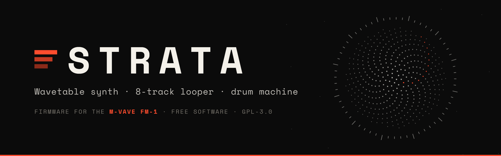
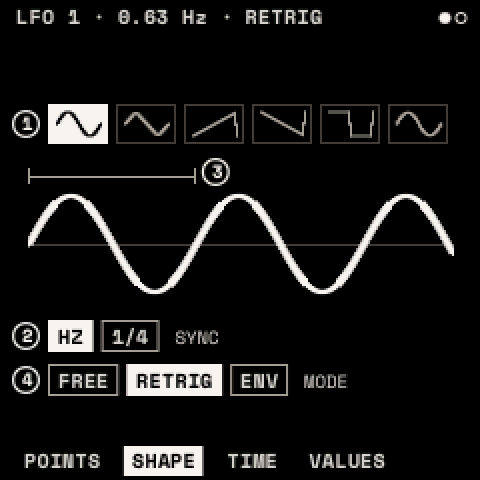
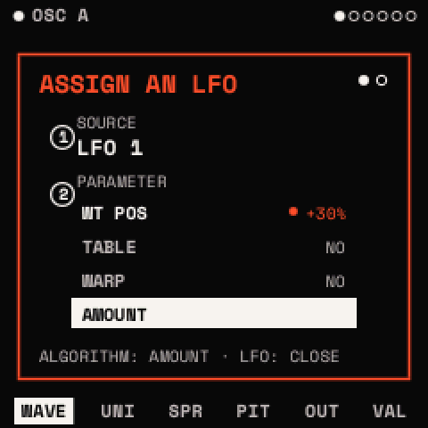
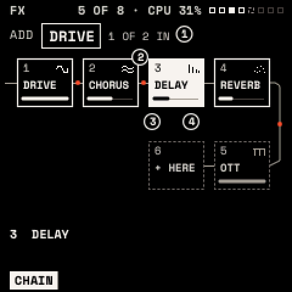
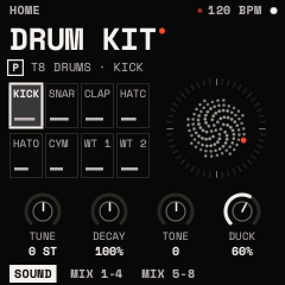

**Strata** turns the **M-VAVE FM-1** into a complete pocket instrument: a deep wavetable synth, an 8-track looper and a
drum machine.

- **Synth**: two wavetable oscillators on 54 tables, sub, noise, a filter, envelopes, drawable LFOs, eight voices.
- **Effects**: a chain of up to eight from thirteen types.
- **Playing**: scales, chords on every key, strum, an arpeggiator with sixteen steps, macros, tap tempo.
- **Looper**: synth, MIDI and drum tracks, clips in eight scenes, overdubs, recorded knob moves, four projects.
- **Drums**: seven drum models, 64 presets, six kits, a step grid, Euclidean fills, a sidechain duck.

**[Install](https://u4ia-dev.github.io/strata/)** in Chrome or Edge on a computer ·
**[Guide and manual](https://u4ia-dev.github.io/strata/book/index.html)** ·
**[Cheat sheet](https://u4ia-dev.github.io/strata/book/guide/cheatsheet.html)**

> **Back up first.** Strata keeps its presets, projects and drum library in the flash area where Felucca keeps its
> projects and samples. **Saving anything in Strata can overwrite them**, and going back to Felucca or the official
> firmware does not restore them. A full flash backup is the only way back to exactly what you had
> ([how](https://u4ia-dev.github.io/strata/book/manual/install.html#back-up-first)). Strata never writes the boot
> area, calibration, Bluetooth pairing or the unit's keys.

## The screens

| | | | |
|:---:|:---:|:---:|:---:|
|  |  |  |  |
| **HOME**: the sound and its bloom | **WAVE**: 54 wavetables | **LFO**: shapes you draw | **Assign**: an LFO onto a knob |
|  |  |  |  |
| **FX**: a chain of eight | **CLIPS**: 8 tracks × 8 scenes | **Drums**: a kit on HOME | **MODEL**: seven drum models |

Rendered by Strata's own emulator, which runs the firmware's drawing code.

## Going back

- **Official firmware (V15)**: the installer's **Return to official V15** with M-VAVE's own `FM-1.fwsc`, or M-VAVE's
  updater.
- **Felucca**: Felucca's installer at [hugelton.github.io/Felucca](https://hugelton.github.io/Felucca/).
- **Exactly what you had**: your backup, written back in backup mode
  ([how](https://u4ia-dev.github.io/strata/book/manual/install.html#going-back)).

## Disclaimer

Strata is independent, unofficial firmware, not affiliated with or endorsed by M-VAVE or the FM-1's owners, nor by
Felucca's author or Hügelton Instruments.
It is provided **as is, without any warranty** (GPL-3.0, sections 15 and 16). Installing firmware other than the
official one can leave the FM-1 unusable until it is recovered; you install it at your own risk. Strata is a
pre-release. Strata was created entirely with Claude, an AI model made by Anthropic.

## For developers

Building: [BUILDING.md](BUILDING.md). The panel, page by page: [docs/CONTROLS.md](docs/CONTROLS.md); the screens:
[docs/UI.md](docs/UI.md); the looper: [docs/LOOPER.md](docs/LOOPER.md); limits: [docs/BUDGET.md](docs/BUDGET.md).
Contributing: [CONTRIBUTING.md](CONTRIBUTING.md).

## Licence

Strata is a modified version of [Felucca](https://github.com/hugelton/Felucca), Copyright (C) 2026 Leo Kuroshita
(@kurogedelic), Hügelton Instruments, licensed GPL-3.0-only like it ([LICENSE](LICENSE)). The screen uses Space Mono
(SIL OFL 1.1). What Strata changed and the parts under other licences: [NOTICE.md](NOTICE.md),
[LICENSING.md](LICENSING.md), [CREDITS.md](CREDITS.md), [LICENSES/](LICENSES/). Felucca's own README:
[docs/FELUCCA-README.md](docs/FELUCCA-README.md).
