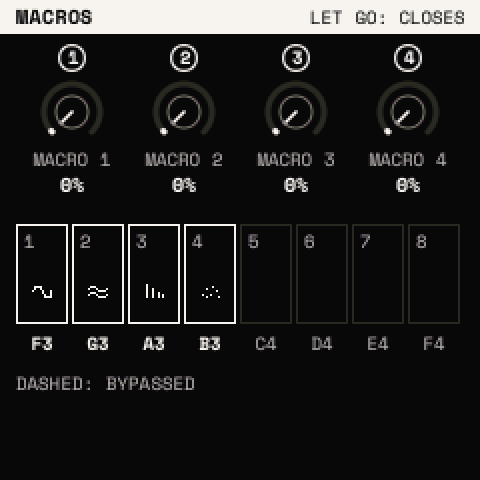

# Effects

Strata's effects are **modules in a chain**: up to eight, played in order, with a limiter after the last. You choose
which, in what order, and two of a kind if you like.

## The chain view

Press <kbd>FX</kbd>. The chain view shows the modules in their order, each with its MIX as a bar.

- KNOB 1 (or ALGORITHM) picks a **type** to add: DRIVE, CHORUS, DELAY, REVERB, OTT, EQ, FLANGER, PHASER, FILTER,
  BITCRUSH, TREMOLO, RING MOD, TAPE.
- KNOB 2 (or SELECT) picks a **slot** in the chain; past the last module it is **+ HERE**.
- KNOB 3 moves the module picked along the chain.
- KNOB 4 sets the module picked's MIX.

## Add, open, take out

1. Pick a type with KNOB 1 and a slot with KNOB 2.
2. Press <kbd>FX</kbd> + <kbd>OCT+</kbd>. The module joins below the slot picked: "ADDED: PHASER · 3 OF 8".
3. Press <kbd>FX</kbd> twice to open it: its pages, with ALGORITHM. SELECT steps to the chain's other modules.
4. Press <kbd>FX</kbd> again to go back to the chain view.

<kbd>FX</kbd> + <kbd>OCT−</kbd> on the chain view takes the module picked out. On a module's own page,
<kbd>FX</kbd> + <kbd>OCT−</kbd> **bypasses** it and <kbd>FX</kbd> + <kbd>OCT+</kbd> puts it back in.

Each type can be in the chain twice, DELAY and REVERB once. The top line shows how many modules of eight, and an
estimate of what they cost the processor.

## Bypass on the fly

Hold <kbd>FX</kbd>: the **MACROS** layer. Its knobs are the four macros, and the white keys F3 to F4 switch the chain's
modules 1 to 8 in and out (lit: in; glowing: bypassed). Let go and the layer closes.

Every add, take-out, move and bypass can be undone with <kbd>SAVE</kbd> + <kbd>OCT−</kbd>. The effects belong to the
sound: they are saved with it.

More: the Manual's [The FX chain](../manual/fx.md).

Next: [Performing](performing.md).
