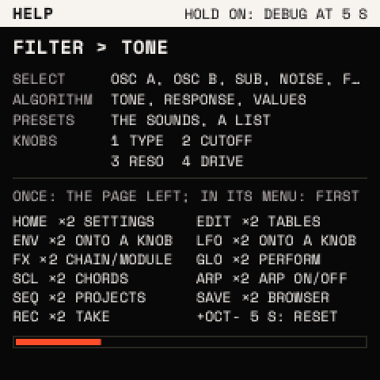

# The panel at a glance

Strata uses every control on the FM-1. This page names them, so the rest of the Guide can say "press
<kbd>EDIT</kbd>" or "turn KNOB 2" and you know where to look.

## What Strata is

Strata is a synthesizer first. You play a **sound** on the keys; the sound is two wavetable oscillators, a sub, noise,
a filter, envelopes, LFOs and a chain of effects. Around it sit an **8-track looper** that records what you play, and a
**drum machine** that any looper track can play. Everything is set from the panel and the screen.

## The controls

| Control | What it does |
| --- | --- |
| The 27 keys, F3 to G5 | Play notes. On some screens they also pick, launch or type: the screen says so. |
| <kbd>OCT−</kbd> <kbd>OCT+</kbd> | Move the keys down or up an octave (−3 to +3). Held with another button, they mean "off" and "on". |
| KNOB 1 to 4 | Set the four values on the screen, left to right. Each has a numbered handle on the screen. |
| SELECT | Step to the next or previous **module** of the menu you are in (OSC A, OSC B, SUB ..). |
| ALGORITHM | Step to the next or previous **page** of the module shown. |
| PRESETS | Pick from a list: the sounds, or a drum, a track, a kit, depending on the screen. |
| MASTER | The output level. |
| <kbd>HOME</kbd> <kbd>EDIT</kbd> <kbd>ENV</kbd> <kbd>LFO</kbd> <kbd>FX</kbd> <kbd>GLO</kbd> <kbd>SCL</kbd> <kbd>ARP</kbd> | The menus: the sound's home, its sources, envelopes, LFOs, effects, voice and tempo, scale and chords, the arpeggiator. |
| <kbd>SEQ</kbd> | The looper's menu. |
| <kbd>SAVE</kbd> | Saving, the preset browser, undo and redo. |
| <kbd>REC</kbd> | Record on the looper. Held, it is the MOD layer for modulation. |
| <kbd>PLAY</kbd> | Start and stop the transport (the looper, the arpeggiator's beat). |

## The screen

Every menu screen is laid out the same way:

- **The top line** names the module (here OSC A), with a filled dot when it is on. At the right, a row of dots shows
  the modules of this menu: SELECT moves between them.
- **The body** draws what the module does. The circled numbers are the knobs' handles: KNOB 1's handle sits on what
  KNOB 1 moves. While a knob turns, its handle and its value turn vermilion.
- **The bottom row** lists the module's pages (WAVE, UNI, SPR ..). The page shown is inverted. ALGORITHM steps
  through them. The last one, VAL, shows every value large, for exact settings.
- **A P in a square** marks what PRESETS picks on this screen.

## The buttons' grammar

Every menu button works the same way:

- **Once**: open its menu, on the page you left it at. Pressed again inside its own menu: its first page.
- **Twice** (two quick presses): its second job, such as <kbd>EDIT</kbd> twice for the wavetable list.
- **Held**: a layer while you hold it, such as <kbd>FX</kbd> held for the macros.
- **With <kbd>OCT+</kbd> or <kbd>OCT−</kbd>**: on or off for what the menu is about, such as <kbd>ARP</kbd> +
  <kbd>OCT+</kbd> to turn the arpeggiator on.

Hold <kbd>HOME</kbd> at any time and a **help map** shows what every control does on the screen you are on.

Next: [First steps](first-steps.md). Every button, on one page: [the cheat sheet](cheatsheet.md).
