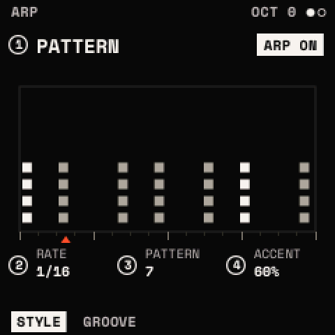
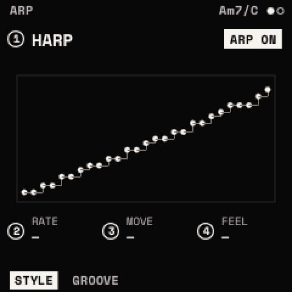
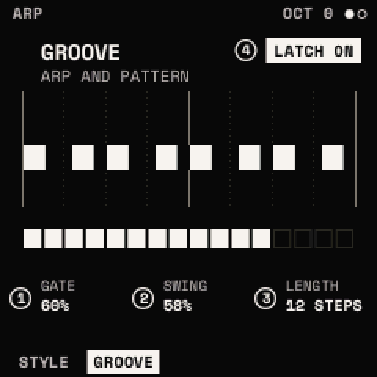
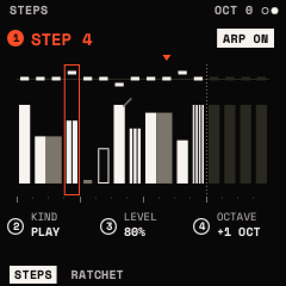
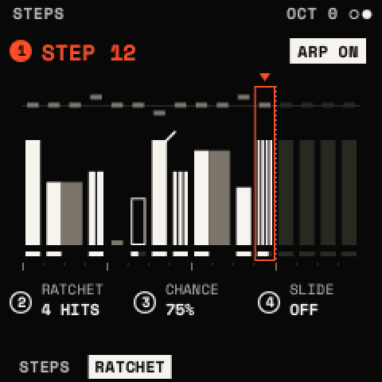

# The ARP

The ARP plays what you hold as a pattern in time. <kbd>ARP</kbd> opens its menu: **ARP** (STYLE, GROOVE) and **STEPS**
(STEPS, RATCHET); SELECT steps them. <kbd>ARP</kbd> + <kbd>OCT+</kbd> turns it on and <kbd>ARP</kbd> + <kbd>OCT−</kbd>
off, from any page; <kbd>ARP</kbd> twice turns it on or off. Hold a chord and turn it on: it arpeggiates what is held at
once.

It plays the chord CHORD makes (KEY, FREE: [Scales and chords](chords.md)) or, with MODE OFF, the keys held; MIDI notes
in count as keys. BASS goes on under it. On a SYNTH+MIDI or MIDI track, what it plays goes out over USB MIDI. Each
looper track has its own ARP settings and steps, kept with the project.

## STYLE: STYLE · RATE · MOVE · FEEL

KNOB 1 picks the style; KNOB 2–4 are the style's own three.

| STYLE | KNOB 2 | KNOB 3 | KNOB 4 |
| --- | --- | --- | --- |
| **ARP** (the default): a step arpeggiator | RATE | MODE | OCTAVES |
| **PATTERN**: the chord as stabs on a rhythm | RATE | PATTERN | ACCENT |
| **HARP**: the keys as strings | – | – | – |

- **RATE**: a step's length: 5, 10, 20, 30, 50, 80 or 120 ms, or a note value of the tempo: 1/32, 1/16T, 1/16, 1/8T,
  1/16D, 1/8, 1/4T, 1/8D, 1/4, 1/4D, 1/2, 1 BAR (1/16 by default).
- **MODE** (ARP), over the notes low to high and across OCTAVES (C E G, one octave):

| MODE | Plays |
| --- | --- |
| UP | C E G |
| DOWN | G E C |
| UP-DOWN | C E G E |
| DOWN-UP | G E C E |
| UP & DOWN | the ends twice: C E G G E C |
| AS PLAYED | the order they were pressed |
| RANDOM | at random |
| WALK | a step up or down at random |
| OUTSIDE IN | C G E |
| INSIDE OUT | E G C |
| PINKY | the top note between the others: C G E G |
| THUMB | the bottom note between the others: C E C G |
| CHORD | all of them each step, an octave up each time through OCTAVES |

- **OCTAVES** (ARP): 1 to 4.
- **PATTERN** (PATTERN): one of 16 rhythms of 16 steps; the chord plays as a stab on each, strummed as STRUM sets, as
  long as GROOVE's GATE and swung by its SWING.
- **ACCENT** (PATTERN): how much softer the stabs off the beat are, 0 to 100 % (20 %).
- **HARP**: every key is a string over four octaves, each playing the chord's note at or under its place, so a finger
  run along the keys plays the chord rising. The chord is CHORD's on SCALE's root (a MIDI note in moves it there); with
  MODE OFF the strings are the scale's notes. HARP has no steps, no RATE and no LATCH.

The page draws sixteen steps of what it will play: a row a note, ties long, ratchets split, the level as brightness, a
CHANCE under 100 % hollow, SWING's steps late, LENGTH's end dotted, and the step playing marked under it. HARP draws the
note each key plays.

## GROOVE: GATE · SWING · LENGTH · LATCH

| Knob | Parameter | What it does |
| --- | --- | --- |
| 1 | **GATE** | a note's length, 5 to 200 % of a step (50 %); over 100 % the notes overlap (legato) |
| 2 | **SWING** | 50 % (straight) to 75 %: the odd steps late, by half a step at 75 % |
| 3 | **LENGTH** | how many of the 16 steps play, 1 to 16 |
| 4 | **LATCH** | ON: what the keys held keeps playing after they are let go; the next press after all were let go starts anew (keys pressed while others are held join). OFF: what is let go stops. Every style but HARP; with the ARP off it holds the chord |

## STEPS and RATCHET

Sixteen steps, LENGTH of them played in turn, round. On both pages KNOB 1 picks a step (its number is the title); the
other knobs set it.

**STEPS: STEP · KIND · LEVEL · OCTAVE**

| Knob | Parameter | What it does |
| --- | --- | --- |
| 2 | **KIND** | PLAY (a note), TIE (the note before held on through this step, no new note), REST (silence) |
| 3 | **LEVEL** | 5 to 100 % of the key's velocity |
| 4 | **OCTAVE** | −2 to +2 octaves on the step's note (0: AS PLAYED) |

**RATCHET: STEP · RATCHET · CHANCE · SLIDE**

| Knob | Parameter | What it does |
| --- | --- | --- |
| 2 | **RATCHET** | 1 to 4 hits in the step |
| 3 | **CHANCE** | 0 to 100 %: how often the step plays (a step left out keeps its note's place: the order goes on) |
| 4 | **SLIDE** | the note held on into the next one; with VOICE MONO or LEGATO and GLIDE, a glide |

Only PLAY steps take the next note of MODE's order. The screen draws a column a step: OCTAVE a tick over the 0 line,
LEVEL a bar (RATCHET's hits side by side, a CHANCE under 100 % hollow), a TIE the note before carried across, a REST a
stub, SLIDE a slope into the next step; the steps past LENGTH dim, the step picked framed, the step playing marked.
RATCHET's page shows each step's CHANCE as a meter under it.

<kbd>ARP</kbd> + <kbd>OCT−</kbd> held 5 s: on ARP, its settings as they start; on STEPS, every step back to PLAY,
100 %, as played, one hit, always, no slide. Not undoable.

## The beat

- **<kbd>PLAY</kbd> on**: ARP and PATTERN step on the transport's beat, their pattern from the bar's start; a key's
  first note waits for the next step.
- **PLAY off**: they start at the key. With MODE OFF the first step waits 15 ms, so all of a chord's notes are in it
  whichever key came first (AS PLAYED: at once).
- **CLOCK IN MIDI** (GLO > GLOBAL): MIDI's clock is the tempo, and MIDI's start, continue and stop run PLAY.
- **The ARP LED**: lit while the ARP is on (dark a moment on each beat while ARP or PATTERN plays), glowing while off.

> **Tip:** for a classic sequence from one finger: CHORD MODE KEY, the ARP on with MODE UP and OCTAVES 2, LATCH on.
> Then use STEPS to put a few RESTs and an OCTAVE +1 here and there, and RATCHET 2 on the last step.
