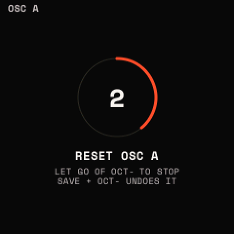

# Buttons and mappings

## Timing

- A **tap** is a press and release before the HOLD time.
- **Held**: held for the HOLD time (SETTINGS > PANEL > HOLD: 300, 400, 500 or 600 ms; 400 by default).
- **Twice**: a second press within 300 ms of the first.
- A button pressed with <kbd>OCT−</kbd> or <kbd>OCT+</kbd> is a **combo**, and does not also act as a tap or a hold.

## One grammar for the menu buttons

<kbd>HOME</kbd>, <kbd>EDIT</kbd>, <kbd>ENV</kbd>, <kbd>LFO</kbd>, <kbd>FX</kbd>, <kbd>GLO</kbd>, <kbd>SCL</kbd>,
<kbd>ARP</kbd> and <kbd>SEQ</kbd> follow the same rules (<kbd>SAVE</kbd>, <kbd>REC</kbd> and <kbd>PLAY</kbd> keep their
own):

- **Once**: from another menu, the page it was left on. In its own menu, its first page (FX: the chain view, the module
  shown picked). It acts at once.
- **Twice**: the second press adds its own action, on what the first opened. ENV, LFO and FX twice count from what was
  shown before the first press (ENV and LFO open the assign window over that page).
- **Held**: its layer, while held ([Layers and windows](layers.md)). HOME held: the help map.
- **+ OCT+ / + OCT−**: on / off (add / take out, next / back) for what the menu is about, from any page. The page
  stays (LFO's: its POINTS page).
- **+ OCT− held 5 s**: what it shows back to its starting values. A countdown shows from 2 s ("LET GO OF OCT- TO
  STOP"); let go of OCT− before 2 s and it is the button + OCT−'s own tap (OCT− acts at its release on these buttons);
  between 2 and 5 s, nothing happens. A section of the sound can be undone afterwards (<kbd>SAVE</kbd> +
  <kbd>OCT−</kbd>); SCL's and the ARP's settings cannot. A knob, another button, another page or the MOD layer stop it.

## The full map

| Button | Once (from another menu / in its own) | Twice | Held | + OCT− held 5 s | + OCT+ | + OCT− |
| --- | --- | --- | --- | --- | --- | --- |
| <kbd>HOME</kbd> | the page left / SOUND | the SETTINGS (HOME again: back) | the help map; 5 s: DEBUG | | the next sound | the sound before |
| <kbd>EDIT</kbd> | the page left / OSC A > WAVE (a drum track: DRUM > MODEL) | the wavetables' list of the oscillator shown (a drum track: the drum presets of the row picked; from KIT or HOME: the kits) | | the module shown reset (DRUM: the drum picked as a kit starts, its effects off; KIT: the kit's own settings) | the source or filter shown on | off |
| <kbd>ENV</kbd> | the page left / ENV 1 > ADSR | the assign window: an envelope or a macro onto a knob of the page before | | the envelope shown reset | | |
| <kbd>LFO</kbd> | the page left / LFO 1 > POINTS | the assign window: an LFO onto a knob of the page before | MOMENTARY | the LFO shown reset (its points too) | a point added (left of the one picked, halfway) | the point picked deleted (not the ends) |
| <kbd>FX</kbd> | the page left / the chain view | the chain view ↔ the module picked | MACROS | the module shown reset (the chain view: the chain as INIT's) | the chain view: the type picked added; a module's page: it back in | the chain view: the module picked taken out; a module's page: bypassed |
| <kbd>GLO</kbd> | the page left / VOICE > VOICE | PERFORM latched (a GLO tap closes it) | PERFORM (PLAY taps the tempo) | VOICE, or GLOBAL (120 BPM, 4/4, INTERNAL) reset | PERFORM latched | let go |
| <kbd>SCL</kbd> | the page left / SCALE | the chords on, off | a key is the scale's root | SCALE and the chords reset (the selected track's) | the chords on (MODE as it was: KEY at first) | off |
| <kbd>ARP</kbd> | the page left / ARP > STYLE | the ARP on, off | | its settings, or its steps, reset | the ARP on | off |
| <kbd>SEQ</kbd> | LOOP, CLIP or TRACK where left / LOOP > CLIPS | the projects' list | the launch pad | the page's settings as they start (the clips stay) | a new clip of a bar in the scene picked | DELETE? the clip; again: deleted |
| <kbd>SAVE</kbd> | the SAVE window | the browser (in it: back) | | | redo | undo |
| <kbd>REC</kbd> | after 300 ms: record (an empty clip: a take; a clip: overdub); again: stop. A latched MOD layer: let go | TAKE: what was played lately, as a clip | the MOD layer | | the MOD layer latched | let go |
| <kbd>PLAY</kbd> | the transport on, off (GLO held: tap tempo) | | | | | |
| <kbd>OCT−</kbd> / <kbd>OCT+</kbd> | the keys' octave | | the browser: OCT− 3 s deletes the user preset playing | | | |

## Each button in detail

### HOME

- Once: HOME, on the page it was left on; in HOME, its first page, SOUND. From the SETTINGS or DEBUG: back to HOME.
- Twice: the SETTINGS.
- Held: the help map; held on to 5 s, the DEBUG menu.
- + OCT+ / OCT−: the next sound or the one before, in the presets' list order (INIT, then A to Z), round.
- Held at power-on: the last sound is not brought back.

### EDIT

- Once: the sound's sources: OSC A, OSC B, SUB, NOISE, FILTER and the MATRIX (SELECT). On a drum track: DRUM and KIT.
- Twice: the **wavetables' list** of the oscillator shown (OSC B's when OSC B is shown, else OSC A's): SELECT the
  category, PRESETS the table, <kbd>SAVE</kbd> twice loads it (the table is built as it loads). On a drum track, the
  **drum presets** of the row picked's category; from KIT or HOME, the **kits**.
- + OCT+ / OCT−: OSC A, OSC B, SUB, NOISE or FILTER on or off (the one EDIT's menu shows). Nothing on the MATRIX or a
  drum track. There are no ON knobs: this is how a source is switched.
- + OCT− held 5 s: the module shown back to its defaults (its ON as it is).

### ENV

- Once: ENV 1 and ENV 2.
- Twice: the **assign window** over the page you were on before the first press: an envelope (ENV 1, ENV 2) or a macro
  (MACRO 1 to 4) onto one of its knobs.
- No layer, no combos. + OCT− held 5 s: the envelope shown reset.

### LFO

- Once: LFO 1 and LFO 2, on POINTS at first.
- Twice: the **assign window**: LFO 1 or LFO 2 onto a knob of the page before.
- Held: **MOMENTARY**.
- + OCT+: a point added, halfway between the one picked and the one before (16 points at most). + OCT−: the point
  picked deleted (the end points stay). Either from any page: the LFO's POINTS page shows. A built-in shape edited this
  way becomes DRAWN ("DRAWN FROM SINE").
- + OCT− held 5 s: the LFO shown reset, its points too.

### FX

- Once: the chain view; in a module, back to the chain view with that module picked.
- Twice: the chain view and the module picked, back and forth.
- Held: **MACROS**.
- + OCT+ / OCT− on the chain view: the type picked added below the slot picked (on + HERE: there), from its defaults;
  the module picked taken out (the matrix slots onto it with it). On a module's page: it back in, or bypassed.
- + OCT− held 5 s: the module shown reset (the chain view: the chain as INIT's).

### GLO

- Once: VOICE and GLOBAL.
- Twice, or + OCT+: **PERFORM** latched; a tap on GLO (or GLO + OCT−) lets it go.
- Held: PERFORM while held. **<kbd>PLAY</kbd> tapped while GLO is held: tap tempo** (three taps or more; their mean gap;
  taps more than 2 s apart start again; refused while MIDI's clock sets the tempo).
- + OCT− held 5 s: VOICE, or GLOBAL (120 BPM, 4/4, CLOCK IN INTERNAL), as they start.

### SCL

- Once: SCALE and CHORD.
- Twice: the chords on or off. + OCT+: on (MODE as it was last, KEY at first); + OCT−: off.
- Held: a key pressed is the scale's root (the key plays no note).
- + OCT− held 5 s: SCALE (CHROMATIC, root C, FIT OFF, VELOCITY 100) and the chords as they start, for the selected
  track. Not undoable.

### ARP

- Once: ARP (STYLE, GROOVE) and STEPS (STEPS, RATCHET).
- Twice: the ARP on or off. + OCT+: on; + OCT−: off. A chord held plays the new way at once.
- + OCT− held 5 s: on ARP, its settings as they start; on STEPS, the sixteen steps cleared (each PLAY, 100 %, as
  played, one hit, always, no slide). Not undoable.

### SEQ

- Once: LOOP, CLIP and TRACK, where they were left; in its own menu, LOOP > CLIPS.
- Twice: the **projects' list**.
- Held: the **launch pad**.
- + OCT+: a new empty clip of one bar on the selected track in the scene picked; while SEQ is still held, PRESETS sets
  its length. (A clip there already: "T1 A HAS A CLIP".)
- + OCT−: "DELETE?" for that clip; + OCT− again deletes it, anything else keeps it. (Not while it records.)
- + OCT− held 5 s: the page's settings as they start, the clips kept: MIXER the track's VOLUME, PAN, MUTE and SOLO;
  SONG its slots and SONG off; RECORD QUANTIZE, CHANNEL and MIDI IN; CLICK its four; CLIP's pages the clip's SPEED and
  NOTE+'s GRID; CLIPS nothing.

### SAVE

- Once: the **SAVE window** (it waits 300 ms for a second press). In the browser: NAME IT. On NAME IT: writes.
- Twice: the **browser**; in the browser: back. With the presets' (or another) list open: loads the entry picked.
- + OCT−: **undo**; + OCT+: **redo**. With a list open: + OCT+ a new entry (named first), + OCT− the entry picked
  deleted (asked first). In the browser, straight after a delete: + OCT− puts it back.
- Held alone: nothing (it waits for its OCT).

### REC

- Once: the looper records on the selected track, in the scene picked, or stops recording. It acts 300 ms after the
  tap, waiting for a second; while recording or counting in, a tap ends it at once.
- Twice: **TAKE**.
- Held: the **MOD layer**. + OCT+: the MOD layer latched; a tap or + OCT− lets it go.

### PLAY

- The transport on or off. On: the clips that are on play from their start, ARP and PATTERN step on its beat, the
  LFOs in FREE mode restart their phase on the beat. Off: everything stops.
- With <kbd>GLO</kbd> held: tap tempo.

### OCT− and OCT+

- Alone: the keys' octave, −3 to +3. In the browser, OCT− acts at its release (held, it deletes).
- **Both held 5 s: backup mode (UBOOT)**, the chip's own USB boot, where a full flash backup can be read or written. A
  countdown shows from 2 s; letting go stops it. Switching the FM-1 off and on returns to Strata.
- On NAME IT: OCT+ letters ↔ numbers and symbols, OCT− deletes.
- While MIDI LEARN listens: OCT− takes the picked parameter's controller away, OCT+ ends LEARN.
- In a window: the SAVE window's rows (OCT− up, OCT+ down); the assign window, OCT− takes the source off.

## The keys

| Where | White keys | Black keys |
| --- | --- | --- |
| Playing (a synth or MIDI track) | notes, through SCL's scale, the chords and the ARP | notes |
| A drum track | 1-8 (F3 to F4) KICK, SNARE, CLAP, HAT CL, HAT OP, CYM, WT 1, WT 2; 9-16 (G4 to G5) the same accented | the first (F#3) DUCK; the others nothing |
| SCL held | the key's note becomes the root | the same |
| MOD layer (REC held) | pick the source (F3 ENV 1 .. G5 EXPRESSION) | nothing |
| MACROS (FX held) | F3 to F4: the chain's modules 1 to 8 bypassed or back in | nothing |
| LAUNCH PAD (SEQ held) | 1-8 the tracks' clips in the scene picked; 9-16 scenes A to H | 1-8 MUTE tracks 1 to 8; C#5 STOP ALL; D#5 SOLO; F#5 UNDO PASS |
| CLIPS page | 1-8 this scene's clips on tracks 1 to 8 (the one playing: stop) | 1-8 scenes A to H |
| GRID, HIT (a drum track) | the sixteen steps shown: a hit in or out | the row: 1 KICK .. 9 DUCK |
| NAME IT | F3 to F#5: A to Z (with OCT+: numbers and symbols); G5: a space | (part of the letters) |

While a window is open (the assign window, the SAVE window, a question) the keys play as usual.
