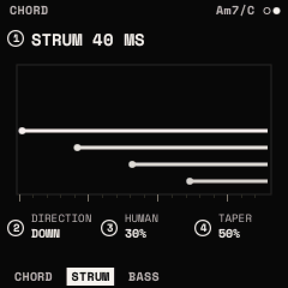
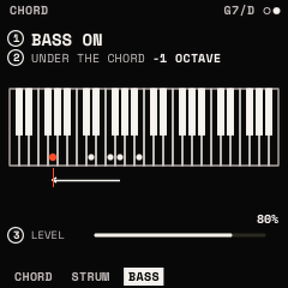

# Scales and chords

<kbd>SCL</kbd> opens two modules: **SCALE** (one page) and **CHORD** (CHORD, STRUM, BASS). Both belong to the
**selected track**: each looper track has its own scale, chords and ARP, kept in the project; the menus edit the
selected track's. A drum track has none. The top line shows the keys' octave, or the chord playing.

## SCALE: SCALE · ROOT · FIT · VELOCITY

| Knob | Parameter | What it does |
| --- | --- | --- |
| 1 | **SCALE** | CHROMATIC, MAJOR, NATURAL MINOR, DORIAN, MIXOLYDIAN, MAJOR PENTATONIC, MINOR PENTATONIC, HARMONIC MINOR, PHRYGIAN, LYDIAN, LOCRIAN, MELODIC MINOR, BLUES, WHOLE TONE, DIMINISHED H-W, DIMINISHED W-H |
| 2 | **ROOT** | C to B, round |
| 3 | **FIT** | OFF: each key its own note (the scale's notes glow, the root brighter). SNAP: a key off the scale plays the scale's note below it. WHITE: the white keys walk the scale from the root at C4; the black keys are silent |
| 4 | **VELOCITY** | the keys' velocity, 1 to 127 (100): the FM-1's keys have none |

The page draws the scale on the 27 keys. **<kbd>SCL</kbd> held + a key**: that key's note becomes the root (the key
plays nothing). MIDI notes are not fitted to the scale.

## CHORD: MODE · TYPE · VOICING · SPREAD

With chords on, each key plays a chord. Only the knobs set them: no key is a button. <kbd>SCL</kbd> + <kbd>OCT+</kbd>
turns them on (MODE as it was last, KEY at first), <kbd>SCL</kbd> + <kbd>OCT−</kbd> off, from any page; <kbd>SCL</kbd>
twice turns them on or off.

| Knob | Parameter | What it does |
| --- | --- | --- |
| 1 | **MODE** | OFF, KEY, FREE |
| 2 | **TYPE** (FREE) / **SHAPE** (KEY) | the chord |
| 3 | **VOICING** | AUTO, or −3 to +6 |
| 4 | **SPREAD** | CLOSE, OPEN, WIDE, 2 OCT |

- **KEY**: every key plays its chord in the key: the scale and root SCALE sets, stacked from the key (a key off the
  scale moves down onto it). KNOB 2 is its **SHAPE**: TRIAD, 7TH, 9TH, SUS2, SUS4, 6TH, ADD9, POWER (the root, its
  fifth, the octave).
- **FREE**: every key plays TYPE's chord on its own note. **TYPE**: MAJ, MIN, SUS2, SUS4, DIM, AUG, POWER, 6, MIN6, 7,
  MAJ7, MIN7, MIN7b5, DIM7, 7SUS4, ADD9, MIN ADD9, 9, MAJ9, MIN9, 6/9, MIN11, 13. The page shows a strip of them from
  the one before the current, its place in the list at the right. FREE's TYPE and KEY's SHAPE are kept apart.
- **VOICING**: AUTO puts each chord in the inversion nearest the one before (smooth voice leading); −3 to +6 inverts
  it (up: the lowest notes up an octave; down: the top notes down).
- **SPREAD**: CLOSE (as built), OPEN (the second note from the top an octave down), WIDE (the lowest an octave down,
  the highest one up), 2 OCT (the chord again an octave up, 8 notes at most).

The chord playing is named on SCL's pages ("Cm7/G": the note after the slash is the lowest) and drawn on three octaves
of keys with the bass. One chord at a time: the last root pressed plays; let go of it and the one held before plays
again. A change of MODE stops what plays (press again).

## STRUM: STRUM · DIRECTION · HUMAN · TAPER

How a chord's notes start (the chords played, PATTERN's stabs).

| Knob | Parameter | What it does |
| --- | --- | --- |
| 1 | **STRUM** | the gap between the notes: OFF (together), 2 to 200 ms |
| 2 | **DIRECTION** | UP (the lowest first), DOWN, ALTERNATE (up, then down, chord by chord), RANDOM |
| 3 | **HUMAN** | 0 to 100 %: each note up to 12 ms late and its level up to 25 % either way, at random |
| 4 | **TAPER** | 0 to 100 %: the later notes softer, the last at half the level at 100 % |

The page draws the chord as it strums: a row a note, each from its start, as bright as its level.

## BASS: BASS · OCTAVE · LEVEL

The chord's root one or two octaves under its lowest note, on the same sound (one of the eight voices).

| Knob | Parameter | What it does |
| --- | --- | --- |
| 1 | **BASS** | OFF, ON |
| 2 | **OCTAVE** | −1 or −2 octaves |
| 3 | **LEVEL** | its velocity, % of the chord's (80 %) |

## With the ARP and MIDI

- With the ARP on, it plays the chord CHORD makes (KEY, FREE), or with MODE OFF the keys held; BASS goes on under it.
  The ARP turned on or off, or its style changed, plays what is held the new way at once.
- MIDI notes in play through the track's chords and ARP as the keys do. What the track plays (the chords, the bass)
  goes out over USB MIDI on the track's CHANNEL with TYPE SYNTH+MIDI or MIDI ([The looper](looper.md#tracks)).

<kbd>SCL</kbd> + <kbd>OCT−</kbd> held 5 s resets SCALE and the chords (STRUM, BASS) for the selected track; this is not
undoable.

> **Tip:** KEY mode keeps every chord in the key. Set the scale and root on SCALE first, then play single keys: each
> plays its own chord of that key. SHAPE 7TH or 9TH gives a richer harmony; VOICING AUTO keeps the chords' notes close
> as you move between them.
