# The drums

Strata's drum machine is a looper track with TYPE **DRUMS**. It plays the project's **drum kit**: one kit a project,
shared by every drum track (any track can be one). Everything else of a track works as for a synth track: its clips and
scenes, VOLUME, PAN, MUTE, SOLO, recording, launching, SONG. A drum track has no chords, ARP or SCALE.

The kit has **eight rows**, each a drum with its own model, and a ninth, silent row, **DUCK**:

| Row | Its place's name | Its key | Its MIDI note (and others) | Starts as |
| --- | --- | --- | --- | --- |
| 1 | KICK | F3 | 36 (35) | PUNCH, KICK |
| 2 | SNARE | G3 | 38 (37, 40) | PUNCH, SNARE |
| 3 | CLAP | A3 | 39 | PUNCH, CLAP |
| 4 | HAT CL | B3 | 42 (44) | METAL, CLOSED |
| 5 | HAT OP | C4 | 46 | METAL, OPEN |
| 6 | CYM | D4 | 49 (51, 52, 53, 55, 57, 59) | METAL, CYMBAL |
| 7 | WT 1 | E4 | 45 (41, 43, 47: the low toms) | WAVE, TABLE A |
| 8 | WT 2 | F4 | 50 (48) | WAVE, TABLE B |
| 9 | DUCK | F#3 | 24 (C1) | no sound: it ducks the synth |

A row keeps its place (its key, its GRID row, its MIDI note) whatever model it plays. The drums add in after the effects
chain (they do not go through it), and they are never ducked. **Needs a hardware test**: the drums' cost on the FM-1
(BENCH's AUDIO row with a kit playing).

## Playing and recording

With a drum track selected:

- White keys 1–8 (F3 to F4) play the eight drums; white keys 9–16 (G4 to G5) the same, **accented**; the first black
  key (F#3) is DUCK. The keys glow so (the accented ones brighter).
- MIDI notes in play the drums by their General MIDI numbers (the table above); any other note plays nothing.
- A drum played is recorded as a **hit**, as notes are on a synth track (REC, play, REC). A hit has a velocity, an
  ACCENT, a CHANCE and a RATCHET.
- A lane is one voice: a hit starts it again. A HAT CL row's hit ends a HAT OP row still ringing (the choke).

## HOME on a drum track

The kit's name, the eight drums as a grid (each lit as it sounds), and four knobs that move the whole kit: TUNE (±24
semitones), DECAY (50 % to 200 % of every drum's time), TONE (±50 on every drum's TONE) and DUCK (the duck's AMOUNT).
PRESETS picks the drum (framed): the one EDIT's DRUM opens on. Details: [HOME](home.md#sound-on-a-drum-track).

## DRUM

<kbd>EDIT</kbd> on a drum track opens **DRUM**: the drum PRESETS picks, wherever a drum track is selected (stopped, the
drum you play is picked too). Its name is the title with a P; the eight names under it, the picked one inverted.
ALGORITHM steps MODEL, SOUND, DRIVE, EQ, SHAPE, MIX and VALUES. Each drum has its own of everything here.

### MODEL: MODEL · TYPE

Any row can be any model. KNOB 1 picks the **MODEL**, KNOB 2 its **TYPE** (its variant). SOUND's TONE and fourth knob
take the model's names. A new model turns the row's name back to its place's (it is no longer the preset it came
from). A project from before V0.87 plays as it did: its rows keep their own models.

| MODEL | TYPE | TONE is | Its own knob | DECAY range | The sound |
| --- | --- | --- | --- | --- | --- |
| ANALOG | BODY | DROP | SNAP | 0.05 – 4 s | a sine body swept down from DROP's height (up to five times the pitch); SNAP adds a second body and noise: kicks, toms, congas, an 808 snare |
| PUNCH | KICK | TONE | PUNCH | 0.08 – 2 s | a sine swept down from PUNCH's height (up to seven times); TONE drives it and adds a click |
| PUNCH | SNARE | TONE | SNAP | 0.06 – 1 s | two sines (the body) and noise through a high pass (TONE, 1 to 8 kHz); SNAP the noise against the body |
| PUNCH | CLAP | TONE | SPREAD | 0.06 – 1.2 s | noise through a band pass in four bursts SPREAD apart (4 to 20 ms), then its tail; TONE narrower |
| FM | DRUM | RATIO | INDEX | 0.03 – 2.5 s | two operators: a pitch drop and a click; RATIO the modulator's (0.5 to 8), INDEX its depth, falling with the hit |
| FM | BELL | RATIO | INDEX | 0.1 – 4 s | the same, higher, without the drop and the click: bells, cowbells, claves |
| CHIP | SQUARE | SPEED | SWEEP | 0.03 – 1.5 s | an 8-bit square swept down from SWEEP's height (up to three octaves) over SPEED; the level in 16 steps |
| CHIP | TRIANGLE | SPEED | SWEEP | 0.03 – 1.5 s | the same on a 4-bit triangle |
| CHIP | NOISE | PITCH | LOOP | 0.02 – 1.5 s | a 15-bit noise register clocked at PITCH; LOOP from 50 % its short loop (a metallic, tonal noise) |
| NOISE | BAND | FREQ | WIDTH | 0.02 – 2 s | noise through a band pass at FREQ; WIDTH narrower |
| METAL | CLOSED | TONE | METAL | 0.02 – 0.4 s | six square waves at a TR-808's frequencies and noise, through a high pass (TONE); METAL the squares' share |
| METAL | OPEN | TONE | METAL | 0.15 – 2 s | the same, longer |
| METAL | CYMBAL | TONE | METAL | 0.4 – 6 s | the same, lower and longer |
| WAVE | TABLE A | FRAME | BEND | 0.05 – 3 s | a one-shot on OSC A's wavetable; TONE picks the FRAME; BEND a fall from up to three octaves |
| WAVE | TABLE B | FRAME | BEND | 0.05 – 3 s | the same on OSC B's table |

A WAVE row plays the table the sound's oscillator has: change OSC A's TABLE and WT 1 changes too.

### SOUND: TUNE · DECAY · TONE · its own

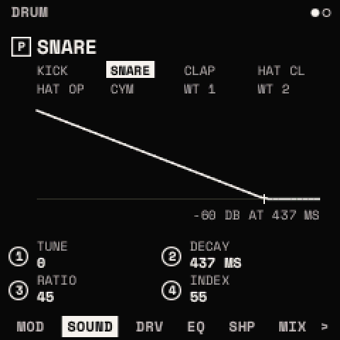

| Knob | Parameter | Range | What it does |
| --- | --- | --- | --- |
| 1 | **TUNE** | −24 to +24 semitones | the drum's pitch (centre detent) |
| 2 | **DECAY** | 0 – 100 | its time to −60 dB, across the model's range (the table above) |
| 3 | **TONE** | 0 – 100 | the model's TONE (DROP, RATIO, SPEED, PITCH, FREQ, FRAME ..) |
| 4 | its own | 0 – 100 | the model's own (PUNCH, SNAP, SPREAD, INDEX, SWEEP, LOOP, WIDTH, METAL, BEND) |

The page draws the drum's fall from the hit to −60 dB ("−60 DB AT 437 MS"), a KICK's sweep dashed.

### DRIVE: TYPE · DRIVE · MIX

| Knob | Parameter | What it does |
| --- | --- | --- |
| 1 | **TYPE** | SOFT, HARD, FOLD, CRUSH |
| 2 | **DRIVE** | 0 – 100: the gain in, up to +24 dB, the level out held about the same; CRUSH: 15 bits down to 2 |
| 3 | **MIX** | the driven sound against the dry (100 by default) |

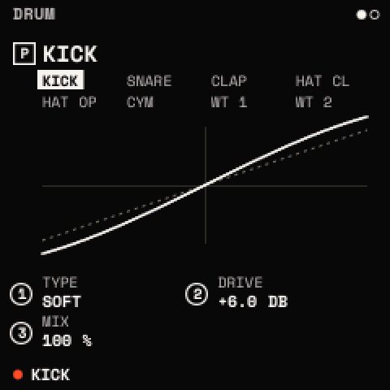

### EQ: LOW · MID · HIGH · FREQ

| Knob | Parameter | What it does |
| --- | --- | --- |
| 1 | **LOW** | a shelf at 200 Hz, ±12 dB (centre detent) |
| 2 | **MID** | a bell at FREQ, ±12 dB |
| 3 | **HIGH** | a shelf at 2 kHz, ±12 dB |
| 4 | **FREQ** | MID's place, 200 Hz to 8 kHz |

The page draws the response, 20 Hz to 20 kHz.

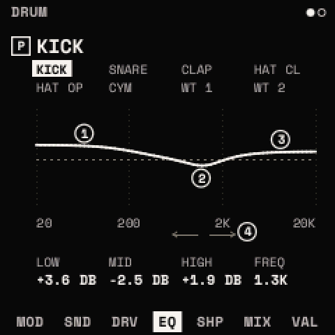

### SHAPE: ATTACK · SUSTAIN

- **ATTACK**: the hit's start, ±12 dB, going back to the body over about 5 ms: more or less snap.
- **SUSTAIN**: the body, ±12 dB.

The page draws the fall with SHAPE, and without it dashed.

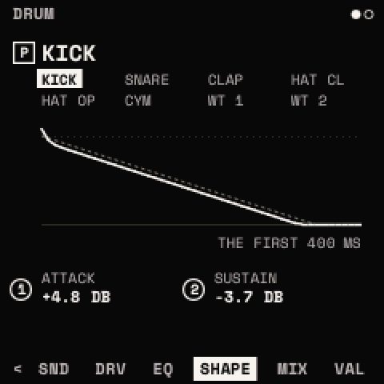

### MIX: LEVEL · PAN

LEVEL (0 to 127) and PAN of the drum picked; the page draws all eight as a mixer.

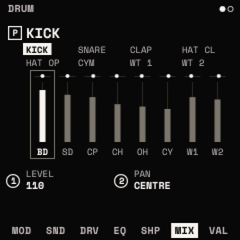

Each drum plays DRIVE, then EQ, then SHAPE, then its pan. Each costs nothing at its neutral setting (DRIVE or MIX at 0,
a band at its middle, ATTACK and SUSTAIN at theirs).

<kbd>EDIT</kbd> + <kbd>OCT−</kbd> held 5 s on DRUM: the drum picked as a kit starts, its effects off.

## KIT

SELECT from DRUM: the whole kit's own settings. ALGORITHM steps ACCENT, DUCK, CURVE, COMP and VALUES.

### ACCENT: ACCENT · VELOCITY · TONE

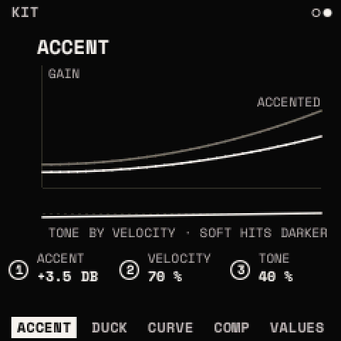

| Knob | Parameter | What it does |
| --- | --- | --- |
| 1 | **ACCENT** | an accented hit's lift, 0 to 100 (+6 dB at 100; 50 by default) |
| 2 | **VELOCITY** | how much a hit's velocity counts: 0, every hit at its LEVEL; 100, by velocity (70) |
| 3 | **TONE** | a soft hit darker, an accented one brighter, 0 to 100 (0: off) |

The page draws the gain by velocity, plain and accented.

### DUCK: SOURCE · AMOUNT · ATTACK · RELEASE

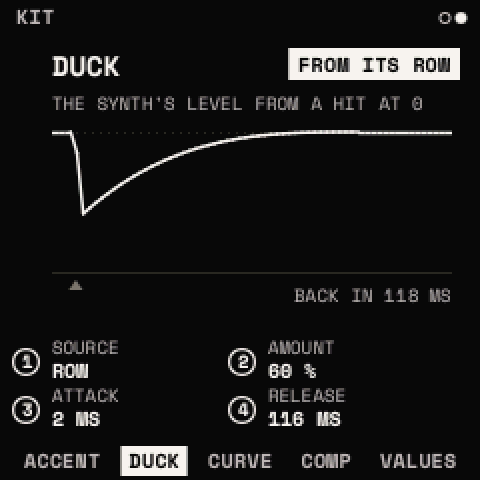

| Knob | Parameter | What it does |
| --- | --- | --- |
| 1 | **SOURCE** | what starts the duck: ROW (the DUCK row's hits: the default), KICK (the KICK row's hits), BOTH |
| 2 | **AMOUNT** | how far the synth ducks, 0 to 100 % (60 %) |
| 3 | **ATTACK** | how fast it goes down, 0 to 50 ms (2 ms) |
| 4 | **RELEASE** | how long it takes to come back, 20 ms to 1 s |

The page draws the synth's level over time from a hit ("BACK IN 118 MS").

### CURVE: SHAPE · HOLD

- **SHAPE**: the way back: LINEAR, EXP (back quickly, then slowly: the default), PUMP (held down, back late).
- **HOLD**: down for 0 to 250 ms before the release.

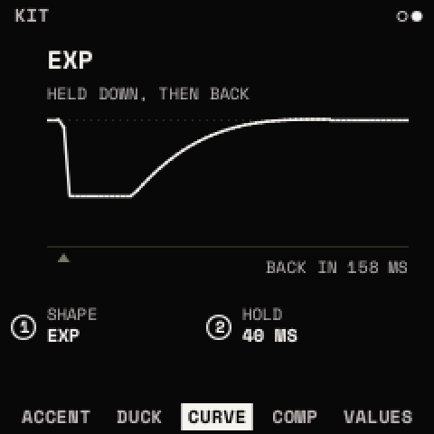

### COMP: AMOUNT · ATTACK · RELEASE · MIX

A compressor on the eight drums together.

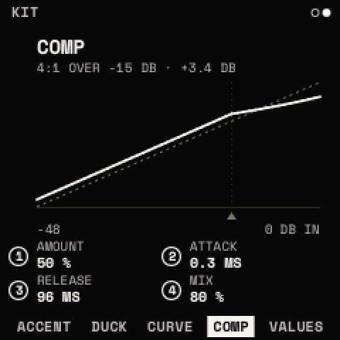

| Knob | Parameter | What it does |
| --- | --- | --- |
| 1 | **AMOUNT** | its threshold, 0 to −30 dB, at 4:1; above 20 %, a make-up gain of up to +9 dB. 0: off ("OFF: THE DRUMS AS THEY ARE") |
| 2 | **ATTACK** | 0.1 to 30 ms |
| 3 | **RELEASE** | 20 ms to 1 s |
| 4 | **MIX** | the pressed sound against the dry, in parallel (100 %) |

The page draws its curve, level in against out, with the threshold ("4:1 OVER −15 DB · +3.4 DB").

<kbd>EDIT</kbd> + <kbd>OCT−</kbd> held 5 s on KIT: these four pages as a kit starts, the drums kept.

## The duck

The sidechain. The DUCK row's hits make no sound: each one ducks the synth, every synth track after its effects, by
AMOUNT, over ATTACK, then lets it back over RELEASE along SHAPE (after HOLD). With SOURCE KICK or BOTH, the KICK row's
hits duck it too. The drums are never ducked; MIDI tracks' notes go out untouched. HOME's fourth knob sets AMOUNT.

> **Tip:** put a DUCK hit on every beat (EUCLID: HITS 4, STEPS 16, ROW DUCK) and turn AMOUNT up: the pad pumps in time.
> CURVE PUMP with a little HOLD makes it obvious; EXP with a short RELEASE makes it subtle.

## Drum presets

64 factory drum presets, eight in each of eight categories, and up to 64 of your own. **<kbd>EDIT</kbd> twice on DRUM**
opens the row picked's category (its preset's, else its place's: the KICK row KICK, the WT rows PERC and TOM): SELECT
the next category, PRESETS the preset (its model at the right), **<kbd>SAVE</kbd> twice** copies it into the row (its
LEVEL and PAN kept); the row then shows its name. The list closes after 5 s untouched.

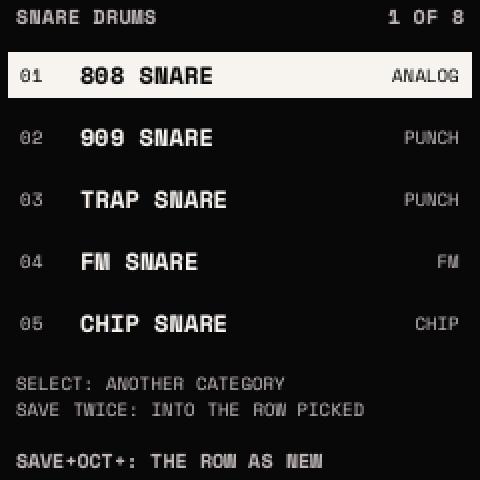

| Category | Factory presets |
| --- | --- |
| KICK | 808 KICK, 909 KICK, TRAP SUB, FM KICK, CHIP KICK, HARD KICK, LO-FI KICK, DEEP KICK |
| SNARE | 808 SNARE, 909 SNARE, TRAP SNARE, FM SNARE, CHIP SNARE, RIMSHOT, BRUSH, LO-FI SNARE |
| CLAP | 808 CLAP, 909 CLAP, TRAP CLAP, WIDE CLAP, SNAP, CHIP CLAP, DIRTY CLAP, ROOM CLAP |
| HAT | 808 HAT, 808 OPEN, 909 HAT, 909 OPEN, TRAP HAT, CHIP HAT, FM HAT, NOISE HAT |
| CYMBAL | 808 CYMBAL, 909 CRASH, RIDE, CHINA, FM RIDE, CHIP CRASH, NOISE CRASH, SPLASH |
| TOM | 808 TOM LO, 808 TOM MID, 808 TOM HI, 909 TOM, FM TOM, CHIP TOM, CONGA, TIMPANI |
| PERC | COWBELL, CLAVE, SHAKER, BELL, BLOCK, MARACA, TABLE A HIT, TABLE B HIT |
| FX | ZAP, LASER, COIN, NOISE BURST, BLIP, DROP, METAL HIT, CRUSHER |

A preset holds a drum's model and TYPE, its TUNE, DECAY, TONE and own knob, and its DRIVE, EQ and SHAPE. In the list,
<kbd>SAVE</kbd> + <kbd>OCT+</kbd> saves the row picked as a new preset (named first), and <kbd>SAVE</kbd> +
<kbd>OCT−</kbd> deletes one of yours (asked first; the factory's stay).

## Kits

**<kbd>EDIT</kbd> twice on KIT, or on HOME** (a drum track) opens the kits: the six factory kits, then yours. PRESETS
picks, **<kbd>SAVE</kbd> twice** loads the one picked as the project's kit: its drums, their effects, the duck and COMP.
The tracks' hits stay. The list closes after 5 s untouched.

| Kit | KICK · SNARE · CLAP · HAT CL · HAT OP · CYM · WT 1 · WT 2 |
| --- | --- |
| 808 | 808 KICK · 808 SNARE · 808 CLAP · 808 HAT · 808 OPEN · 808 CYMBAL · COWBELL · 808 TOM MID |
| 909 | 909 KICK · 909 SNARE · 909 CLAP · 909 HAT · 909 OPEN · 909 CRASH · RIMSHOT · 909 TOM |
| LO-FI | LO-FI KICK · LO-FI SNARE · DIRTY CLAP · NOISE HAT · 808 OPEN · NOISE CRASH · SHAKER · TABLE A HIT |
| VIDEO GAME | CHIP KICK · CHIP SNARE · CHIP CLAP · CHIP HAT · MARACA · CHIP CRASH · CHIP TOM · LASER |
| TRAP | TRAP SUB · TRAP SNARE · TRAP CLAP · TRAP HAT · 808 OPEN · 808 CYMBAL · 808 TOM LO · ZAP |
| DRUM & BASS | HARD KICK · FM SNARE · 909 CLAP · 909 HAT · 909 OPEN · RIDE · FM TOM · ZAP |

Each factory kit also brings its own levels, pans, ACCENT, VELOCITY, duck settings and COMP (909 and DRUM & BASS duck
from the KICK with a PUMP curve, for example). The kit the project's came from is marked in the list, with a dot when
it has been edited since (HOME's name has the same dot); loading another then warns "SAVE TWICE: THE KIT'S EDITS GO". **A
kit loaded is not undone** by undo.

## Saving drums and kits

On a drum track, <kbd>SAVE</kbd> once opens the SAVE window for the **drum** (on DRUM: the row picked as a drum preset)
or the **kit** (on KIT, HOME and elsewhere):

- **SAVE**: over your own drum preset or kit, its name kept ("SAVED OVER DRUM 3"). A factory one can't be written over
  ("FACTORY'S STAY").
- **SAVE AS NEW**: NAME IT, on its next version's name: 11 characters for a drum, 12 for a kit; KNOB 3 a drum's
  category; KNOB 4 the slot.

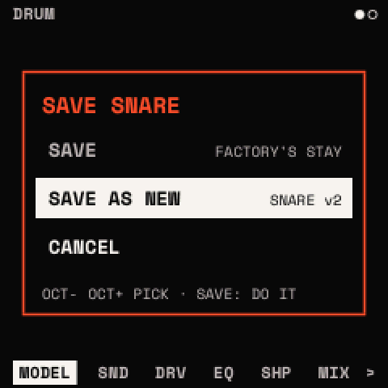

**Your library**: 64 drum presets and 16 kits, kept apart from the projects (in the store at 0xDB000), so any project
can use them. A kit is also kept, as it is, in its project.

## GRID, HIT and EUCLID

On a drum track, SEQ's CLIP is **GRID**, **HIT**, **EUCLID**, **CLIP** and **TOOLS**. The clip is shown in sixteenths,
sixteen steps at a time, a row a drum and DUCK. KNOB 1 picks the step (the sixteen shown follow it), KNOB 2 the row.

On GRID and HIT:

- **The white keys are the sixteen steps shown**: a key puts a hit of the row picked in, or takes it out. Stopped, you
  hear it go in. An empty clip gets a bar at the first hit put in, and plays when PLAY starts.
- **The black keys pick the row**: 1 KICK .. 8 WT 2, 9 DUCK.
- The keys' LEDs show the row's hits, the playhead's step (mid) and the row picked.

| Page | KNOB 3 | KNOB 4 |
| --- | --- | --- |
| GRID | VELOCITY of the hit at the step and row picked | its ACCENT (on, off) |
| HIT | its CHANCE: 100 % down to 13 %, in eighths: how often it plays | its RATCHET: 1 to 4 hits in its sixteenth |

**A step held**: while a step's white key is held, the four knobs are its hit's VELOCITY, ACCENT, CHANCE and RATCHET
(two by two under the grid, "STEP 5 HELD"). An empty step's key puts the hit in at once; a hit's key takes it out at the
release, unless a knob turned while it was held. Let go, the knobs are STEP, ROW and the page's again.

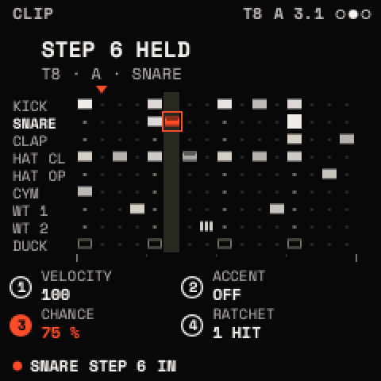

A hit's brightness is its velocity; accented, the cell's full height; under 100 % CHANCE, hollow and filled as far as
it plays; a ratchet, its hits as slivers; DUCK's hits, frames.

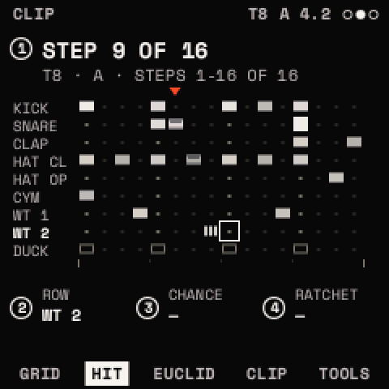

**EUCLID: HITS · STEPS · ROTATE · ROW.** A Euclidean rhythm on the row picked: HITS (0 to 16) spread as evenly as can be
over STEPS (1 to 16) sixteenths, ROTATE (0 to 15) moves the pattern round, ROW picks the row. Each turn refills that
row's hits over the whole clip (an empty clip gets a bar first), the pattern again every STEPS sixteenths; the other
rows stay. The title says it: "5 HITS IN 12 STEPS".

**CLIP** and **TOOLS** are a synth track's ([The looper](looper.md#clip)); CLEAR takes the clip's hits.

> **Tip:** layered Euclid: KICK 4 in 16, SNARE 2 in 16 rotated 4, HAT CL 7 in 12, WT 1 3 in 8. Rhythms of different
> STEPS drift against each other and make a long, evolving pattern from four turns of a knob.

## What is kept

In the project: the kit (its drums and their effects, the duck's and COMP's settings, its name and the kit it came
from), the tracks' TYPE, and the hits with their ACCENT, CHANCE and RATCHET. A project saved by V0.8 or V0.81 loads with
the kit as a kit starts; one saved by V0.85 or V0.86 step 1, with its drums' effects off. Your drum presets and kits
are kept in their own library.
