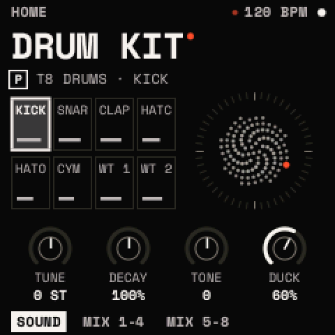
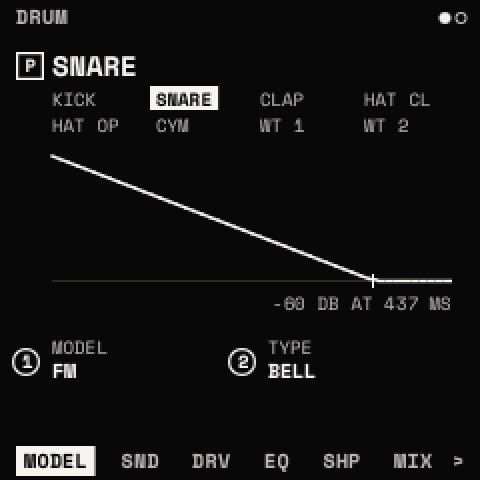
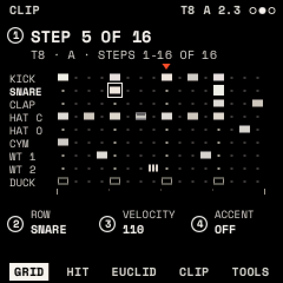
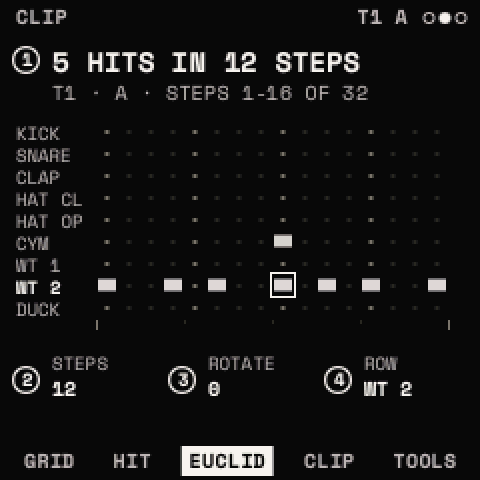
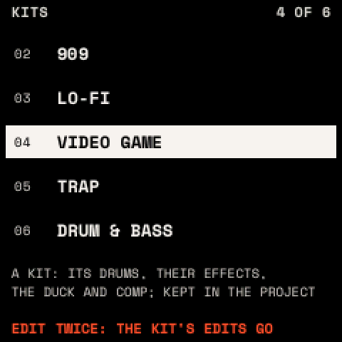

# The drums

Any looper track can be a drum track (TYPE DRUMS). All drum tracks of a project play its one **kit**: eight drum rows
and a silent ninth row, **DUCK**, that ducks the synth. The drums don't go through the effects chain.

## How to

**Make a drum track**: press <kbd>SEQ</kbd>, choose the track with PRESETS, turn KNOB 1 (TYPE) to DRUMS and stop.

**Play**: white keys 1–8 (F3–F4) play KICK, SNARE, CLAP, HAT CL, HAT OP, CYM, WT 1, WT 2; white keys 9–16 play them
accented; F#3 is DUCK. Record with <kbd>REC</kbd> as on any track.

**Program a beat on the grid**

1. Press <kbd>SEQ</kbd>, then SELECT to CLIP. The GRID page shows the clip in sixteenth steps.
2. Press a black key to choose the row (1 KICK … 9 DUCK).
3. Press white keys to put hits in or take them out on the sixteen steps shown. KNOB 1 moves to other steps.
4. Press <kbd>PLAY</kbd>.

Hold a step's key and turn the knobs to set that hit's VELOCITY, ACCENT, CHANCE and RATCHET.

**Fill a row with a rhythm (EUCLID)**: on CLIP, ALGORITHM to EUCLID. Turn KNOB 4 to choose the row, then KNOB 1 HITS,
KNOB 2 STEPS and KNOB 3 ROTATE. Each turn refills that row across the clip.

**Load a kit**: press <kbd>EDIT</kbd> twice on HOME or KIT, turn PRESETS, press <kbd>SAVE</kbd> twice. Your clips stay.

**Load a drum preset into a row**: press <kbd>EDIT</kbd> (DRUM shows the drum PRESETS chooses), then <kbd>EDIT</kbd>
twice. SELECT changes the category, PRESETS the preset; <kbd>SAVE</kbd> twice loads it. The row keeps its LEVEL and PAN.

**Save**: on a drum track, <kbd>SAVE</kbd> saves the drum (on DRUM) or the kit (elsewhere) as a sound is saved: SAVE
over your own, or SAVE AS NEW with a name. You can keep 64 drum presets and 16 kits; any project can use them.

## HOME on a drum track

HOME shows the kit and its eight drums, lit as they sound. PRESETS chooses the drum EDIT opens. The knobs move the
whole kit: **TUNE** (±24 semitones), **DECAY** (50–200 % of each drum's length), **TONE** (±50) and
**DUCK** (how far the synth ducks).

## DRUM

<kbd>EDIT</kbd> on a drum track. Pages: MODEL, SOUND, DRIVE, EQ, SHAPE, MIX, VALUES. Each drum has its own settings.

| Page | Parameter | What it does |
| --- | --- | --- |
| MODEL | MODEL, TYPE | The drum's model and its variant (below). Any row can use any model. |
| SOUND | TUNE | ±24 semitones |
| | DECAY | Length (each model's own range) |
| | TONE, and a fourth knob | The model's own controls (below) |
| DRIVE | TYPE, DRIVE, MIX | SOFT, HARD, FOLD or CRUSH (bit reduction), its amount and mix |
| EQ | LOW, MID, HIGH, FREQ | ±12 dB shelves at 200 Hz and 2 kHz, a bell at FREQ (200 Hz – 8 kHz) |
| SHAPE | ATTACK, SUSTAIN | ±12 dB on the hit's start and on its body |
| MIX | LEVEL, PAN | The drum's level (0–127) and pan; the page shows all eight |

| MODEL | TYPEs | TONE / fourth knob | Sound |
| --- | --- | --- | --- |
| ANALOG | BODY | DROP / SNAP | A sine swept down; SNAP adds noise. Kicks, toms, congas, 808 snares. |
| PUNCH | KICK, SNARE, CLAP | TONE / PUNCH, SNAP, SPREAD | Classic kick, snare and clap. |
| FM | DRUM, BELL | RATIO / INDEX | Two-operator FM: drums, bells, cowbells. |
| CHIP | SQUARE, TRIANGLE, NOISE | SPEED / SWEEP (NOISE: PITCH / LOOP) | 8-bit video-game sounds. |
| NOISE | BAND | FREQ / WIDTH | Band-passed noise: shakers, brushes, snaps. |
| METAL | CLOSED, OPEN, CYMBAL | TONE / METAL | 808-style hats and cymbals. A closed hat cuts an open one. |
| WAVE | TABLE A, TABLE B | FRAME / BEND | A one-shot of OSC A's or OSC B's wavetable. |

## KIT

SELECT from DRUM: the whole kit's settings.

| Page | Parameter | What it does |
| --- | --- | --- |
| ACCENT | ACCENT, VELOCITY, TONE | Accent boost (up to +6 dB); how much velocity counts; soft hits darker, accents brighter |
| DUCK | SOURCE, AMOUNT, ATTACK, RELEASE | What ducks the synth (ROW: DUCK hits; KICK; BOTH), how far, how fast down (0–50 ms) and back (20 ms – 1 s) |
| CURVE | SHAPE, HOLD | How the synth comes back (LINEAR, EXP, PUMP) and how long it stays down (0–250 ms) |
| COMP | AMOUNT, ATTACK, RELEASE, MIX | A compressor on all eight drums; AMOUNT 0 is off |

The duck lowers every synth track after its effects; the drums are never ducked.

> **Tip:** sidechain pumping: EUCLID with ROW DUCK, HITS 4, STEPS 16, then raise DUCK on HOME. CURVE PUMP makes it
> obvious, EXP with a short RELEASE subtle.

## GRID, HIT, EUCLID

| Page | Knobs | What they set |
| --- | --- | --- |
| GRID | STEP, ROW, VELOCITY, ACCENT | The hit at the chosen step and row |
| HIT | STEP, ROW, CHANCE, RATCHET | How often it plays (100 % down to 13 %); 1–4 hits in its sixteenth |
| EUCLID | HITS, STEPS, ROTATE, ROW | HITS spread evenly over STEPS (1–16), turned by ROTATE |

CLIP and TOOLS work as on any track.

## Presets and kits

64 factory drum presets, eight in each category: KICK, SNARE, CLAP, HAT, CYMBAL, TOM, PERC, FX. Six factory kits:

| Kit | Rows |
| --- | --- |
| 808 | 808 KICK, SNARE, CLAP, HAT, OPEN, CYMBAL, COWBELL, 808 TOM MID |
| 909 | 909 KICK, SNARE, CLAP, HAT, OPEN, CRASH, RIMSHOT, 909 TOM |
| LO-FI | LO-FI KICK, LO-FI SNARE, DIRTY CLAP, NOISE HAT, 808 OPEN, NOISE CRASH, SHAKER, TABLE A HIT |
| VIDEO GAME | CHIP KICK, SNARE, CLAP, HAT, MARACA, CHIP CRASH, CHIP TOM, LASER |
| TRAP | TRAP SUB, TRAP SNARE, CLAP, HAT, 808 OPEN, 808 CYMBAL, 808 TOM LO, ZAP |
| DRUM & BASS | HARD KICK, FM SNARE, 909 CLAP, HAT, OPEN, RIDE, FM TOM, ZAP |

Each kit also sets its levels, pans, accent, duck and compressor. Loading a kit can't be undone; the list warns if the
current kit has unsaved changes.

MIDI notes play the drums by General MIDI number: KICK 36, SNARE 38, CLAP 39, HAT CL 42, HAT OP 46, CYM 49, WT 1 45,
WT 2 50, DUCK 24.
