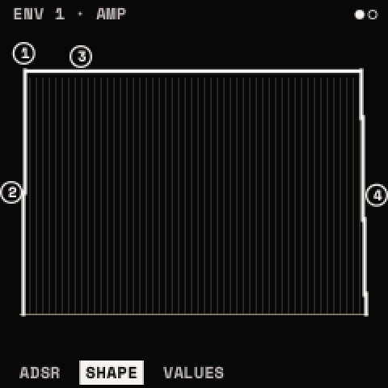

# Envelopes

Two envelopes a voice. **ENV 1** is the amp: every note's level follows it. **ENV 2** moves nothing until the matrix
puts it onto a parameter (the assign window, the MOD layer or the MATRIX). <kbd>ENV</kbd> opens them; SELECT steps
ENV 1 and ENV 2; ALGORITHM steps ADSR, SHAPE and VALUES.

The drawing is the envelope's shape; while notes play, each voice is a dot riding along it.

## ADSR: ATTACK · DECAY · SUSTAIN · RELEASE

| Knob | Parameter | Range | What it does |
| --- | --- | --- | --- |
| 1 | **ATTACK** | 1 ms – 30 s | the rise from the note's start to the top. Modulatable |
| 2 | **DECAY** | 1 ms – 30 s | the fall from the top (after HOLD) to SUSTAIN. Modulatable |
| 3 | **SUSTAIN** | 0 – 100 % | the level held while the key is down (ENV 1: 100 %; ENV 2: 0 % by default). Modulatable |
| 4 | **RELEASE** | 1 ms – 30 s | the fall to silence after the key is let go. Modulatable |

The times are exponential on the knob: fine at the short end, coarse at the long end.

## SHAPE: HOLD · A CURVE · D CURVE · R CURVE

| Knob | Parameter | Range | What it does |
| --- | --- | --- | --- |
| 1 | **HOLD** | OFF – 30 s | time held at the top before DECAY begins. Modulatable |
| 2 | **A CURVE** | −100 % – +100 % | the attack's curve: below 0 concave (slow, then fast), above 0 convex (fast, then slow); 0 straight |
| 3 | **D CURVE** | −100 % – +100 % | the decay's curve (−50 % by default) |
| 4 | **R CURVE** | −100 % – +100 % | the release's curve (−50 % by default) |

An envelope retriggers from where it is, never from zero, so a note played again, or a voice taken over, does not
click. Sustain on a MIDI pedal (CC 64) holds the releases.

<kbd>ENV</kbd> + <kbd>OCT−</kbd> held 5 s resets the envelope shown (undoable). <kbd>ENV</kbd> twice opens the
[assign window](layers.md#the-assign-window-env-twice-lfo-twice) with ENV 1, ENV 2 and the four macros as sources.

> **Tip:** for plucks and basses, ENV 2 with ATTACK at its shortest, a short DECAY and SUSTAIN at 0, onto CUTOFF. For
> pads, a slow ATTACK on ENV 1 and a long RELEASE, and ENV 2 slow onto WT POS so the wave evolves as the pad swells.
