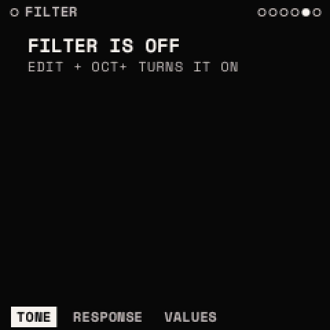

# Filter

One filter a voice, in stereo, between the sources routed to it and the amp (ENV 1). <kbd>EDIT</kbd>, SELECT to
FILTER; it starts off: <kbd>EDIT</kbd> + <kbd>OCT+</kbd> turns it on. The drawing is the filter's response; the part a
knob moves is lit while it turns, the curve before the turn dashed behind.

While the filter is off, its pages say so ("FILTER IS OFF · EDIT + OCT+ TURNS IT ON"), as a source's pages do.

## TONE: TYPE · CUTOFF · RESO · DRIVE

| Knob | Parameter | Range | What it does |
| --- | --- | --- | --- |
| 1 | **TYPE** | LP 12 .. FORMANT | the response (below) |
| 2 | **CUTOFF** | 20 Hz – 20 kHz | where the filter acts. Modulatable; MIDI CC 74 |
| 3 | **RESO** | 0 – 100 % | resonance: a peak at the cutoff; the SVF types self-oscillate near the top, bounded on all. Modulatable; CC 71 |
| 4 | **DRIVE** | 0 – 100 % | gain into a soft clip before the filter, the level partly made up. Modulatable |

| TYPE | What it is |
| --- | --- |
| LP 12, LP 24 | low pass, 12 or 24 dB an octave: darker as CUTOFF falls |
| HP 12, HP 24 | high pass: thinner as CUTOFF rises |
| BP 12, BP 24 | band pass: only a band round CUTOFF |
| NOTCH | a band round CUTOFF taken out |
| PEAK | a band round CUTOFF lifted |
| LADDER | four stages in a loop with a saturator in the feedback: the warm, singing low pass for basses and leads |
| FORMANT | three band passes on a vowel's formants; CUTOFF walks through the vowels A E I O U |

The SVF types (LP, HP, BP, NOTCH, PEAK) are zero-delay-feedback filters: in tune up to the top and stable under any
modulation.

## RESPONSE: KEYTRACK · VAR · MIX

| Knob | Parameter | Range | What it does |
| --- | --- | --- | --- |
| 1 | **KEYTRACK** | 0 – 100 % | how much CUTOFF follows the note, about C3: at 100 % it moves with the pitch. Modulatable |
| 2 | **VAR** | 0 – 100 % | the cutoff spread in stereo, the left down and the right up, up to an octave each; on FORMANT, the formants shifted. Modulatable |
| 3 | **MIX** | 0 – 100 % | the filtered sound against the dry. Modulatable |

Then **VALUES**, the seven values large ([The panel and the screen](panel.md#values)).

> **Tip:** the classic filter envelope: TYPE LP 24 or LADDER, CUTOFF low, RESO a third of the way, then <kbd>ENV</kbd>
> twice on this page and put ENV 2 onto CUTOFF with a positive AMOUNT. ENV 2's DECAY now sets the pluck.

> **Tip:** KEYTRACK at 50–100 % keeps a bright sound equally bright up the keyboard; at 0 high notes sound duller.
