# The FX chain

The effects are **modules in a chain** of up to eight, played in the order shown, with a **limiter** fixed after the
last (a peak limiter at −0.5 dBFS: it catches peaks and is transparent below them). The chain belongs to the sound: it
is saved, loaded and undone with it. The effects are one for all the voices.

## The chain view

<kbd>FX</kbd> shows the chain view: the modules as boxes in their order, each with its MIX as a bar, a glyph of its
type, and a dashed box for a bypassed one; the type to add at the top; the module picked named at the bottom.

| Control | On the chain view |
| --- | --- |
| KNOB 1 or ALGORITHM | the **type** to add (each type's instances in the chain shown: "1 OF 2 IN") |
| KNOB 2 or SELECT | a **slot** of the chain; past the last module, the place to add one (+ HERE) |
| KNOB 3 | **MOVE**: the module picked one place along the chain a detent |
| KNOB 4 | the module picked's **MIX** (OTT and TREMOLO: DEPTH; EQ: none) |
| <kbd>FX</kbd> + <kbd>OCT+</kbd> | the type picked added below the slot picked (on + HERE: there), from its defaults: "ADDED: PHASER · 3 OF 8" |
| <kbd>FX</kbd> + <kbd>OCT−</kbd> | the module picked taken out (the matrix slots onto it go with it) |
| <kbd>FX</kbd> twice | the module picked opened: its pages |

In a module: SELECT steps the chain's modules in their order, ALGORITHM the module's pages; the top line shows its
place in the chain as eight squares (filled: this one; outlined: in the chain; dashed: bypassed). <kbd>FX</kbd> once
goes back to the chain view with that module picked. <kbd>FX</kbd> + <kbd>OCT−</kbd> there **bypasses** the module,
<kbd>FX</kbd> + <kbd>OCT+</kbd> puts it back in; the dot before its name shows which.

**Rules.** Each type can be in the chain twice (DRIVE 2, EQ 2 ..), DELAY and REVERB once: "PHASER: TWO AT MOST",
"DELAY: ONE AT MOST", "THE CHAIN IS FULL: 8 MODULES". Undo (<kbd>SAVE</kbd> + <kbd>OCT−</kbd>) takes back each add,
take-out, move and bypass. A change of the chain fades: a module joining, going, bypassed or back fades over about 6
ms, a move dips about 12 ms; a module that joins starts from silence.

**Cost.** The top line shows the chain's count of 8 and its cost on one core, from the cost model's estimate: REVERB
about 13 %, DELAY 6 %, CHORUS, OTT and EQ 5 %, FLANGER and PHASER 4 %, FILTER and TAPE 3 %, DRIVE and RING MOD 2 %,
BITCRUSH and TREMOLO 1 %. A bypassed module that has gone silent costs nothing.

**MACROS** (<kbd>FX</kbd> held): the white keys F3 to F4 bypass the chain's modules 1 to 8 or put them back, live
([Layers and windows](layers.md#macros)).

<kbd>FX</kbd> + <kbd>OCT−</kbd> held 5 s resets the module shown to its defaults (on the chain view: the chain as
INIT's).

## The modules

Every module ends with VALUES. Ranges and defaults: the [parameter reference](parameters.md#drive). "Mod" there marks
what the matrix can move (an effect's parameter only while its module is in the chain).

### DRIVE

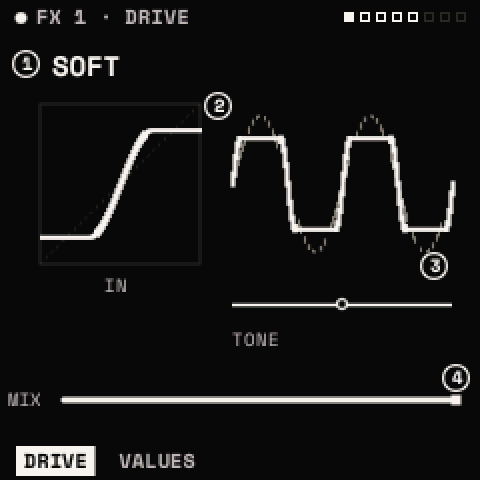

**DRIVE: TYPE · DRIVE · TONE · MIX.** TYPE: SOFT (a smooth clip), TUBE (the clip biased: even harmonics), HARD (a
clamp), FOLD (a sine folder: the wave folds back on itself). DRIVE: the gain in, ×1 to ×32 (30 % by default), the level
partly made up. TONE: a tilt about 2 kHz, −100 % darker to +100 % brighter. MIX: dry to driven.

### CHORUS

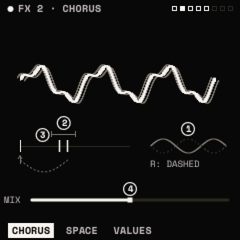

**CHORUS: RATE · DEPTH · DELAY · MIX.** Two taps a side on a short line, swept by sines, the left and right opposite.
RATE 0.01–40 Hz (0.5 Hz), DEPTH up to 3 ms of sweep, DELAY 2–15 ms, MIX (50 %; MIDI CC 93).
**SPACE: FEEDBACK · SPREAD.** FEEDBACK into the line (a flanging edge); SPREAD 0 to 100 %: how far the right side's
taps differ from the left's (0 % mono, 100 % the widest).

### DELAY

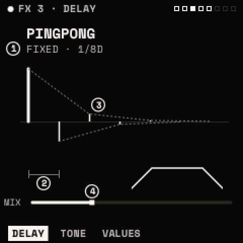

**DELAY: SYNC · TIME · FEEDBACK · MIX.** SYNC: FREE (TIME in milliseconds, 10–750 ms) or FIXED (TIME a note value of
the tempo, 8 BAR .. 1/32; 1/8D by default). FEEDBACK: the repeats (40 %). MIX (30 %; CC 94).
**TONE: MODE · LP · HP.** MODE: STEREO or PINGPONG (the repeats bouncing side to side, the default). LP and HP filter
the repeats, darker and thinner each time round. The delay runs at half rate, which keeps 750 ms in its memory; its
repeats stop near 10 kHz.

### REVERB

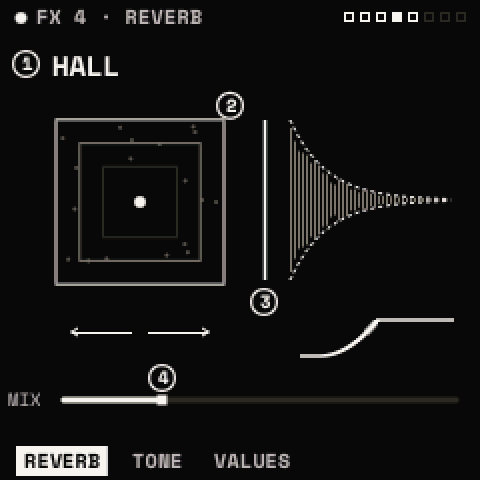

**REVERB: TYPE · SIZE · PREDELAY · MIX.** TYPE: PLATE (dense, bright) or HALL (larger, the default). SIZE: the room
(60 %). PREDELAY: up to 50 ms before the reverb starts. MIX (25 %; CC 91).
**TONE: DECAY · DAMP · LOW CUT · WIDTH.** DECAY: the tail's length. DAMP: the tail darkening as it decays. LOW CUT:
lows taken out of the reverb (80 Hz). WIDTH: mono to full stereo. A feedback-delay network with slowly drifting taps,
so it does not ring metallically. One reverb at most, and the costliest module.

### OTT

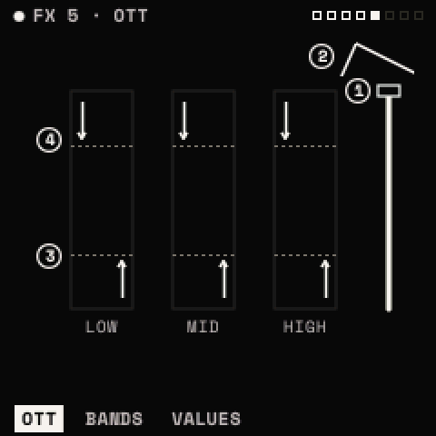

**OTT: DEPTH · TIME · UPWARD · DOWNWARD.** A three-band compressor in both directions: the bands split at 88 Hz and
2.5 kHz, each pushed **down** above −12 dB (to about 30:1, by DOWNWARD) and pulled **up** below −40 dB (to 3:1 and up
to +24 dB, by UPWARD). DEPTH is its mix (100 %); TIME scales its attack and release.
**BANDS: LOW · MID · HIGH:** each band's level after it, −24 to +24 dB. Its page shows each band's level live.

> **Tip:** OTT makes quiet detail loud: a reverb tail, a noise layer, a unison's beating. Put it before the reverb to
> squash the dry sound, or after to bring the tail up.

### EQ

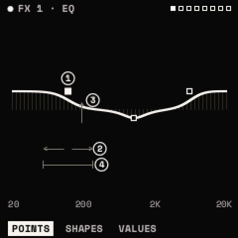

**POINTS: POINT · FREQ · GAIN · Q.** Three bands: KNOB 1 picks LOW, MID or HIGH; KNOB 2–4 set that band's frequency
(20 Hz – 20 kHz; 150 Hz, 1 kHz, 4 kHz), its gain (−18 to +18 dB) and its Q (0.25 – 8). Each band has a type (VALUES'
second page): LOW and HIGH a SHELF, a PASS (12 dB an octave) or a PEAK; MID a PEAK, a NOTCH or a BAND.
**SHAPES: SHAPE · FREQ · AMOUNT.** SHAPE sets all three bands at once to one of nine curves: FLAT, HIGH PASS, LOW PASS,
BAND PASS, NOTCH, TWO PEAKS, SMILE, TELEPHONE, AIR. FREQ moves the curve along (its bands together); AMOUNT scales its
gains. A band set on POINTS makes the shape CUSTOM. The EQ has no MIX.

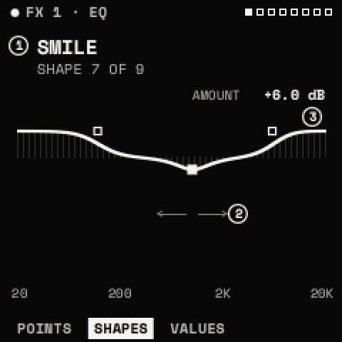

### FLANGER

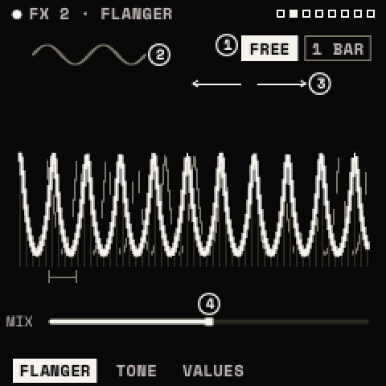

**FLANGER: SYNC · RATE · DEPTH · MIX.** One tap a side on a short line swept by a sine. SYNC FREE: RATE in hertz (0.18
Hz); FIXED: a note value (1 BAR). DEPTH: the sweep (70 %). MIX: 50 % gives the deepest notches.
**TONE: DELAY · FEEDBACK · SPREAD.** DELAY: the sweep's start, 0.3 to 5 ms. FEEDBACK: −100 % (hollow) to +100 %
(ringing; +50 %). SPREAD: the right side's sweep up to half a cycle after the left's.

### PHASER

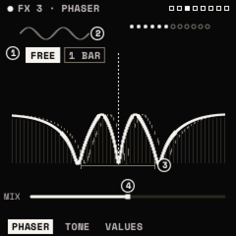

**PHASER: SYNC · RATE · DEPTH · MIX.** All-pass stages swept around CENTER, by a sine at RATE (or a note value with
SYNC FIXED). DEPTH: up to 2.5 octaves each way.
**TONE: CENTER · FEEDBACK · STAGES · SPREAD.** CENTER: the sweep's middle (632 Hz). FEEDBACK: −100 % to +100 %
(+30 %). STAGES: 2, 4, 6, 8, 10 or 12 (more stages, more notches). SPREAD: the right side later, as the flanger's.

### FILTER

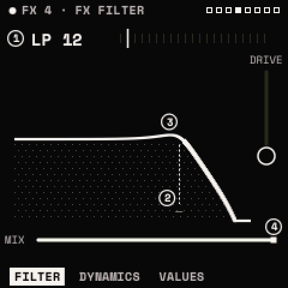

**FILTER: TYPE · CUTOFF · RESO · MIX.** A filter on the whole sound, after the voices, with 21 types: the voice
filter's ten (LP 12, LP 24, HP 12, HP 24, BP 12, BP 24, NOTCH, PEAK, LADDER, FORMANT), and:

| TYPE | What it does |
| --- | --- |
| LP 6, HP 6 | gentle one-pole slopes |
| DIRTY LP | a low pass whose resonance is driven into a clip |
| COMB +, COMB − | metallic combs; CUTOFF tunes them (86 Hz – 20 kHz) |
| LO SHELF, HI SHELF, TILT | RESO is a gain, −18 to +18 dB |
| DJ | one knob: CUTOFF under the middle a low pass, over it a high pass, open at the middle |
| LO-FI | the rate held down at CUTOFF, RESO the bits, then a low pass |
| RING | the sound times a carrier at CUTOFF; RESO from sine to square |

A new TYPE fades the module out and back in.
**DYNAMICS: DRIVE · FOLLOW.** DRIVE before the filter. FOLLOW: the cutoff follows the input's level, −100 % (down as it
gets louder) to +100 % (up): an envelope follower, for auto-wah.

> **Tip:** a one-knob DJ filter: TYPE DJ, CUTOFF at its middle. On this page press <kbd>ENV</kbd> twice, pick MACRO 1
> and CUTOFF, then on the window's second page POLARITY BIPOLAR and AMOUNT about 50 %. With HOME's KNOB 1 at its middle
> the sound is open; turn it left to darken, right to thin out.

### BITCRUSH

**CRUSH: BITS · RATE · MIX.** BITS: 1 to 16 (8). RATE: the sample rate held down to 20 Hz – 20 kHz (5 kHz). MIX.

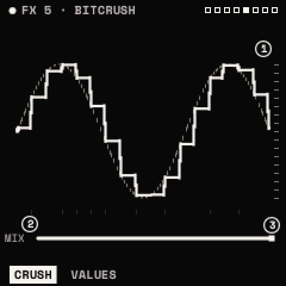

### TREMOLO

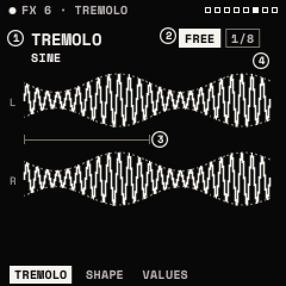

**TREMOLO: MODE · SYNC · RATE · DEPTH.** MODE: TREMOLO (the level swept) or AUTOPAN (the side swept). RATE: in hertz
(3.9 Hz) or, with SYNC FIXED, a note value (1/8). DEPTH (70 %).
**SHAPE: SHAPE · SPREAD.** SHAPE: SINE, TRIANGLE, SQUARE (rounded), SAW. SPREAD: the right side's phase against the
left's, 0 to 100 %.

### RING MOD

**RING MOD: FREQ · SHAPE · SPREAD · MIX.** The sound times a carrier at FREQ (20 Hz – 20 kHz; 448 Hz). SHAPE: the
carrier from sine to square. SPREAD: the right side's carrier up to a fifth higher. MIX (50 %).

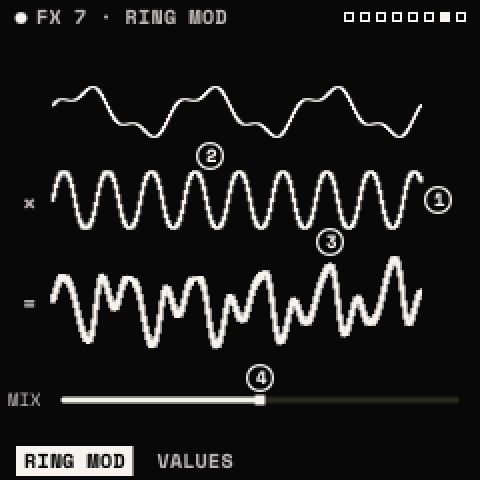

### TAPE

**TAPE: WOW · FLUTTER · SATURATE · MIX.** WOW: a slow pitch drift (0.6 Hz, up to 2.5 ms). FLUTTER: a fast one (9 and
13 Hz, up to 0.4 ms). SATURATE: into a soft clip. MIX (100 %).
**TONE: TONE · HISS.** TONE: the tape head's loss, a low pass from 20 kHz down to 2.5 kHz. HISS: a hiss under what
plays, gated by it, −34 dB at most.

## Older presets

Presets saved before the chain existed (V0.5) load with the effects that were on, as a chain in the order they played.
