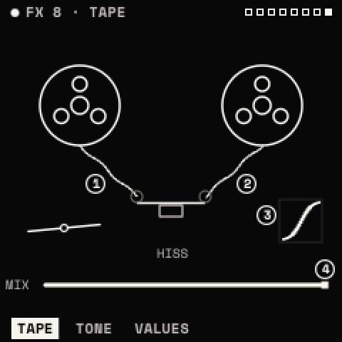

# Effects

The effects are a chain of up to eight modules, played in order, followed by a limiter. Each type can be in the chain
twice, except DELAY and REVERB (once each). The chain is part of the sound and is saved with it.

## How to

**Add an effect**

1. Press <kbd>FX</kbd> for the chain view.
2. Turn KNOB 1 (or ALGORITHM) to choose a type, and KNOB 2 (or SELECT) to choose a slot. Past the last effect the
   slot is **+ HERE**.
3. Hold <kbd>FX</kbd> and press <kbd>OCT+</kbd>. The effect is added below the chosen slot.

**Edit it**: press <kbd>FX</kbd> twice to open the chosen effect. ALGORITHM steps its pages, SELECT moves to the next
effect in the chain. Press <kbd>FX</kbd> to return to the chain.

**Move it**: on the chain view, turn KNOB 3. **Set its mix**: KNOB 4.

**Remove it**: on the chain view, <kbd>FX</kbd> + <kbd>OCT−</kbd>. **Bypass it**: on its own page,
<kbd>FX</kbd> + <kbd>OCT−</kbd> (and <kbd>OCT+</kbd> to bring it back), or hold <kbd>FX</kbd> and press its white key
(F3 for the first effect … F4 for the eighth).

Every change can be undone with <kbd>SAVE</kbd> + <kbd>OCT−</kbd>. The top line shows how many effects are in the
chain and an estimate of their processor cost; REVERB is the costliest.

## The effects

| Effect | Page 1 | Page 2 | Notes |
| --- | --- | --- | --- |
| DRIVE | TYPE, DRIVE, TONE, MIX | | TYPE: SOFT, TUBE, HARD, FOLD. TONE tilts darker or brighter. |
| CHORUS | RATE, DEPTH, DELAY, MIX | SPACE: FEEDBACK, SPREAD | SPREAD widens the stereo. |
| DELAY | SYNC, TIME, FEEDBACK, MIX | TONE: MODE, LP, HP | SYNC FIXED makes TIME a note value. MODE: STEREO or PINGPONG. LP and HP filter the repeats. Up to 750 ms. |
| REVERB | TYPE, SIZE, PREDELAY, MIX | TONE: DECAY, DAMP, LOW CUT, WIDTH | TYPE: PLATE or HALL. |
| OTT | DEPTH, TIME, UPWARD, DOWNWARD | BANDS: LOW, MID, HIGH | Three-band compression, up and down. Brings out quiet detail. |
| EQ | POINTS: POINT, FREQ, GAIN, Q | SHAPES: SHAPE, FREQ, AMOUNT | Three bands (LOW, MID, HIGH), ±18 dB. SHAPES sets all three at once (FLAT, HIGH PASS, LOW PASS, BAND PASS, NOTCH, TWO PEAKS, SMILE, TELEPHONE, AIR). Band types on VALUES. |
| FLANGER | SYNC, RATE, DEPTH, MIX | TONE: DELAY, FEEDBACK, SPREAD | Negative FEEDBACK sounds hollow. |
| PHASER | SYNC, RATE, DEPTH, MIX | TONE: CENTER, FEEDBACK, STAGES, SPREAD | STAGES 2–12. |
| FILTER | TYPE, CUTOFF, RESO, MIX | DYNAMICS: DRIVE, FOLLOW | 21 types (below). FOLLOW moves the cutoff with the input level (auto-wah). |
| BITCRUSH | BITS, RATE, MIX | | BITS 1–16; RATE lowers the sample rate. |
| TREMOLO | MODE, SYNC, RATE, DEPTH | SHAPE: SHAPE, SPREAD | MODE: TREMOLO or AUTOPAN. SHAPE: SINE, TRIANGLE, SQUARE, SAW. |
| RING MOD | FREQ, SHAPE, SPREAD, MIX | | SHAPE: sine to square carrier. |
| TAPE | WOW, FLUTTER, SATURATE, MIX | TONE: TONE, HISS | TONE darkens like a worn head; HISS adds gated tape hiss. The screen moves with the sound: the reels turn faster as it gets louder and a dot rides the SATURATE curve. |

With SYNC FIXED, the rate of DELAY, FLANGER, PHASER and TREMOLO is a note value of the tempo. Every effect also has a
VALUES page. Ranges and defaults are in the [parameter reference](parameters.md#drive).

**FILTER's types**: the voice filter's ten (LP 12/24, HP 12/24, BP 12/24, NOTCH, PEAK, LADDER, FORMANT), plus LP 6,
HP 6, DIRTY LP, COMB + and COMB − (metallic), LO SHELF, HI SHELF and TILT (RESO is the gain), DJ (left of centre a low
pass, right a high pass), LO-FI and RING.

> **Tip:** a one-knob DJ filter: FILTER type DJ, CUTOFF at the centre. On its page press <kbd>ENV</kbd> twice, choose
> MACRO 1 and CUTOFF, then set POLARITY to BIPOLAR and AMOUNT to about 50 %. HOME's KNOB 1 now sweeps from dark to thin.

> **Tip:** OTT before the reverb squashes the dry sound; after it, it lifts the tail.
