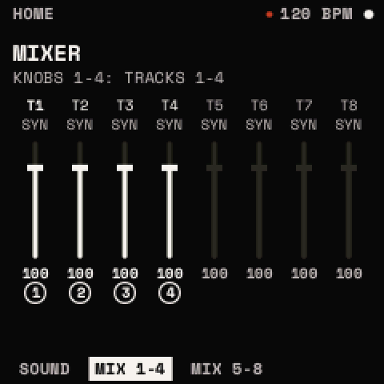

# HOME

<kbd>HOME</kbd> shows the sound playing on the selected track and its output. It has three pages (ALGORITHM): SOUND,
MIX 1-4 and MIX 5-8. On HOME, **SELECT picks the track** (T1 to T8) and HOME shows that track's sound or kit; PRESETS
picks the sound (a synth track) or the drum (a drum track).

## SOUND (a synth track)

- **The name**, large, with the unsaved dot while it has edits. Under it the category and the bank: "OTHER · INIT", a
  starter's number, or a user slot.
- **TABLE** (OSC A's table and position), **UNISON** (voices · detune), **FILTER** (its type, or OFF): the sound at a
  glance.
- **The bloom** at the right: the output as a sunflower of 424 seeds. It opens with the sound (a bud in silence, wide
  at full level), swirls at each note (one way for a note above the last, the other way for one below) and unwinds in
  about a second; a sine shows rings, a saw a spiral grain, a chord their interference. The one vermilion seed is the
  newest sample. In silence it is still and costs nothing.
- **The top line**: the tempo, with its dot.
- **KNOB 1 · 2 · 3 · 4: MACRO 1 · 2 · 3 · 4**, as dials. A macro moves whatever the matrix puts it on
  ([Modulation](modulation.md#the-macros)); INIT's four macros are in its first four matrix slots, going nowhere until
  you give them a destination.

> **Tip:** design a sound so that its four macros are its four most useful moves. Then HOME is all you need to play
> it, and <kbd>FX</kbd> held reaches the macros from any other page.

## MIX 1-4, MIX 5-8

The eight looper tracks as faders: each its number, its TYPE and its VOLUME (0 to 127; 100 as recorded). The page's
four have handles: KNOB 1 to 4 set tracks 1 to 4 (or 5 to 8). These are the same VOLUMEs as SEQ's MIXER.

## SOUND on a drum track

- **The kit's name**, with the unsaved dot while the kit has edits since it was loaded.
- "P T8 DRUMS · KICK": the track, and the drum PRESETS picks (framed in the grid). EDIT's DRUM opens on it.
- **The eight drums** as a 2 × 4 grid, each its short name and its LEVEL as a bar, lit by its envelope as it sounds.
- The bloom, smaller.
- **KNOB 1 · 2 · 3 · 4** move the whole kit at once, on top of each drum's own settings:

| Knob | Range | What it does |
| --- | --- | --- |
| TUNE | −24 to +24 semitones | every drum's tuning moved together |
| DECAY | 50 % to 200 % | every drum's decay time shorter or longer, up to an octave of time each way |
| TONE | −50 to +50 | every drum's TONE moved together |
| DUCK | 0 to 100 % | the duck's AMOUNT: how far the synth ducks under a DUCK hit ([The drums](drums.md#the-duck)) |

<kbd>EDIT</kbd> twice from here opens the kits' list.
