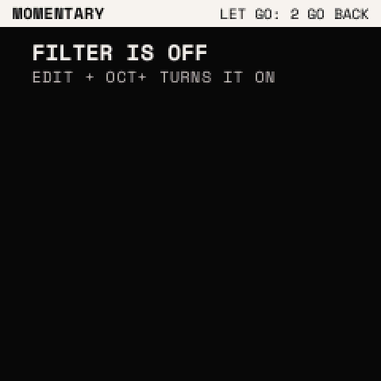
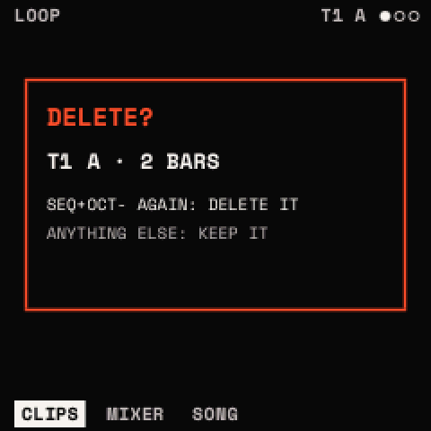
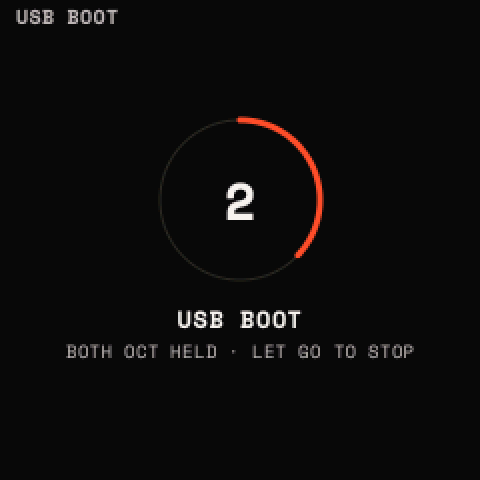
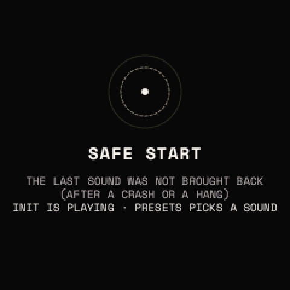

# Layers and windows

## Layers

A layer lasts while its button is held. A banner along the top names it and says how it ends ("LET GO: CLOSES"; "TAP
GLO: CLOSES" when latched), and its button's LED breathes. REC's MOD layer and GLO's PERFORM can be **latched**: the
button + <kbd>OCT+</kbd> (PERFORM also: GLO twice); a tap on the button, or the button + <kbd>OCT−</kbd>, lets it go.

| Layer | Its button | The knobs | The keys | Let go |
| --- | --- | --- | --- | --- |
| MOD | <kbd>REC</kbd> | the source's depth on each knob's parameter | a white key picks the source | it closes |
| PERFORM | <kbd>GLO</kbd> | 1 pitch bend, 2 mod wheel, 3 GLIDE, 4 VOLUME | play | the bend returns to the middle; the wheel stays |
| MACROS | <kbd>FX</kbd> | MACRO 1–4 | F3 to F4: the chain's modules 1 to 8 bypassed or back in | it closes |
| MOMENTARY | <kbd>LFO</kbd> | the page's values, for now (16 at most) | play | every value it changed goes back |
| LAUNCH PAD | <kbd>SEQ</kbd> | nothing | launch, scenes, mute, stop, solo, undo pass | it closes |

### MOD

Hold <kbd>REC</kbd> on any page. The screen lists the page's four parameters with the depth of the source picked on
each, and the keys with the sources under them. Press a white key to pick the source, then turn a knob: the source's
depth on that knob's parameter, −100 to +100 %. A matrix slot is made when needed; a slot the layer made and left at
0 goes when the layer closes. A parameter that cannot be modulated shows "–".

| Key | Source | Key | Source |
| --- | --- | --- | --- |
| F3 | ENV 1 | G4 | VELOCITY |
| G3 | ENV 2 | A4 | NOTE |
| A3 | LFO 1 | B4 | RANDOM |
| B3 | LFO 2 | C5 | ALTERNATE |
| C4 | MACRO 1 | D5 | MOD WHEEL |
| D4 | MACRO 2 | E5 | BEND |
| E4 | MACRO 3 | F5 | AFTERTOUCH |
| F4 | MACRO 4 | G5 | EXPRESSION |

The sources in use on this page glow on their keys; the one picked is lit. <kbd>REC</kbd> + <kbd>OCT+</kbd> latches the
layer, to work with both hands.

> **Tip:** the MOD layer is the fastest way to try a modulation: hold REC, tap A3 (LFO 1), and turn each knob a little
> to hear which parameter it suits.

### PERFORM

- KNOB 1: **pitch bend**, 16 detents from the middle to an end; it springs back to the middle when the layer closes.
  Its range is VOICE's BEND UP and BEND DN.
- KNOB 2: the **mod wheel** (as MIDI's CC 1; the MOD WHEEL source). It stays where you leave it.
- KNOB 3: GLIDE. KNOB 4: VOLUME (the sound's).
- <kbd>PLAY</kbd> tapped while PERFORM is open: tap tempo.

### MACROS

The four macros as dials, and the chain's eight places over the white keys F3 to F4: a key bypasses that module or
puts it back (lit: in; glowing: bypassed; dashed on the screen: bypassed).

### MOMENTARY

Hold <kbd>LFO</kbd> and turn the page's knobs: the values change for as long as you hold it (16 at most), then all go
back to where they were. Use it for a sweep or a drop that returns by itself.

### LAUNCH PAD

| Keys | Do |
| --- | --- |
| White keys 1–8 (F3 to F4) | the tracks' clips in the scene picked: launch; the one playing: stop; an empty one: that track selected |
| White keys 9–16 (G4 to G5) | scenes A to H launched |
| Black keys 1–8 (F#3 to A#4) | MUTE tracks 1 to 8 |
| C#5 | STOP ALL (at the bar, unless LAUNCH is NOW) |
| D#5 | SOLO the selected track |
| F#5 | UNDO PASS: the last overdub pass taken back; again: put back |

Once a key is used on the pad, SEQ's release does nothing more. The keys' LEDs: a track's clip playing lit, launched
blinking, there glowing; the scene picked lit, a scene with clips glowing; a track that plays (not muted) lit; SOLO lit
while on; STOP, SOLO and UNDO glowing.

## The help map

Hold <kbd>HOME</kbd>: for the screen shown, what SELECT, ALGORITHM, PRESETS and the four knobs do, and every button's
twice. A bar fills along the bottom; at 5 s DEBUG opens. Let go before: nothing changes.

## Windows

A window opens over the page, its top line and bottom row kept. While one is open the keys play. A button that is not
the window's own closes it and does nothing more (<kbd>PLAY</kbd> and <kbd>REC</kbd> act as ever); a knob that is not
its own, SELECT and PRESETS close it too.

### The assign window (ENV twice, LFO twice)

It puts a source onto one of the knobs of the page shown before you pressed the button.

- Page 1 (ASSIGN AN LFO / AN ENVELOPE): KNOB 1 the **SOURCE** (LFO: LFO 1, LFO 2; ENV: ENV 1, ENV 2, MACRO 1 to 4);
  KNOB 2 the **PARAMETER**, among the page's four (one no source can move says NO; one the source already moves shows
  its amount).
- Page 2 (ALGORITHM): KNOB 1 **POLARITY**, BIPOLAR or UNIPOLAR; KNOB 2 **AMOUNT**, −100 to +100 %, as a dial.
- <kbd>OCT−</kbd>: the source taken off the parameter picked.
- Any other button closes it. A slot it made and left at 0 goes as it closes.
- A page with no knob a source can move: "NO KNOB HERE AN LFO MOVES". The matrix full: "THE MATRIX IS FULL: 8 SLOTS".

[Modulation](modulation.md) explains sources, polarity and the matrix.

### The SAVE window (SAVE once)

Three rows: **SAVE** (over the sound's own user slot: "OVER USER 3"; a starter sound, INIT or a sound from no slot:
"STARTERS STAY", not to be picked), **SAVE AS NEW** (NAME IT, on its next version's name), **CANCEL**.
<kbd>OCT−</kbd> moves up, <kbd>OCT+</kbd> down; <kbd>SAVE</kbd> does the row picked. On a drum track it saves the drum
(on DRUM) or the kit (elsewhere): [The drums](drums.md#saving-drums-and-kits).

### The questions

A question in a vermilion frame says what SAVE does and what anything else does.

| Question | Asked by | Yes | No |
| --- | --- | --- | --- |
| DELETE? (a clip) | <kbd>SEQ</kbd> + <kbd>OCT−</kbd> | <kbd>SEQ</kbd> + <kbd>OCT−</kbd> again | anything else ("KEPT") |
| T1: DRUMS? (a track's TYPE) | TYPE turned on a track with clips | <kbd>SAVE</kbd> | anything else ("TYPE KEPT") |
| WIPE? | SETTINGS > WIPE | <kbd>SAVE</kbd> | anything else |
| DELETE? (a preset, a drum preset, a kit) | <kbd>SAVE</kbd> + <kbd>OCT−</kbd> in a list | <kbd>SAVE</kbd> + <kbd>OCT−</kbd> again | anything else |

### The lists

PRESETS opens the presets' list; other buttons open other lists with the same grammar: **PRESETS** moves through it,
**<kbd>SAVE</kbd> twice** loads the entry picked and closes it, **<kbd>SAVE</kbd> + <kbd>OCT+</kbd>** makes a new one,
**<kbd>SAVE</kbd> + <kbd>OCT−</kbd>** deletes the one picked (asked first). Left untouched for **5 s**, a list closes and
nothing changes; another button closes it too. Five rows round the one picked, the one playing dotted.

| List | Opened by | SELECT | SAVE + OCT+ | SAVE + OCT− |
| --- | --- | --- | --- | --- |
| Presets | turning PRESETS (a synth track) | | the sound as a new preset (NAME IT) | the preset picked deleted (starters stay) |
| Wavetables | <kbd>EDIT</kbd> twice | the next category | (the tables are the factory's) | (they stay) |
| Drum presets | <kbd>EDIT</kbd> twice on DRUM | the next category | the row as a new drum preset | one of yours deleted |
| Kits | <kbd>EDIT</kbd> twice on KIT or HOME (a drum track) | | the kit as a new kit | one of yours deleted |
| Projects | <kbd>SEQ</kbd> twice | | (pick an empty one and load it) | the one loaded cleared |

## Countdowns and system screens

- **A reset**: a menu button + <kbd>OCT−</kbd> held, from 2 s, a ring and the seconds left.
- **UBOOT**: <kbd>OCT−</kbd> and <kbd>OCT+</kbd> held, from 2 s; at 5 s the FM-1 enters backup mode.

  

- **A user preset deleted**: <kbd>OCT−</kbd> held 3 s in the browser ("HOLD: DELETE USER 3 IN 2").
- **SAFE START**: shown at a start after a crash or a hang: the last sound was not brought back, INIT plays, and
  PRESETS picks a sound.

  

- **MIDI LEARN**'s banner while it listens.
