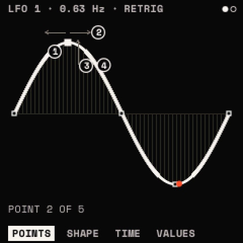
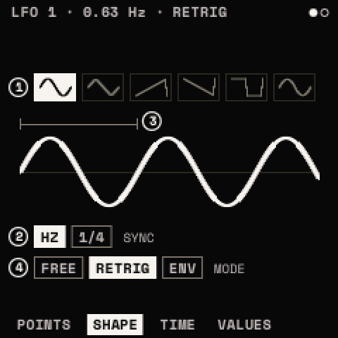
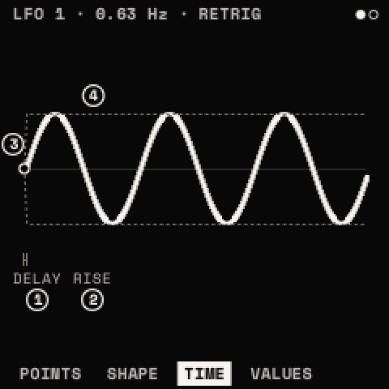

# LFOs

Two LFOs, **LFO 1** and **LFO 2**, each a shape you can draw, at a rate in hertz or a note value of the tempo. Like
ENV 2, an LFO moves nothing until the matrix puts it onto a parameter. <kbd>LFO</kbd> opens them; SELECT steps LFO 1
and LFO 2; ALGORITHM steps POINTS, SHAPE, TIME and VALUES. The top line names the LFO's rate and mode; a dial at the
right turns at its phase.

## POINTS: POINT · TIME · LEVEL · CURVE

Every LFO shape is a line through points over one cycle: up to 16, the first at the cycle's start and the last at its
end.

| Knob | What it does |
| --- | --- |
| 1 **POINT** | picks a point |
| 2 **TIME** | moves it along the cycle (between its neighbours; two points at one place make a step) |
| 3 **LEVEL** | moves it up or down |
| 4 **CURVE** | bends the segment that follows it |

- <kbd>LFO</kbd> + <kbd>OCT+</kbd>: a point added halfway between the point picked and the one before, the curve kept
  ("16 POINTS AT MOST").
- <kbd>LFO</kbd> + <kbd>OCT−</kbd>: the point picked deleted ("THE END POINTS STAY").
- Both work from any page: the LFO's POINTS page shows.

Each built-in shape has its own points. Editing a built-in shape's points turns it into **DRAWN** ("DRAWN FROM SINE"),
starting from that shape: so the quickest way to a custom shape is to pick the nearest built-in one and move its
points.

## SHAPE: SHAPE · SYNC · RATE · MODE

| Knob | Parameter | Range | What it does |
| --- | --- | --- | --- |
| 1 | **SHAPE** | SINE, TRIANGLE, SAW UP, SAW DOWN, SQUARE, S&H, SMOOTH, STEP 4, STAIRS, PULSE, BOUNCE, TRAPEZ, DRAWN | the wave. S&H is a random step each cycle; SMOOTH a random glide |
| 2 | **SYNC** | FREE, FIXED | FREE: RATE in hertz; FIXED: RATE a note value of the tempo |
| 3 | **RATE** | 0.01 – 40 Hz (FREE); 8 BAR .. 1/32 (FIXED) | the speed. With FIXED, one note value a detent: 8 BAR, 4 BAR, 2 BAR, 1 BAR, 1/2D, 1/2, 1/2T, 1/4D, 1/4, 1/4T, 1/8D, 1/8, 1/8T, 1/16D, 1/16, 1/16T, 1/32. Modulatable (with FIXED its modulation steps the note values, so it stays on the beat) |
| 4 | **MODE** | FREE, RETRIG, ENV | FREE: one phase for every voice (<kbd>PLAY</kbd> restarts it on the beat); RETRIG (default): each voice's own, from PHASE at each note; ENV: one cycle from the note, then its last value held |

LFO 1's RATE starts at 0.63 Hz, LFO 2's at 0.28 Hz; each keeps a hertz rate and a note value (1/4) of its own, so
SYNC switches between them.

## TIME: DELAY · RISE · PHASE · SMOOTH

| Knob | Parameter | Range | What it does |
| --- | --- | --- | --- |
| 1 | **DELAY** | OFF – 30 s | the LFO silent for this long after the note |
| 2 | **RISE** | OFF – 30 s | then fading in over this long |
| 3 | **PHASE** | 0 – 360° | where in the cycle it starts (RETRIG, ENV) |
| 4 | **SMOOTH** | 0 – 100 % | rounds the shape's corners (a square, a step, S&H) |

An LFO is bipolar: it swings both ways round the parameter's value, unless the matrix slot's POLARITY makes it
unipolar ([Modulation](modulation.md#polarity)).

## MOMENTARY

Hold <kbd>LFO</kbd> on any page: the knobs change the page's values for as long as you hold it, then every value goes
back. See [Layers and windows](layers.md#momentary).

> **Tip:** delayed vibrato: LFO 1 SINE at about 5 Hz, MODE RETRIG, DELAY 300 ms, RISE 500 ms, onto OSC A's and OSC B's
> FINE (or SEMI) with a small amount. Long notes start straight and then sing.

> **Tip:** a tempo-synced gate: LFO 2 DRAWN as a few steps, SYNC FIXED at 1/16, MODE FREE, onto VOLUME or the filter's
> CUTOFF. Press PLAY so it locks to the beat.
