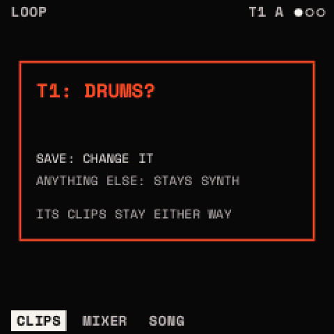
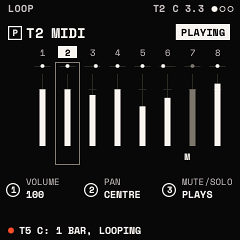
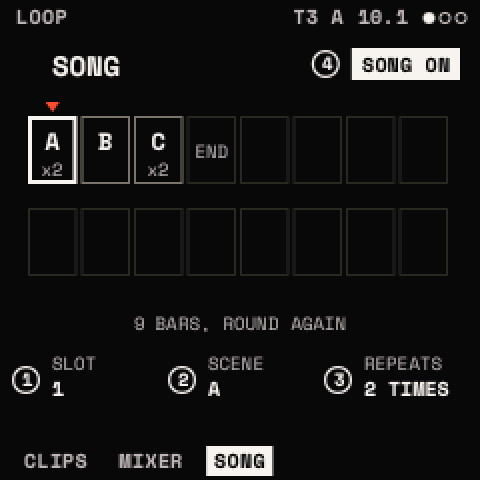
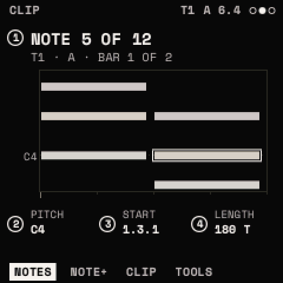
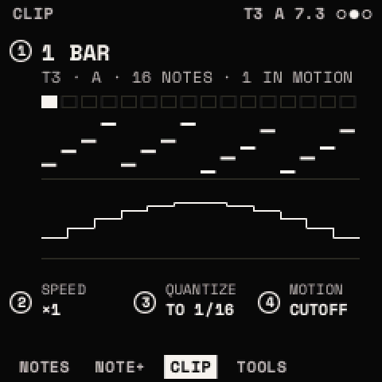
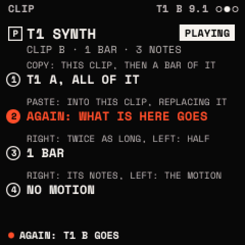

# The looper

The looper records what you play into loops and plays them back together, like a small DAW's clip view.

- **Eight tracks**, T1 to T8. Each is a synth, MIDI or drum track, with its own SCALE, chords and ARP, VOLUME, PAN,
  MUTE and SOLO, MIDI channel out and in.
- **Eight scenes**, A to H. Each track has one clip place in each scene: 64 clips a project.
- **A clip** is a loop of notes and knob moves at the times they were played (96 ticks a quarter note), 1 to 16 bars
  long (fewer in very long bars). Each clip keeps its own length, so tracks can loop at different lengths.
- **SONG** chains scenes, each its repeats. **Four projects** keep it all.

The design and its decisions: the repository's docs/LOOPER.md. **Needs a hardware test**: the looper's timing by ear and
against a DAW's clock, recording from the keys and MIDI, the click's level, the projects' writes.

## The SEQ menu

| | |
| --- | --- |
| <kbd>SEQ</kbd> once | the looper: **LOOP** (CLIPS, MIXER, SONG), **CLIP** (NOTES, NOTE+, CLIP, TOOLS; a drum track: GRID, HIT, EUCLID, CLIP, TOOLS) and **TRACK** (RECORD, CLICK). SELECT steps LOOP, CLIP, TRACK; ALGORITHM a module's pages |
| <kbd>SEQ</kbd> twice | the projects' list |
| <kbd>SEQ</kbd> held | the launch pad |
| <kbd>SEQ</kbd> + <kbd>OCT+</kbd> | a new empty clip of one bar on the selected track in the scene picked; with SEQ still held, PRESETS sets its length |
| <kbd>SEQ</kbd> + <kbd>OCT−</kbd> | DELETE? that clip; SEQ + OCT− again deletes it |
| <kbd>SEQ</kbd> + <kbd>OCT−</kbd> held 5 s | the page's settings as they start (the clips stay) |

**PRESETS picks the track on every SEQ page** (its name is the page's title, with a P before it; a change says "T3
DRUMS" for a moment). The top line shows the track, the scene picked, the bar and beat while running, and REC or DUB
while recording ("T3 A 2.2 REC").

## Tracks

**The selected track** plays the panel's keys and is what SCL, ARP and the chords' pages edit. Pick it with PRESETS on
any SEQ page, SELECT on HOME, or a white key 1–8 on the launch pad.

**TYPE** (CLIPS, KNOB 1):

| TYPE | Plays |
| --- | --- |
| SYNTH | the sound playing |
| SYNTH+MIDI | the same, and its notes out over USB MIDI on its CHANNEL |
| MIDI | no sound: its notes out over USB MIDI only (a DAW, another synth) |
| DRUMS | the project's drum kit ([The drums](drums.md)) |

Every synth track plays the one sound loaded for now (a sound a track is planned for V0.9). The TYPE changes when the
turning stops (0.5 s). A track that has clips asks first, as a window ("T1: DRUMS?"): <kbd>SAVE</kbd> changes it,
anything else keeps it ("TYPE KEPT"). A TYPE change keeps the clips as they are: on a synth or MIDI track a drum hit
plays as a sixteenth note, on a drum track a note as a plain hit of its drum (by its General MIDI drum number; other
notes are silent). Back to the first TYPE, nothing was lost.

## LOOP

### CLIPS: TYPE · SCENE

The tracks are rows (their numbers at the left, the selected one boxed, a muted one underlined) and the scenes are
columns (A to H, the one picked bold). A clip playing is filled, with a line along its foot for its place (stopped but
on: dimmer); a clip there is framed; an empty place is a dot; a clip launched blinks in a vermilion frame until it
starts; one recording is vermilion; one stopping at the bar has a notch. The selected track's place in the scene picked
is framed. A chip at the top right says what runs: PLAYING, STOPPED, COUNT-IN, REC: NEXT BAR, REC, OVERDUB.

- KNOB 1 **TYPE**: the selected track's TYPE.
- KNOB 2 **SCENE**: the scene picked (A to H), where REC records and SEQ + OCT+ makes a clip.
- **The keys launch here** (SEQ not held): white keys 1–8 this scene's clips on tracks 1–8 (the one playing: it
  stops); black keys 1–8 scenes A–H. Their LEDs show what plays (lit), what is launched or recording (blinking), what
  is there (glowing).

### MIXER: VOLUME · PAN · MUTE/SOLO

The eight tracks as strips (PAN's dot over a fader of VOLUME with a tick at 100; M and S under), the selected one
framed. The knobs set the selected track's:

- **VOLUME**: 0 to 127 (100: as recorded).
- **PAN**: left to right, with a centre detent.
- **MUTE/SOLO**: PLAYS, MUTE, SOLO. A muted track starts no notes; SOLO mutes the others.

HOME's MIX 1-4 and MIX 5-8 set the eight VOLUMEs too.

### SONG: SLOT · SCENE · REPEATS · SONG

Sixteen slots, each a scene and its REPEATS (1 to 16): KNOB 1 picks a slot, KNOB 2 its scene (or END), KNOB 3 its
repeats, KNOB 4 **SONG** ON or OFF. With SONG ON, <kbd>PLAY</kbd> plays slot 1's scene its repeats (a scene lasts as
long as its longest clip), then slot 2's, and so on to the first slot without a scene (END), then round again from
slot 1. The page shows
the slots in two rows (the one picked framed, the one playing marked) and the song's length in bars.

## Launching

A launch (a clip, a scene, a stop) waits for the next bar, or as TRACK > CLICK's **LAUNCH** says: BAR, BEAT or NOW.
Stopped, a launch starts the transport from the top. <kbd>PLAY</kbd> stops everything; <kbd>PLAY</kbd> again plays the
clips that were on, from their start. A scene launched plays each track's clip in that scene.

## Recording

<kbd>REC</kbd> records on the **selected track**, in the **scene picked**. It acts 300 ms after the tap (waiting to see
if a second tap makes it TAKE).

**A take** (an empty clip):

1. Stopped: a bar of COUNT-IN (its clicks), then the transport starts. Running: it starts at the next bar. REC blinks
   while it waits.
2. What you play goes in at its time (QUANTIZE: onto 1/32 .. 1/4), as long as you held it.
3. <kbd>REC</kbd> again ends the take, rounded to whole bars (1 to 16; sixteen bars end it by themselves), and it loops
   at once. A take records at SPEED x1.

**Overdub** (a clip with notes): <kbd>REC</kbd> adds to it pass after pass (a clip not playing is launched first) until
<kbd>REC</kbd> again. A note played just before its place is not played twice. **UNDO PASS** (the launch pad's last
black key, F#5) takes the last pass back (up to 256 notes and moves); again puts it back, until something new is
recorded.

**Knob moves**: a knob turned while a synth track records (a parameter that can be modulated: CUTOFF, WT POS, an
effect's MIX ..) writes its moves, replacing the ones it passes; while it turns, the knob is heard. When the clip
plays, the parameter follows the moves; stopped, or the clip stopped, the knob's own value again. The sound itself is
untouched: SAVE and undo keep the knob's value.

The notes go in as played, before the track's chords and ARP: they play through them, so changing the chords changes
what a clip plays.

### TAKE (REC twice)

Played something good while not recording? <kbd>REC</kbd> twice makes it a clip: Strata keeps the last 256 notes played
on the selected track, stopped or running. TAKE puts those of the last 16 bars into an empty clip in the scene picked:
from the bar they started in (running) or their first quarter note (stopped), rounded up to whole bars; notes still held end
now. Running, the new clip plays from the next bar. "THAT SCENE HAS A CLIP": pick an empty scene first.

## CLIP

The selected track's clip in the scene picked. SELECT from LOOP. (A drum track's CLIP is GRID, HIT, EUCLID, CLIP and
TOOLS: [The drums](drums.md#grid-hit-and-euclid).)

### NOTES: NOTE · PITCH · START · LENGTH

A piano roll, a bar at a time round the note picked ("NOTE 5 OF 12", the track, scene and bar under it): the range its
notes span (an octave at least, the Cs named at the left), each note a bar as bright as its velocity, the one picked
framed, the playhead over the bar playing.

- **NOTE**: picks a note, in time order.
- **PITCH**: moves it up or down.
- **START**: moves it in time, by NOTE+'s GRID.
- **LENGTH**: lengthens or shortens it, by GRID.

### NOTE+: VELOCITY · GRID · DELETE

- **VELOCITY**: the note picked's (a lane of velocities under the roll).
- **GRID**: the step START and LENGTH move by: FREE (a tick), 1/32, 1/16 (default), 1/8, 1/4.
- **DELETE**: turned right, the note picked is deleted.

### CLIP: LENGTH · SPEED · QUANTIZE · MOTION

- **LENGTH**: in bars. On an empty clip, it makes one of that length with no notes, to fill by overdub.
- **SPEED**: x1/2, x1, x2. The clip playing goes on from where it is; a scene lasts as long as its longest clip at its
  speed.
- **QUANTIZE**: turned right, the clip's notes moved onto GRID's step (1/16 with GRID FREE).
- **MOTION**: picks a parameter the clip moves; its moves are drawn as a line.

### TOOLS: COPY · PASTE · DOUBLE/HALVE · CLEAR

Each tool acts on a turn. One that would take something away asks for a second turn within 2 s ("AGAIN: T2 B GOES").

- **COPY**: a turn keeps the clip shown; turning on, a bar of it (BAR 1, BAR 2 ..).
- **PASTE** (right): what was copied into the clip shown. A whole clip replaces it (its length and SPEED with it); a bar
  goes into the same bar here, that bar's notes and moves replaced ("T1 C HAS NO BAR 2" when it has none). It takes
  what the copied clip holds at the moment you paste.
- **DOUBLE / HALVE**: right, twice as long, its notes and moves again in the second half (up to the longest allowed);
  left, half as long, its second half gone (asked when notes go).
- **CLEAR**: right, its notes (a drum track: its hits); left, the motion MOTION picks on CLIP. Asked first.

None works on the clip recording ("RECORDING: REC ENDS IT").

## TRACK

SELECT from CLIP.

### RECORD: QUANTIZE · CHANNEL · MIDI IN

- **QUANTIZE**: what is recorded goes onto a grid: OFF (as played), 1/32, 1/16, 1/8, 1/4.
- **CHANNEL**: the selected track's MIDI channel out, 1 to 16 (tracks 1 to 8 start on channels 1 to 8).
- **MIDI IN**: SELECTED (notes coming in play whichever track is selected) or a channel, 1 to 16 (notes on that channel
  play and record this track, selected or not).

### CLICK: CLICK · LEVEL · COUNT-IN · LAUNCH

- **CLICK**: OFF; REC (counting in and recording: the default); ON (always while running). The downbeat is higher.
- **LEVEL**: 0 to 10 (6).
- **COUNT-IN**: OFF or 1 BAR, before a take started while stopped.
- **LAUNCH**: when a launch plays: BAR (default), BEAT, NOW.

The page draws the bar's beats as rings, the one now lit.

## Projects

<kbd>SEQ</kbd> twice opens the projects' list: four projects, the one loaded marked, the others KEPT, EMPTY or blocked by
older presets.

- PRESETS picks one; <kbd>SAVE</kbd> twice saves the one loaded, stops the transport and loads the one picked (an empty
  one: a new project).
- <kbd>SAVE</kbd> + <kbd>OCT−</kbd> on the one loaded: cleared, asked first.
- The bottom line counts the events in use: **2,048 notes and moves a project**, shared by all its clips.

A project keeps the tracks (their TYPE, channels, VOLUME, PAN, MUTE, SOLO, SCALE, chords and ARP), the clips and their
SPEED, SONG and the drum kit. The one loaded is saved by itself when the transport is stopped and nothing has sounded for
3 s, and only what changed is written. The settings keep QUANTIZE, COUNT-IN, LAUNCH, CLICK and its LEVEL, and which
project is loaded.

**Where projects live**: projects 1 and 2 just past where older builds' 128 user presets ended, 3 and 4 where presets
65 to 104 were (Strata has 64 user presets since V0.8). While an older build's presets are still there,
projects 3 and 4 are not saved over them: "PROJECT 3: OLD PRESETS THERE". A project saved by V0.8 to V0.85 loads with
every clip at x1.

> **Tip:** a quick song: record a loop in scene A, launch scene A, and with it playing build scene B track by track
> (pick scene B, REC on each track). Then SONG: slot 1 A ×4, slot 2 B ×4, SONG ON, PLAY.
