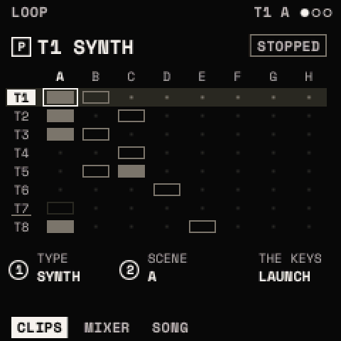
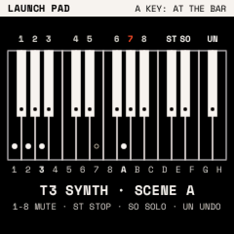
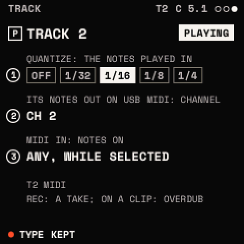
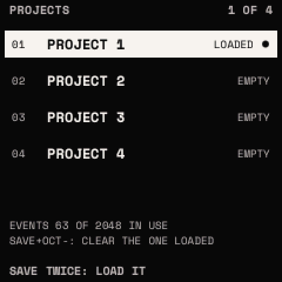

# The looper

Eight tracks (T1–T8) and eight scenes (A–H). Each track can hold one clip per scene: a loop of notes and knob moves,
1 to 16 bars long. A scene is a row of clips that play together; SONG chains scenes. Four projects keep it all.

<kbd>SEQ</kbd> opens three modules (SELECT): **LOOP** (CLIPS, MIXER, SONG), **CLIP** (NOTES, NOTE+, CLIP, TOOLS) and
**TRACK** (RECORD, CLICK). On every looper page, PRESETS chooses the track. The top line shows the track, the scene, the
bar and beat, and REC or DUB while recording.

## How to

**Record a loop**

1. Press <kbd>SEQ</kbd>. Turn PRESETS to choose a track and KNOB 2 to choose a scene with an empty place.
2. Tap <kbd>REC</kbd>. If the transport is stopped, one bar of count-in clicks plays first; if it is running,
   recording starts at the next bar.
3. Play. Notes are recorded as played (or quantized, see RECORD), and so are turns of any knob that can be modulated.
4. Tap <kbd>REC</kbd> again. The clip is rounded to whole bars and loops at once.

**Overdub**: tap <kbd>REC</kbd> on a clip that has notes. Each pass adds to it until you tap <kbd>REC</kbd> again. Hold
<kbd>SEQ</kbd> and press F#5 (UNDO PASS) to take the last pass back.

**Keep what you just played**: press <kbd>REC</kbd> twice. TAKE puts the notes you played on the selected track (the
last 256, within 16 bars) into a new clip in the chosen scene.

**Launch**: on the CLIPS page, white keys 1–8 launch this scene's clips on tracks 1–8 (press again to stop), and black
keys 1–8 launch scenes A–H. A launch waits for the next bar. <kbd>PLAY</kbd> stops everything; press it again to
restart the clips from the top.

**Make or delete a clip**: <kbd>SEQ</kbd> + <kbd>OCT+</kbd> makes an empty 1-bar clip (keep SEQ held and turn PRESETS
to set its length). <kbd>SEQ</kbd> + <kbd>OCT−</kbd> asks DELETE?; press it again to delete.

**Edit notes**: SELECT to CLIP. On NOTES, KNOB 1 chooses a note and KNOB 2–4 set its PITCH, START and LENGTH.

## The launch pad

Hold <kbd>SEQ</kbd>:

| Keys | What they do |
| --- | --- |
| White 1–8 (F3–F4) | Launch or stop each track's clip in the chosen scene |
| White 9–16 (G4–G5) | Launch scenes A–H |
| Black 1–8 (F#3–A#4) | Mute tracks 1–8 |
| C#5, D#5, F#5 | STOP ALL, SOLO the selected track, UNDO PASS (again: put it back) |

## Tracks

| TYPE | What the track plays |
| --- | --- |
| SYNTH | the sound playing (all synth tracks share it) |
| SYNTH+MIDI | the same, and sends its notes out over USB MIDI |
| MIDI | only sends its notes out over USB MIDI |
| DRUMS | the project's drum kit ([The drums](drums.md)) |

Set TYPE with KNOB 1 on CLIPS. A track with clips asks first; <kbd>SAVE</kbd> confirms. Clips are kept whatever the
type.

## Pages

| Page | Knobs | What they do |
| --- | --- | --- |
| CLIPS | TYPE, SCENE | Tracks as rows, scenes as columns. Filled: playing; framed: there; dot: empty; blinking: launched; vermilion: recording. |
| MIXER | VOLUME, PAN, MUTE/SOLO | The selected track's level (0–127, 100 as recorded), pan, and PLAYS, MUTE or SOLO. |
| SONG | SLOT, SCENE, REPEATS, SONG | Up to 16 slots, each a scene played 1–16 times. With SONG ON, <kbd>PLAY</kbd> plays the slots in order and starts again after the last. |
| NOTES | NOTE, PITCH, START, LENGTH | A piano roll of the clip, one bar at a time. |
| NOTE+ | VELOCITY, GRID, DELETE | GRID (FREE, 1/32 … 1/4) is the step START and LENGTH move by. Turn DELETE right to delete the note. |
| CLIP | LENGTH, SPEED, QUANTIZE, MOTION | Bars; speed ×½, ×1, ×2; turn QUANTIZE right to snap the notes to GRID; MOTION shows a parameter's recorded moves. |
| TOOLS | COPY, PASTE, DOUBLE/HALVE, CLEAR | Copy a clip or one bar; paste it here; double or halve the clip; clear its notes (right) or the motion (left). Anything that removes something asks for a second turn. |
| RECORD | QUANTIZE, CHANNEL, MIDI IN | Recording grid (OFF, 1/32 … 1/4); the track's MIDI channel out; MIDI IN: SELECTED, or a channel that always plays this track. |
| CLICK | CLICK, LEVEL, COUNT-IN, LAUNCH | Click OFF, REC (while counting in and recording) or ON; its level 0–10; count-in OFF or 1 BAR; launches wait for a BAR, a BEAT, or play NOW. |

A recorded knob move takes over its parameter while the clip plays; when the clip stops, the knob's own value returns.
The sound itself is not changed.

## Projects

Press <kbd>SEQ</kbd> twice for the projects list. Turn PRESETS to choose one and press <kbd>SAVE</kbd> twice to load it;
the current project is saved first. <kbd>SAVE</kbd> + <kbd>OCT−</kbd> clears the loaded project (it asks first).

A project keeps the tracks (type, channels, mix, scale, chords and ARP), the clips, SONG and the drum kit, up to 2,048
notes and moves in all. It is saved by itself when the transport is stopped and nothing has sounded for 3 seconds.

> **Tip:** build a song: record scene A, launch it, then record scene B track by track while A plays. On SONG, set
> slot 1 to A ×4 and slot 2 to B ×4, turn SONG ON and press <kbd>PLAY</kbd>.
