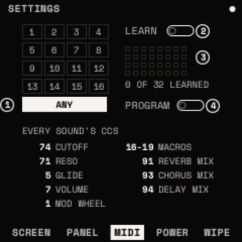

# MIDI and USB

Strata receives MIDI over USB and the FM-1's MIDI input jack, and sends MIDI over USB only (the FM-1 has no MIDI out
jack). On a computer it appears as "Strata for FM-1", with MIDI, audio and a serial port.

## How to

**Set the channel**: <kbd>HOME</kbd> twice, ALGORITHM to MIDI, KNOB 1 CHANNEL (ANY or 1–16).

**Map a controller (MIDI LEARN)**

1. On SETTINGS > MIDI, turn LEARN on.
2. Go to any page and turn the knob you want to control.
3. Move the controller. It now sets that parameter.
4. Press <kbd>OCT+</kbd> to finish. <kbd>OCT−</kbd> removes the chosen parameter's mapping; CLEAR (turned twice)
   removes them all. Up to 32 mappings.

**Send notes to a computer**: set a looper track's TYPE to MIDI (or SYNTH+MIDI) and its CHANNEL on TRACK > RECORD.
Everything that track plays, including chords and the ARP, goes out on that channel.

**Follow a computer's clock**: <kbd>GLO</kbd>, SELECT to GLOBAL, set CLOCK IN to MIDI. Start, continue and stop then run
the transport.

## What Strata receives

| Message | Does |
| --- | --- |
| Notes | Play the selected track, through its chords and ARP (or a track whose MIDI IN is that channel). On a drum track: the drums by General MIDI number. |
| Pitch bend, channel aftertouch | The BEND and AFTERTOUCH sources |
| CC 1, 11, 64 | Mod wheel, expression, sustain |
| CC 120, 123 | All sound and all notes off |
| CC 0 + program change | Load a preset (with PROGRAM on) |
| Clock, start, continue, stop | With CLOCK IN MIDI |

| CC | Parameter |
| --- | --- |
| 5 | GLIDE |
| 7 | VOLUME |
| 16–19 | MACRO 1–4 |
| 20, 70 | OSC B, OSC A WT POS |
| 21, 22 | OSC A, OSC B AMOUNT |

| CC | Parameter |
| --- | --- |
| 71 | FILTER RESO |
| 74 | FILTER CUTOFF |
| 91 | REVERB MIX |
| 93 | CHORUS MIX |
| 94 | DELAY MIX |

## Program change

With SETTINGS > MIDI > PROGRAM on, a program change loads a preset from the bank set by CC 0. Bank 0: programs 0–7 are
the starter sounds (SUPERSAW … OTT GROWL) and 8 is INIT. Any other bank: program 0 is USER 1, up to USER 64.

## USB

- **MIDI**: in and out. Only one app at a time can open the port on Windows.
- **Audio**: the FM-1 is a USB audio input, so you can record it on the computer.
- **Serial console** (115200 baud): read-only diagnostics; type `help`.
- **Backup mode**: the SysEx message `F0 22 24 35 7D F7` restarts the FM-1 into backup mode, as on the official
  firmware ([Recovery](install.md#recovery)).

Strata never turns on the FM-1's Bluetooth or Wi-Fi.
