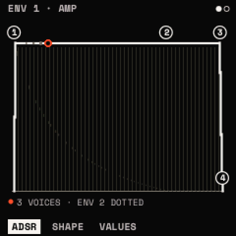
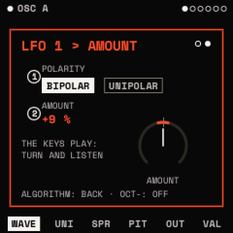

# Envelopes, LFOs and modulation

ENV 1 shapes every note's level. ENV 2, the two LFOs, the macros and the MIDI controllers move other parameters
through the **matrix**: eight slots, each a source, a destination and an amount. All of it is saved with the sound.

## How to

### Put a modulator on a knob

1. Go to the page with the parameter you want to move, such as FILTER's TONE page.
2. Press <kbd>LFO</kbd> twice for an LFO, or <kbd>ENV</kbd> twice for an envelope or a macro. The assign window opens.
3. Turn KNOB 1 to choose the source and KNOB 2 to choose the parameter. Parameters marked NO can't be modulated.
4. Turn ALGORITHM to the second page. Turn KNOB 2 to set the AMOUNT (−100 to +100 %) and KNOB 1 to set the POLARITY. The dial points up at rest; its arc shows how far the source swings the knob from
   there, both ways for BIPOLAR, one way for UNIPOLAR.
5. Press any button to close it. <kbd>OCT−</kbd> in the window removes the source from the parameter.

### Try sources quickly (the MOD layer)

1. Hold <kbd>REC</kbd>. The screen lists the page's four parameters.
2. Press a white key to choose a source; the screen names each key's source (F3 is ENV 1, A3 LFO 1, C4 MACRO 1).
3. Turn a knob to set that source's depth on its parameter. Let go of REC to finish (<kbd>REC</kbd> + <kbd>OCT+</kbd>
   keeps the layer open).

### Draw an LFO

1. Press <kbd>LFO</kbd>. The POINTS page shows the shape as points.
2. KNOB 1 chooses a point, KNOB 2 moves it in time, KNOB 3 up or down, KNOB 4 bends the line after it.
3. <kbd>LFO</kbd> + <kbd>OCT+</kbd> adds a point; <kbd>LFO</kbd> + <kbd>OCT−</kbd> deletes the one chosen (up to 16
   points; the end points stay). Editing a built-in shape turns it into DRAWN.

## Envelopes

<kbd>ENV</kbd> opens ENV 1 (the amp) and ENV 2 (free to assign). Times run from 1 ms to 30 s.

| Page | Parameter | What it does |
| --- | --- | --- |
| ADSR | ATTACK, DECAY, SUSTAIN, RELEASE | Rise, fall to the sustain level, level held, fall after release |
| SHAPE | HOLD | Time held at the top before DECAY |
| | A CURVE, D CURVE, R CURVE | Each stage's curve: − slow then fast, + fast then slow |

ENV 1's SUSTAIN starts at 100 %, ENV 2's at 0 %. A sustain pedal (MIDI CC 64) holds the releases.

## LFOs

<kbd>LFO</kbd> opens LFO 1 and LFO 2. The top line shows the rate and mode.

| Page | Parameter | What it does | Range |
| --- | --- | --- | --- |
| POINTS | POINT, TIME, LEVEL, CURVE | Edit the shape (above) | |
| SHAPE | SHAPE | SINE, TRIANGLE, SAW UP, SAW DOWN, SQUARE, S&H, SMOOTH, STEP 4, STAIRS, PULSE, BOUNCE, TRAPEZ, DRAWN | |
| | SYNC | FREE: RATE in Hz; FIXED: RATE as a note value | |
| | RATE | Speed | 0.01–40 Hz, or 8 BAR … 1/32 |
| | MODE | FREE (one phase for all voices; <kbd>PLAY</kbd> restarts it on the beat), RETRIG (per note), ENV (one cycle, then hold) | |
| TIME | DELAY, RISE | Wait, then fade in, after each note | OFF – 30 s |
| | PHASE | Start point | 0–360° |
| | SMOOTH | Rounds the corners | 0–100 % |

> **Tip:** delayed vibrato: LFO 1 SINE at about 5 Hz, MODE RETRIG, DELAY 300 ms, RISE 500 ms, onto both oscillators'
> FINE with a small amount.

## The matrix

<kbd>EDIT</kbd>, then SELECT to MATRIX. KNOB 1 chooses a slot (1–8), KNOB 2 its SOURCE, KNOB 3 its DEST (only
parameters that can be modulated; an effect's only while it is in the chain), KNOB 4 its AMOUNT. At 100 % a source can
sweep the whole range.

| Source | Range | What it is |
| --- | --- | --- |
| ENV 1, ENV 2 | 0…1 | the envelopes, per note |
| LFO 1, LFO 2 | −1…+1 | the LFOs |
| VELOCITY | 0…1 | the note's velocity |
| NOTE | −1…+1 | the key's position, low to high |
| RANDOM, ALTERNATE | −1…+1 | a new random value, or a flip, at each note |
| MACRO 1–4 | 0…1 | the macros |
| MOD WHEEL, EXPRESSION | 0…1 | MIDI CC 1 and CC 11 (or PERFORM's wheel) |
| BEND | −1…+1 | pitch bend |
| AFTERTOUCH | 0…1 | MIDI channel aftertouch |
| FIXED | | a constant offset |

**Polarity.** A unipolar source (0…1) pushes a parameter one way; a bipolar one (−1…+1) swings it both ways. Each
slot's POLARITY, set in the assign window, swaps this: an LFO made UNIPOLAR only opens a filter from where you set it.

A slot onto an effect, a macro or VOLUME follows the newest note's envelopes and LFOs, since the effects are shared by
all voices. VALUES pages show the range the modulation takes each parameter to.

## Macros

MACRO 1–4 are HOME's four knobs, <kbd>FX</kbd> held (MACROS), and MIDI CC 16–19. Each moves whatever its matrix slots
point at, and a macro can itself be modulated. INIT has MACRO 1–4 in its first four slots, waiting for a destination.

> **Tip:** one macro, several slots: MACRO 1 onto CUTOFF, RESO and the reverb's MIX turns HOME's KNOB 1 into a single
> "open it up" control.
