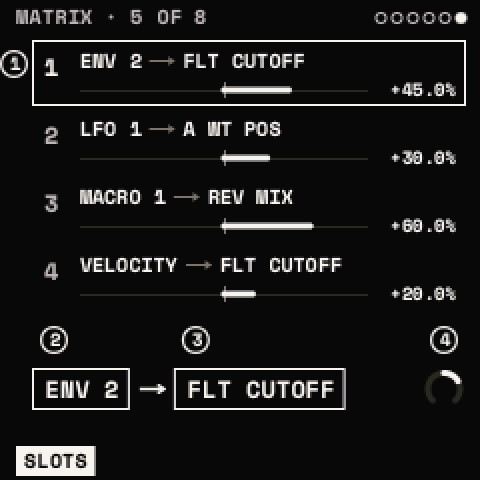

# Modulation

Anything that moves a sound over time goes through the **modulation matrix**: eight slots, each a **source**, a
**destination** (a parameter) and an **AMOUNT**. You can fill a slot three ways: the **assign window** (<kbd>ENV</kbd>
or <kbd>LFO</kbd> twice), the **MOD layer** (<kbd>REC</kbd> held) or the **MATRIX** page itself. All three write the
same slots, and they are saved with the sound.

## The MATRIX

<kbd>EDIT</kbd>, then SELECT to the last module, MATRIX (one page, SLOTS, then nothing more).

| Knob | Parameter | What it does |
| --- | --- | --- |
| 1 | **SLOT** | picks a slot, 1 to 8 (the page shows four at a time, those round the one picked) |
| 2 | **SOURCE** | the slot's source (below), or NONE |
| 3 | **DEST** | the parameter it moves: only those that can be modulated; an effect's only while its module is in the chain |
| 4 | **AMOUNT** | −100 % to +100 %: at 100 % the source can move the parameter across its whole range |

Each slot shows "source → destination", its amount as a bar from the middle and a figure. The top line counts the
slots in use. A destination's modulation also shows on its own page (VALUES draws the range the modulation takes it to,
and names the source: "ENV 2 +45.0%").

Which parameters can be modulated: the **Mod** column of the [parameter reference](parameters.md). Among them: WT POS,
AMOUNT, SEMI, FINE, LEVEL, PAN, DETUNE, BLEND, WIDTH, WT SPRD; the SUB's WIDTH and the NOISE's COLOR; every filter
value but TYPE; the envelopes' times, HOLD and SUSTAIN; the LFOs' RATE; VOLUME; the macros; and most of each effect's
values. Lists (a TYPE, a SHAPE, a WARP) and switches cannot be modulated.

## The sources

| Source | Range | What it is |
| --- | --- | --- |
| ENV 1, ENV 2 | 0 .. 1 | the envelopes, a voice each |
| LFO 1, LFO 2 | −1 .. +1 | the LFOs |
| VELOCITY | 0 .. 1 | the note's velocity (the FM-1's keys: SCL's VELOCITY; MIDI: the note's own) |
| NOTE | −1 .. +1 | the key's place, low to high across the keyboard |
| RANDOM | −1 .. +1 | a new random value at each note |
| ALTERNATE | −1 .. +1 | flips at each note: one way, then the other |
| MACRO 1–4 | 0 .. 1 | the four macros (HOME's knobs, FX held, MIDI CC 16–19) |
| MOD WHEEL | 0 .. 1 | MIDI CC 1, or PERFORM's KNOB 2 |
| BEND | −1 .. +1 | the pitch bend: MIDI's, or PERFORM's KNOB 1 |
| AFTERTOUCH | 0 .. 1 | MIDI channel aftertouch (the FM-1's keys have none) |
| EXPRESSION | 0 .. 1 | MIDI CC 11 |
| FIXED | | a constant: an offset, to move a parameter by the AMOUNT alone |

The envelopes, the LFOs, VELOCITY, NOTE, RANDOM and ALTERNATE are **per voice**: each note has its own. The macros, the
wheel, BEND, AFTERTOUCH, EXPRESSION and FIXED are **global**. A slot onto a global destination (an effect, a macro,
VOLUME) takes the per-voice sources of the newest voice: the effects are one for all the voices.

## Polarity

A source swings one way (**unipolar**, 0 .. 1: the envelopes, VELOCITY, the macros, the wheel, AFTERTOUCH,
EXPRESSION) or both ways round the parameter's value (**bipolar**, −1 .. +1: the LFOs, NOTE, RANDOM, ALTERNATE, BEND).
Each slot has a **POLARITY** that turns this round: a bipolar source made unipolar moves only up from the value (0 ..
1), a unipolar one made bipolar swings both ways (−1 .. +1). POLARITY is set on the assign window's second page
(BIPOLAR, UNIPOLAR), and is kept with the sound.

> **Tip:** an LFO made UNIPOLAR on CUTOFF opens the filter from where you set it and comes back down to it, rather
> than closing it below; an envelope made BIPOLAR sweeps a parameter down and back up through its value.

## The assign window

<kbd>LFO</kbd> twice or <kbd>ENV</kbd> twice, over the page you were on: KNOB 1 the source, KNOB 2 which of the page's
parameters, ALGORITHM to page 2 for POLARITY (KNOB 1) and AMOUNT (KNOB 2); <kbd>OCT−</kbd> takes the source off.
Details: [Layers and windows](layers.md#the-assign-window-env-twice-lfo-twice).

## The MOD layer

Hold <kbd>REC</kbd>, press a white key for the source, turn the page's knobs: each turn sets the source's depth on that
knob's parameter. Details: [Layers and windows](layers.md#mod).

## The macros

MACRO 1 to 4 are both **sources** and **destinations**. As sources they move what their slots point at; as parameters
they are set by HOME's four knobs, by <kbd>FX</kbd> held (MACROS), by MIDI CC 16 to 19, or by another source (a slot
onto a macro runs first, so an LFO on MACRO 1 moves everything MACRO 1 moves). INIT keeps MACRO 1 to 4 in its first four
slots, going nowhere: pick a destination and an AMOUNT for one and its HOME knob does that.

> **Tip:** one macro, several slots: put MACRO 1 onto CUTOFF (+), RESO (+) and a reverb's MIX (+) in three slots, and
> HOME's KNOB 1 becomes one "open it up" control.

## The order of things

The matrix is worked out once a block (about 0.7 ms): each voice adds its slots' source × AMOUNT × range to its
parameters, then each is held within its range. A slot whose amount is 0 costs nothing; when all eight slots are in
use, the assign window says "THE MATRIX IS FULL: 8 SLOTS" and the MOD layer "MATRIX FULL".
