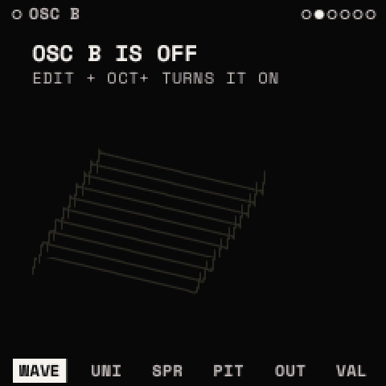
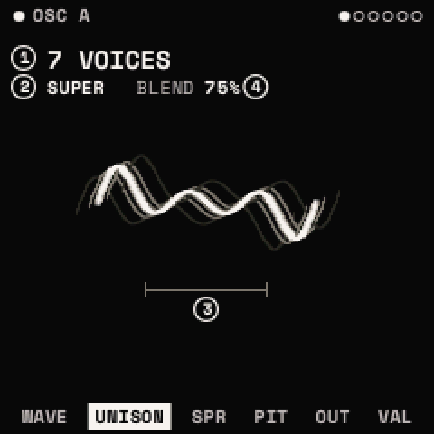
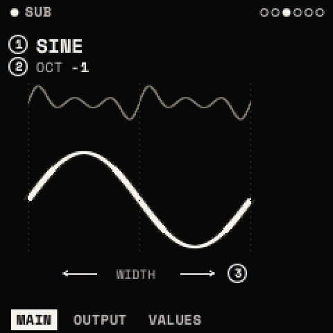
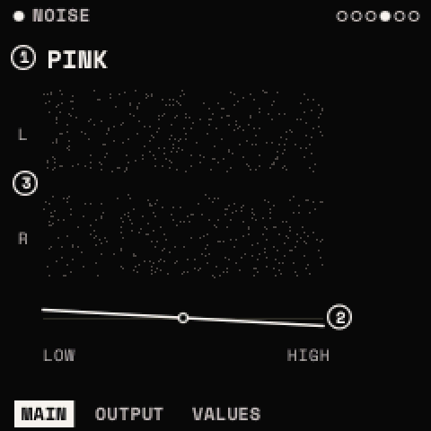

# Oscillators, sub and noise

<kbd>EDIT</kbd> opens the sound's sources. SELECT steps OSC A, OSC B, SUB, NOISE, FILTER and MATRIX; ALGORITHM steps a
module's pages. There are no ON knobs: show a source and press <kbd>EDIT</kbd> + <kbd>OCT+</kbd> to turn it on,
<kbd>EDIT</kbd> + <kbd>OCT−</kbd> to turn it off (its dot on the top line shows which). OSC A starts on, the others
off; while a source is off its pages say so ("OSC B IS OFF · EDIT + OCT+ TURNS IT ON"), its drawing dimmed. Each
source has its own OUTPUT page with a ROUTE: through the FILTER, or DIRECT past it.

Ranges and defaults for every parameter: the [parameter reference](parameters.md#osc-a).

## OSC A and OSC B

Two wavetable oscillators, alike. A **wavetable** is a set of single-cycle waves (frames) in a row; WT POS reads
between them, so a turn of WT POS morphs the wave. Each oscillator reads its own table.

### WAVE: WT POS · TABLE · WARP · AMOUNT

| Knob | Parameter | What it does |
| --- | --- | --- |
| 1 | **WT POS** | The place in the table, 0 to 100 %: the first frame to the last, crossfaded between. Modulatable; MIDI CC 70 (OSC A), 20 (OSC B). |
| 2 | **TABLE** | One of the 54 factory tables (below). A new table is built as it loads, with a short fade. |
| 3 | **WARP** | How the wave's phase is read: OFF, SYNC, BEND+, BEND−, PWM, ASYM+, ASYM−, MIRROR, FM. |
| 4 | **AMOUNT** | How much WARP does, 0 to 100 %. Modulatable; CC 21 (OSC A), 22 (OSC B). |

The drawing shows the table's frames in depth, the frame playing in front, and the warp's effect on it.

**The warps:**

| WARP | What it does |
| --- | --- |
| OFF | the table as it is |
| SYNC | hard sync: the cycle read 1 to 16 times faster as AMOUNT rises, its reset softened: the classic sync sweep |
| BEND+ / BEND− | the cycle pinched in toward its middle, or pushed out toward its ends, mirrored about the centre |
| PWM | the wave squeezed into the first part of the cycle, the rest held: pulse-width modulation for any table |
| ASYM+ / ASYM− | the phase bent one way over the whole cycle: the wave leans |
| MIRROR | the first half plays the wave at double speed, the second half mirrored; AMOUNT moves the fold |
| FM | phase modulation from the other oscillator (its centre unison voice): bells, metallic and growling tones |

A warp never makes the table alias: its amount is held so its steepest part stays under 21 kHz at the note playing.

> **Tip:** FM needs the other oscillator running. A classic set-up: OSC B on a sine-like table, its LEVEL at 0 so it
> is not heard, and OSC A's WARP FM; then OSC B's PITCH sets the FM ratio. The starter sound FM KEYS is built so.

### UNISON: UNISON · UNI MODE · DETUNE · BLEND

| Knob | Parameter | What it does |
| --- | --- | --- |
| 1 | **UNISON** | Copies of the oscillator a note, 1 to 16. |
| 2 | **UNI MODE** | LINEAR (the copies' detune evenly spread) or SUPER (denser near the centre, a supersaw's curve). |
| 3 | **DETUNE** | How far the copies are detuned, either side of the note. Modulatable. |
| 4 | **BLEND** | The side copies' level against the centre one (loudness kept the same as UNISON changes). Modulatable. |

### SPREAD: WIDTH · WT SPRD · PHASE · RAND

| Knob | Parameter | What it does |
| --- | --- | --- |
| 1 | **WIDTH** | The unison copies spread across the stereo field, 0 % (mono) to 100 %. Modulatable. |
| 2 | **WT SPRD** | Each copy reads the table at a slightly different WT POS: a moving, chorused texture. Modulatable. |
| 3 | **PHASE** | Where in the cycle a note starts, 0 to 360°. |
| 4 | **RAND** | How random each copy's start phase is, 0 to 100 % (100 % by default). |

### PITCH: OCT · SEMI · FINE · PH MODE

| Knob | Parameter | What it does |
| --- | --- | --- |
| 1 | **OCT** | −4 to +4 octaves. |
| 2 | **SEMI** | −12 to +12 semitones. Modulatable. |
| 3 | **FINE** | −100 to +100 cents. Modulatable. |
| 4 | **PH MODE** | RETRIG: each note starts at PHASE (with RAND); FREE: the oscillator runs on between notes. |

> **Tip:** with UNISON, RAND at 0 and PH MODE RETRIG, every copy starts together and the note has a sharp, "laser"
> attack; RAND at 100 % gives the smooth, wide start of a supersaw.

### OUTPUT: LEVEL · PAN · ROUTE

| Knob | Parameter | What it does |
| --- | --- | --- |
| 1 | **LEVEL** | 0 to 100 % (75 % by default). Modulatable. |
| 2 | **PAN** | −100 % (left) to +100 % (right). Modulatable. |
| 3 | **ROUTE** | FILTER (through the voice's filter) or DIRECT (past it, straight to the amp). |

## The wavetables

54 factory tables in nine categories, built by Strata from recipes when they load (nothing is a sample). <kbd>EDIT</kbd>
twice opens the **wavetables' list** for the oscillator shown: SELECT jumps to the next category, PRESETS picks a
table, <kbd>SAVE</kbd> twice loads it. The list shows each table's number and category; a dot marks the one playing.

| Category | Tables |
| --- | --- |
| ANALOG | BASIC MORPH, SAW, SQUARE, TRI TO SAW, SAW TO SQR, SINE TO TRI, PULSE WIDTH, SOFT PULSE, DARK SAW |
| ADDITIVE | ODD TILT, ALL TILT, ODD TO EVEN, COMB SWEEP, COMB DEPTH, PHASED SAW |
| SPECTRAL | BAND SWEEP, TWIN BANDS, WIDE BAND, BAND SPREAD, CHAOS A, CHAOS B, DUST, DRAWBARS, BELLS, GLASS, STRINGS, HOLLOW |
| VOCAL | VOWELS, VOWEL SHIFT, DARK VOWELS, BRIGHT A-I, CHOIR |
| FM | FM 1:1, FM 1:2, FM 1:3, FM 2:7, FM 1:5 BELL |
| SYNC | SYNC SAW, SYNC SQUARE, SYNC SINE, SYNC TRI |
| FOLD | FOLD SINE, FOLD TRI, FOLD ASYM, FOLD MIX |
| PHASE | PD SAW, PD SQUARE, RESO SAW, RESO TRI, RESO TRAP |
| DIGITAL | CRUSH SINE, CRUSH SAW, STEPS, STAIR TRI |

The list orders them by category: ANALOG, ADDITIVE, VOCAL, SPECTRAL, SYNC, FM, FOLD, PHASE, DIGITAL. The tables are the
factory's: they cannot be changed or deleted.

> **Tip:** most tables are made to be swept. Put an LFO or ENV 2 on WT POS (the assign window: <kbd>LFO</kbd> twice on
> the WAVE page) before you judge a table by its first frame.

## SUB

A simple oscillator under OSC A, following its pitch.

- **MAIN: SHAPE · OCT · WIDTH.** SHAPE: SINE, TRIANGLE, SAW, SQUARE, PULSE, ROUND (a square softened). OCT: −3 to 0
  octaves under OSC A (−1 by default). WIDTH: the PULSE's width, from a square (0 %) to a narrow pulse (100 %);
  modulatable.
- **OUTPUT: LEVEL · PAN · ROUTE**, as an oscillator's.

## NOISE

- **MAIN: TYPE · COLOR · STEREO.** TYPE: WHITE, PINK, BROWN. COLOR: a tilt about 1 kHz, −100 % (darker) to +100 %
  (brighter); modulatable. STEREO: 0 % the same noise both sides, 100 % (default) independent sides.
- **OUTPUT: LEVEL · PAN · ROUTE** (LEVEL 50 % by default).

> **Tip:** a little NOISE routed DIRECT, with a short ENV-shaped level (the matrix: ENV 2 onto NOISE LEVEL), adds a
> breathy attack that the filter does not darken.
