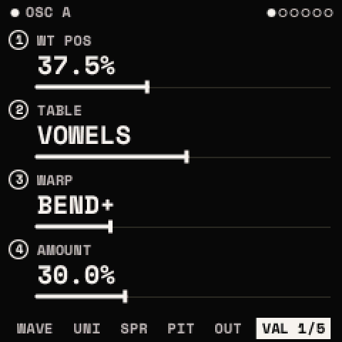

# The panel and the screen

## The controls

| Control | What it does in Strata |
| --- | --- |
| 27 keys, F3 to G5 | Play notes on the selected track. In some layers and screens they pick, toggle, launch or type (see [Buttons and mappings](buttons.md#the-keys)). |
| <kbd>OCT−</kbd> / <kbd>OCT+</kbd> | The keys' octave, −3 to +3 (SCL's top line shows it). Held with a menu button: off and on (the button's combos). |
| KNOB 1–4 | The four values on the screen, left to right. Each has a numbered handle drawn on what it moves. |
| SELECT | The next or previous **module** of the menu shown (OSC A, OSC B, SUB ..; an effect module ..), stopping at the first and the last. A menu of one module: nothing. On HOME: the track. On the FX chain view: the slot. |
| ALGORITHM | The next or previous **page** of the module shown, everywhere, stopping at the first and the last. |
| PRESETS | A list, by the page: the sounds (a list that opens as it turns), on the looper's pages the track, on a drum track the drum, in an open list its entry. |
| MASTER | The output level. |
| <kbd>HOME</kbd> <kbd>EDIT</kbd> <kbd>ENV</kbd> <kbd>LFO</kbd> <kbd>FX</kbd> <kbd>GLO</kbd> <kbd>SCL</kbd> <kbd>ARP</kbd> <kbd>SEQ</kbd> | The menus, one grammar for all ([Buttons and mappings](buttons.md)). |
| <kbd>SAVE</kbd> | The SAVE window, the browser, undo and redo. |
| <kbd>REC</kbd> | The looper's record; twice TAKE; held the MOD layer. |
| <kbd>PLAY</kbd> | The transport: the looper's clips, the ARP's and PATTERN's beat, the LFOs' FREE phase from the beat. |

The keys have no velocity on the FM-1: they play at SCL's VELOCITY (100 by default). MIDI notes keep their own.

## The menus

| Button | Its modules (SELECT) |
| --- | --- |
| <kbd>HOME</kbd> | HOME (SOUND, MIX 1-4, MIX 5-8) |
| <kbd>EDIT</kbd> | OSC A, OSC B, SUB, NOISE, FILTER, MATRIX; on a drum track DRUM, KIT |
| <kbd>ENV</kbd> | ENV 1, ENV 2 |
| <kbd>LFO</kbd> | LFO 1, LFO 2 |
| <kbd>FX</kbd> | the chain's modules in their order (the chain view: FX once in its own menu) |
| <kbd>GLO</kbd> | VOICE, GLOBAL |
| <kbd>SCL</kbd> | SCALE, CHORD |
| <kbd>ARP</kbd> | ARP, STEPS |
| <kbd>SEQ</kbd> | LOOP, CLIP, TRACK |
| <kbd>HOME</kbd> twice | SETTINGS (SCREEN, PANEL, MIDI, POWER, WIPE) |
| <kbd>HOME</kbd> held 5 s | DEBUG (BENCH, KEY SCAN, CORE 2) |

Each menu remembers the page it was left on, and each module the page it showed last.

## The knobs

- **Speed-sensitive.** Turned slowly, a value moves 0.1 % of its range a detent; turned quickly, up to 5 %. With
  SETTINGS > PANEL > ACCEL off, 1 % a detent at any speed. A list, a count or a short range moves one entry a detent.
- **Centre detents.** On a knob with a middle (PAN, the tracks' and drums' PAN, TUNE, the kit's TONE, every bipolar
  parameter: the EQ's gains, FOLLOW, the matrix's amounts ..), a turn through the middle stops there and holds for
  three detents more the same way; a turn back leaves at once, and a new turn from the middle (after 0.6 s) holds
  nothing.
- **Showing the value.** The knob turning is lit: its handle goes vermilion, and on the filter's and the effects'
  pages the part of the drawing it moves is lit, the shape before the turn dashed behind, until a second after its
  last detent. Its value goes vermilion where the page shows it (a chip, a figure, a title); where the page does not,
  the bottom row shows its name and value instead of the page names.

## The screen

Every menu screen has one layout:

- **The top line**: the module's name, with its dot (filled: on; hollow: off). A word of status (HOME's tempo, SCL's
  octave or chord, the looper's track, scene, bar and beat, REC or DUB). At the right, the menu's module dots
  (SELECT's), or on an effect module its place in the chain as eight squares (filled: this one; outlined: in the chain;
  dashed: bypassed). With SETTINGS > POWER > SHOW BATTERY, the battery.
- **The body**: a drawing of what the module does, with the four knobs' numbered handles on what each moves.
- **The bottom row**: the module's pages, the one shown inverted, the others by short names (UNI, SPR, PIT, OUT, VAL)
  where they would not fit, with a < or > where the row goes on. A **toast**, a word for a moment (a vermilion dot
  and a few words, 1.5 s), takes its place.
- **A P in a square**: what PRESETS turns on this page (the sound on HOME, the drum on a drum track's HOME and DRUM,
  the track on the looper's pages).
- **The unsaved dot**: a small vermilion dot after the sound's or the kit's name (on HOME, in the presets' list, in
  the browser) while it is edited since it was loaded or saved.

The layers (MOD, PERFORM, MACROS, MOMENTARY, the launch pad, the help map) and the windows (the assign window, the SAVE
window, the questions, the lists) keep their own look: [Layers and windows](layers.md).

## VALUES

Every module (OSC A and B, SUB, NOISE, FILTER, ENV 1 and 2, LFO 1 and 2, VOICE, DRUM, KIT, each effect module) ends
with **VALUES**: its pages' knobs again, a page each in the same order ("VALUES 1/5" holds WAVE's four, "2/5"
UNISON's ..). Each value is large, with its bar, the range its modulation takes it to, and the source ("ENV 2
+45.0%"). A knob on VALUES moves its parameter's finest step a detent (0.1 % of the range; a list one entry) however
fast it turns: use it for an exact value. VALUES is always a module's last page; ALGORITHM reaches it.

## Help

- **HELP** (SETTINGS > SCREEN, on by default): a module opened from elsewhere shows a hint at the bottom for two
  seconds ("ENV TWICE: AN ENVELOPE ONTO A KNOB"), and a menu opened from another says what pressing it again does
  ("AGAIN: THE TABLES").
- **The help map**: hold <kbd>HOME</kbd>. For the screen you are on it shows what SELECT, ALGORITHM, PRESETS and the
  four knobs do, and every button's twice. Held on, a bar fills along the bottom and DEBUG opens at 5 s. Let go
  before: nothing changes.

## The themes

SETTINGS > SCREEN > COLOR: twelve themes, each six colours (the ground, the ink, the labels, the lesser lines, the
faint lines, and one accent for what is live). STRATA (warm white on black, vermilion: the default), CLASSIC, ICE,
VIOLET, PAPER (light), NIGHT (dim by design), HI-CON, MONO, MOSS, DUSK, SAND (light) and NEON. The type is Space Mono,
nothing under 9 pixels. **Needs a hardware test**: legibility at the panel's size, the themes on the panel.

## Power-on

1. The splash for two seconds, then HOME's SOUND.
2. The sound playing at power-off comes back, with the settings and the project loaded.
3. **<kbd>HOME</kbd> held at power-on**: the last sound is not brought back (a way out should a sound ever stop the
   unit).
4. **SAFE START**: after a crash or a hang Strata starts the same way by itself, on INIT, and says so.

## Screen sleep

SETTINGS > POWER > SCREEN OFF AFTER (OFF, 1, 5, 15 MIN) darkens the panel after that long with no control touched. Any
control wakes it, and the press, turn or key that wakes it does nothing else. The backlight stays lit (on the FM-1 its
pin also enables the key and knob scan, so with it off nothing could wake the screen). The sound, the looper, MIDI and
USB go on; it never darkens under a countdown or a count-in. **Unverified on the FM-1.**
