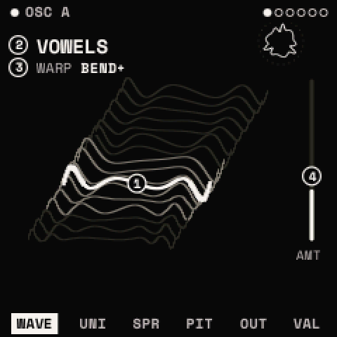
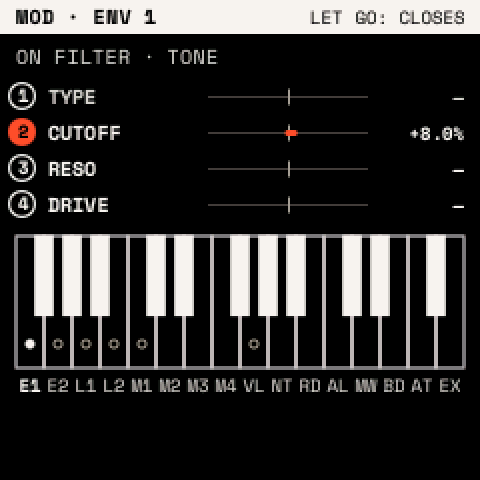

# The panel

How Strata uses the FM-1's controls and screen, and the rules every menu follows. The
[cheat sheet](../guide/cheatsheet.md) lists every button in one table.

## The controls

| Control | What it does |
| --- | --- |
| Keys (F3 to G5) | Play the selected track. On some screens they choose, launch or type instead. |
| <kbd>OCT−</kbd> <kbd>OCT+</kbd> | Change the keys' octave (−3 to +3). Held with a menu button, they mean off and on. |
| KNOB 1–4 | Set the four values on the screen, left to right. |
| SELECT | Go to the next or previous module of the menu (<kbd>EDIT</kbd>: OSC A, OSC B, SUB, NOISE, FILTER, MATRIX). |
| ALGORITHM | Go to the next or previous page of the module. |
| PRESETS | Open the presets list (on looper pages: choose the track; on a drum track: choose the drum). |
| MASTER | Output level. |

The FM-1's keys have no velocity; they play at SCL's VELOCITY (100).

## The screen

- **Top line**: the module's name, with a filled dot when it is on. The dots at the right are the menu's modules;
  SELECT moves between them.
- **Body**: a drawing of what the module does. The circled numbers are the knobs' handles, placed on what each knob
  moves. A knob's handle and value turn vermilion while it turns; the shape before the turn stays dashed behind.
- **Bottom row**: the module's pages; the one shown is highlighted. The last page, **VALUES**, shows the same knobs as
  large numbers, and turns them in the finest steps: use it to set an exact value.
- **P in a square**: what PRESETS chooses on this page.
- **Vermilion dot after a name**: the sound or kit has unsaved changes.

A module that is switched off says so on its pages ("OSC B IS OFF · EDIT + OCT+ TURNS IT ON").

## Knobs

- Turned slowly, a knob moves its value in fine steps; turned quickly, in large ones. SETTINGS > PANEL > ACCEL off
  makes every step the same size.
- Knobs with a centre (PAN, TUNE, bipolar amounts) pause at the centre for a few detents, so you can find it.

## Buttons

1. **Once**: opens the menu on the page you left. Pressed inside its own menu: goes to its first page.
2. **Twice** (within 300 ms): its second job, such as <kbd>EDIT</kbd> twice for the wavetable list.
3. **Held**: opens its layer until you let go.
4. **With <kbd>OCT+</kbd> / <kbd>OCT−</kbd>**: hold the button, then press OCT+ to switch on or add, OCT− to switch off
   or remove.
5. **With <kbd>OCT−</kbd> held 5 s**: resets what the menu shows. A countdown appears after 2 s; let go of OCT− to
   cancel. Sound changes can be undone afterwards with <kbd>SAVE</kbd> + <kbd>OCT−</kbd>.

**Help**: hold <kbd>HOME</kbd> to see what every control does on the current screen.

## Layers

Hold a button to open its layer; let go to close it. REC's and GLO's layers can stay open: press the button with
<kbd>OCT+</kbd> (GLO also: twice), and tap the button to close.

| Layer | Hold | Knobs | Keys |
| --- | --- | --- | --- |
| MOD | <kbd>REC</kbd> | Set the chosen source's depth on each knob's parameter | White keys choose the source |
| PERFORM | <kbd>GLO</kbd> | Pitch bend, mod wheel, GLIDE, VOLUME | Play |
| MACROS | <kbd>FX</kbd> | MACRO 1–4 | F3–F4 bypass effects 1–8 |
| MOMENTARY | <kbd>LFO</kbd> | Change the page's values until you let go | Play |
| LAUNCH PAD | <kbd>SEQ</kbd> | | Launch clips and scenes, mute tracks |

Details: [MOD](modulation.md), [PERFORM, MACROS, MOMENTARY](playing.md), [the launch pad](looper.md).

## Windows and lists

Windows open over the page; the keys still play. Any other button, SELECT or PRESETS closes a window.

| Window | Opens with | Use |
| --- | --- | --- |
| Assign window | <kbd>ENV</kbd> or <kbd>LFO</kbd> twice | Put a source onto a knob ([how](modulation.md#put-a-modulator-on-a-knob)) |
| SAVE window | <kbd>SAVE</kbd> | SAVE, SAVE AS NEW or CANCEL: <kbd>OCT−</kbd>/<kbd>OCT+</kbd> choose, <kbd>SAVE</kbd> confirms |
| Questions (DELETE?, T1: DRUMS?, WIPE?) | an action that removes something | Confirm as the window says; anything else cancels |

Lists (presets, wavetables, drum presets, kits, projects) all work the same way: turn PRESETS to move, press
<kbd>SAVE</kbd> twice to load, <kbd>SAVE</kbd> + <kbd>OCT+</kbd> to save a new entry, <kbd>SAVE</kbd> +
<kbd>OCT−</kbd> to delete (it asks first). A list closes after 5 seconds untouched.

## Power-on

Strata shows its splash for two seconds, then HOME, with the sound, settings and project you had. Hold
<kbd>HOME</kbd> while switching on to start without the last sound. After a crash Strata does this by itself and shows
SAFE START.
