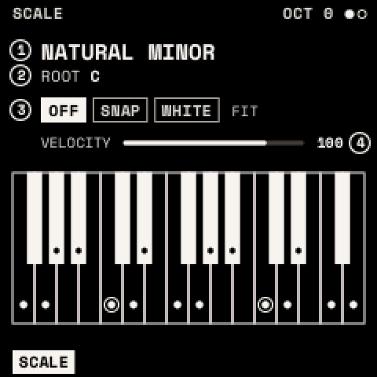
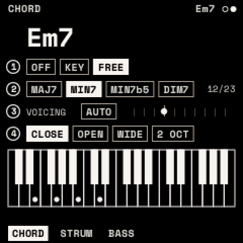
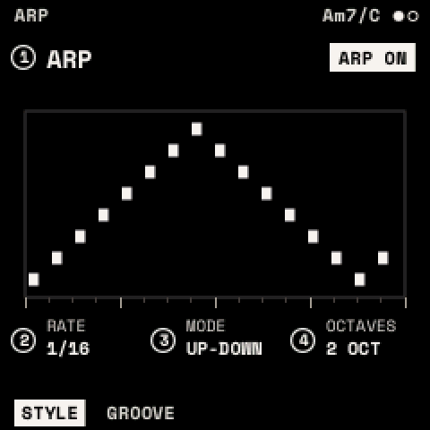
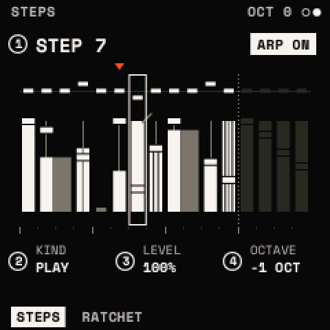
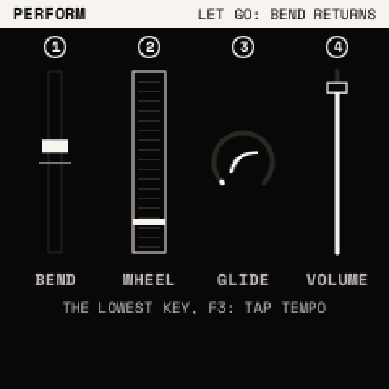

# Playing

Scales, chords and the ARP change what the keys play; each looper track has its own. PERFORM, MACROS and MOMENTARY
change how you play.

## How to

**Play in a scale**: press <kbd>SCL</kbd>, turn KNOB 1 for the SCALE and KNOB 2 for the ROOT, then KNOB 3 for FIT.
Or hold <kbd>SCL</kbd> and press a key to make it the root.

**Play chords**: hold <kbd>SCL</kbd> and press <kbd>OCT+</kbd>. Every key now plays a chord; <kbd>SCL</kbd> +
<kbd>OCT−</kbd> turns chords off.

**Arpeggiate**: hold a chord, then hold <kbd>ARP</kbd> and press <kbd>OCT+</kbd>. <kbd>ARP</kbd> + <kbd>OCT−</kbd>
stops it. Turn LATCH on (GROOVE page) to keep it playing after you let go.

**Bend and glide**: hold <kbd>GLO</kbd> for PERFORM (<kbd>GLO</kbd> twice keeps it open). **Tap the tempo**: hold
<kbd>GLO</kbd> and tap F3, the lowest key, three or more times (F3 makes no sound while you tap).

## SCALE

| Parameter | What it does |
| --- | --- |
| SCALE | CHROMATIC, MAJOR, NATURAL MINOR, DORIAN, MIXOLYDIAN, MAJOR and MINOR PENTATONIC, HARMONIC MINOR, PHRYGIAN, LYDIAN, LOCRIAN, MELODIC MINOR, BLUES, WHOLE TONE, DIMINISHED H-W and W-H |
| ROOT | C to B |
| FIT | OFF: every key plays its own note (scale notes glow). SNAP: a key outside the scale plays the scale note below. WHITE: the white keys play the scale from the root at C4; black keys are silent. |
| VELOCITY | The keys' velocity, 1–127 (100) |

MIDI notes are not fitted to the scale.

## CHORD, STRUM, BASS

<kbd>SCL</kbd>, then SELECT to CHORD. The screen names the chord playing (for example "Cm7/G") and shows its notes.

| Page | Parameter | What it does |
| --- | --- | --- |
| CHORD | MODE | OFF; KEY (each key plays its chord in the scale); FREE (each key plays TYPE on its own note) |
| | SHAPE (KEY) | TRIAD, 7TH, 9TH, SUS2, SUS4, 6TH, ADD9, POWER |
| | TYPE (FREE) | MAJ, MIN, SUS2, SUS4, DIM, AUG, POWER, 6, MIN6, 7, MAJ7, MIN7, MIN7b5, DIM7, 7SUS4, ADD9, MIN ADD9, 9, MAJ9, MIN9, 6/9, MIN11, 13 |
| | VOICING | AUTO (each chord close to the last), or inversions −3 to +6 |
| | SPREAD | CLOSE, OPEN, WIDE, 2 OCT |
| STRUM | STRUM | Gap between the notes: OFF or 2–200 ms |
| | DIRECTION | UP, DOWN, ALTERNATE, RANDOM |
| | HUMAN | Random timing and level, 0–100 % |
| | TAPER | Later notes softer, 0–100 % |
| BASS | BASS | The chord's root under it: OFF, ON |
| | OCTAVE | 1 or 2 octaves below |
| | LEVEL | Its level, % of the chord's (80 %) |

One chord plays at a time: the last key pressed. MIDI notes play through the track's chords like the keys.

## The ARP

<kbd>ARP</kbd> opens ARP (STYLE, GROOVE) and, with SELECT, STEPS (STEPS, RATCHET). It plays the chord, or the keys held
when chords are off.

| Page | Parameter | What it does |
| --- | --- | --- |
| STYLE | STYLE | ARP (notes in turn), PATTERN (the chord as rhythmic stabs), HARP (the keys become the chord's strings) |
| | RATE | Step length: 5–120 ms, or 1/32 … 1 BAR (1/16) |
| | MODE (ARP) | UP, DOWN, UP-DOWN, DOWN-UP, UP & DOWN, AS PLAYED, RANDOM, WALK, OUTSIDE IN, INSIDE OUT, PINKY, THUMB, CHORD |
| | OCTAVES (ARP) | 1–4 |
| | PATTERN, ACCENT (PATTERN) | One of 16 rhythms; how much softer the off-beat stabs are |
| GROOVE | GATE | Note length, 5–200 % of a step |
| | SWING | 50 % (straight) to 75 % |
| | LENGTH | Steps played, 1–16 |
| | LATCH | Keep playing after the keys are released |
| STEPS | STEP | Choose one of the 16 steps |
| | KIND | PLAY, TIE (hold the last note), REST |
| | LEVEL, OCTAVE | 5–100 % of the velocity; −2 to +2 octaves |
| RATCHET | RATCHET | 1–4 hits in the step |
| | CHANCE | How often the step plays, 0–100 % |
| | SLIDE | Hold into the next note (a glide in MONO or LEGATO with GLIDE) |

On STEPS, each step's CHANCE shows as a fader in its column: the cap is up at 100 % and down at 0.

With the transport running (<kbd>PLAY</kbd>), ARP and PATTERN follow its beat from the start of the bar; stopped, they
start when you press a key. The ARP button is lit while the ARP is on.

> **Tip:** a sequence from one finger: CHORD MODE KEY, ARP on with MODE UP and OCTAVES 2, LATCH on. Then add a few
> RESTs and an OCTAVE +1 on STEPS, and RATCHET 2 on the last step.

## PERFORM, MACROS, MOMENTARY

| Layer | Hold | What the knobs do |
| --- | --- | --- |
| PERFORM | <kbd>GLO</kbd> | KNOB 1 pitch bend (springs back when the layer closes), KNOB 2 mod wheel, KNOB 3 GLIDE, KNOB 4 VOLUME. Tap the tempo with F3, the lowest key (it does not sound): hold <kbd>GLO</kbd>, tap three or more times. |
| MACROS | <kbd>FX</kbd> | MACRO 1–4. White keys F3–F4 bypass effects 1–8 (lit: in; dim: bypassed). |
| MOMENTARY | <kbd>LFO</kbd> | Change the page's values; they return when you let go. |

## Tempo

<kbd>GLO</kbd>, then SELECT to GLOBAL. The tempo is kept with the settings, not the sound.

| Parameter | What it does | Range |
| --- | --- | --- |
| BPM | Tempo, in beats of TS-NOTE | 20–300 (120) |
| TS-BEAT | Beats per bar | 1–16 (4) |
| TS-NOTE | The note that counts as a beat | 1, 2, 4, 8, 16 (4) |
| CLOCK IN | INTERNAL, or MIDI: follow incoming MIDI clock, start and stop | |

With CLOCK IN MIDI, the screen shows "BPM: MIDI"; if the clock stops for a second, the panel's BPM returns.
