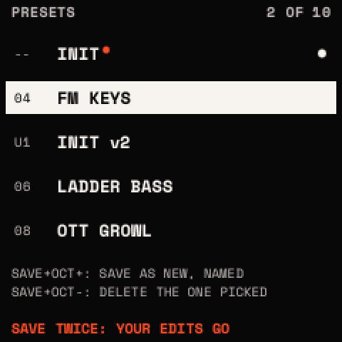
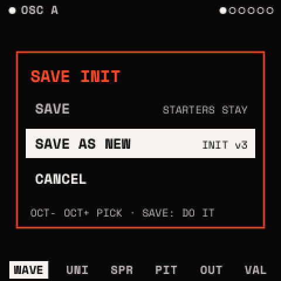
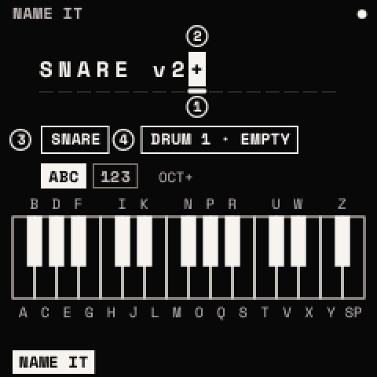

# Presets and saving

## What a sound holds

A sound (a preset) holds every parameter of OSC A and B, SUB, NOISE, FILTER, ENV 1 and 2, LFO 1 and 2 (their drawn
points too), VOICE, the four macros, the eight matrix slots with their POLARITY, and the FX chain with its modules'
values; a name of up to 16 characters and a category (BASS, LEAD, PAD, PLUCK, KEYS, FX, SEQ, OTHER). It does not hold
the tempo, the scale, the chords or the ARP (those are the settings' and the project's), nor the drum kit (the
project's).

## The presets

| Bank | What | Can be written over |
| --- | --- | --- |
| INIT | a plain sound: OSC A on BASIC MORPH, the rest off, MACRO 1–4 in the first four matrix slots | no |
| STARTER | eight sounds: SUPERSAW (LEAD), PLUCK (PLUCK), PAD (PAD), FM KEYS (KEYS), SYNC LEAD (LEAD), LADDER BASS (BASS), VOWEL PAD (PAD), OTT GROWL (BASS) | no ("STARTERS STAY") |
| USER | your presets, 64 slots, USER 1 to USER 64 | yes |

A new unit starts on INIT. The factory presets of a later phase are not in V0.87 yet.

## The presets' list (PRESETS)

Turning PRESETS on any page but the looper's, a synth track selected, opens the list and moves through it; nothing
loads while it turns. INIT is first, then every preset A to Z, starters and yours together ("04" a starter's
number, "U1" a user slot's). Five rows round the one picked, the one picked inverted, the one playing a dot at the
right, a vermilion dot after a name with unsaved edits; the top line counts ("2 OF 10").

| In the list | Does |
| --- | --- |
| PRESETS | moves through it |
| <kbd>SAVE</kbd> twice | loads the one picked and closes the list (undo takes the load back). With unsaved edits, the bottom row warns first: "SAVE TWICE: YOUR EDITS GO" |
| <kbd>SAVE</kbd> + <kbd>OCT+</kbd> | the sound playing saved as a new preset: NAME IT opens on its next version's name in the first free slot; SAVE writes it and goes back to the page (HOME: back, unsaved) |
| <kbd>SAVE</kbd> + <kbd>OCT−</kbd> | the preset picked deleted: "DELETE?" over its name first; a second SAVE + OCT− deletes it, anything else keeps it. The starter sounds stay |
| 5 s untouched, or another button | the list closes, nothing changed |

<kbd>HOME</kbd> + <kbd>OCT+</kbd> / <kbd>OCT−</kbd> loads the next or previous preset of the same list straight away.

## The SAVE window (SAVE once)

<kbd>SAVE</kbd> once (it waits 300 ms for a second press) opens the SAVE window over the page:

- **SAVE**: over the sound's own user slot ("OVER USER 3"). For a starter sound, INIT or a sound from no slot the row
  says "STARTERS STAY" and cannot be picked; SAVE AS NEW is picked instead.
- **SAVE AS NEW**: NAME IT on its **next version**: "WARM PAD" becomes "WARM PAD v2", one above the highest version of
  that name among your presets ("SUPERSAW v2" from a starter). It goes in the first free slot of the 64, its category
  kept.
- **CANCEL**.

<kbd>OCT−</kbd> / <kbd>OCT+</kbd> pick a row, <kbd>SAVE</kbd> does it; a knob or another button shuts it. The bottom row
then says "SAVED: WARM PAD v2 · USER 3", or "EVERY USER SLOT IN USE".

## NAME IT

| Control | Does |
| --- | --- |
| The keys | type at the cursor: F3 to F#5 are A to Z, G5 a space |
| <kbd>OCT+</kbd> | the keys type numbers and symbols (1 2 3 4 5 6 7 8 9 0 - . _ / # + & ' ! ? ( ) , : * @), again letters |
| <kbd>OCT−</kbd> | deletes the character before the cursor |
| KNOB 1 | the cursor |
| KNOB 2 | the character at the cursor (at the end: one more) |
| KNOB 3 | the category |
| KNOB 4 | the slot: its own (a rename: the top line says RENAME), or the first free one; a slot in use says what it would replace |
| <kbd>SAVE</kbd> | writes it ("NAME IT FIRST" if empty) |
| <kbd>HOME</kbd> | back without saving |

Sixteen characters, in capitals. The keys' letters show over or under them on the screen.

## The browser (SAVE twice)

The presets by category and bank:

- KNOB 1: the **category**: ALL, BASS, LEAD, PAD, PLUCK, KEYS, FX, SEQ, OTHER, with their counts.
- KNOB 2: the **preset**, loaded as it turns (undo takes a load back).
- KNOB 3: the **bank**: ALL, STARTER, USER.
- <kbd>SAVE</kbd> twice or <kbd>HOME</kbd>: back to where you were.
- <kbd>SAVE</kbd> once: **NAME IT** for the sound playing (a rename into its own slot, or for a starter the first free
  slot). SAVE there writes it and goes back to the browser; HOME goes back without.
- **<kbd>OCT−</kbd> held 3 s**: the user preset playing is deleted after a countdown ("HOLD: DELETE USER 3 IN 2"; letting
  go stops it). The sound plays on, from no slot. **<kbd>SAVE</kbd> + <kbd>OCT−</kbd> straight after puts it back**
  ("BACK IN USER 3"; its slot taken meanwhile: the first free one). A starter: "A STARTER SOUND STAYS". <kbd>OCT−</kbd>
  tapped in the browser changes the octave at its release.

## Undo and redo

<kbd>SAVE</kbd> + <kbd>OCT−</kbd> steps back, <kbd>SAVE</kbd> + <kbd>OCT+</kbd> forward again, through the last **8**
states of the sound. A state is kept when an edit starts after a second without one: each knob gesture, each MOD-layer
edit, an LFO point, an effect added, moved, taken out or bypassed, an assignment, a section reset, and each preset load.
An undone load makes the sound the preset it was again (so SAVE writes over that preset's slot).

Undo covers the sound only: not the settings, the scale, chords or ARP, the looper's clips, or a drum kit loaded.

## What is kept, and when

- **The sound playing** (and which preset it came from) is written once nothing has sounded for 3 s and it differs from
  what is kept; at power-on it comes back. <kbd>HOME</kbd> held at power-on skips it.
- **The settings** (the theme, the panel, MIDI and LEARN, the tempo, the selected track's scale, chords and ARP, the
  looper's settings, POWER, LIGHTS) the same way.
- **A preset** when you save it. Every write waits for a moment of silence (the audio fades for a few milliseconds) and
  is read back before it counts; a write cut off leaves the copy before it.
- **MIDI program change** loads presets when SETTINGS > MIDI > PROGRAM is on: [MIDI](midi.md#program-change).

The store and its places: [The store and backups](store.md).
