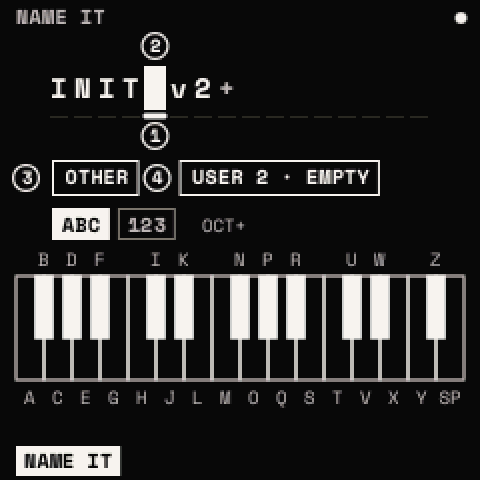
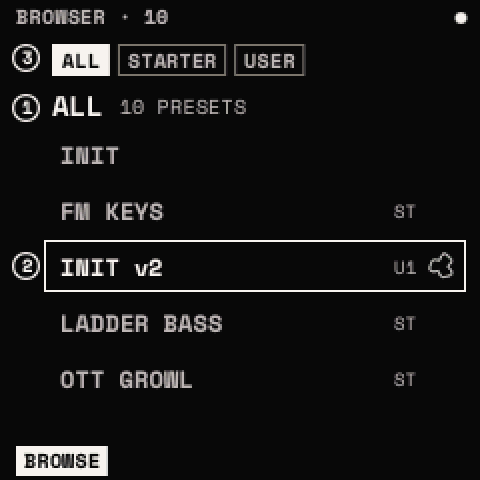

# Presets and saving

A preset holds the whole sound: oscillators, filter, envelopes, LFOs, matrix, effects, voice and macros, with a name
(up to 16 characters) and a category. Strata has INIT, eight starter sounds (SUPERSAW, PLUCK, PAD, FM KEYS, SYNC LEAD,
LADDER BASS, VOWEL PAD, OTT GROWL) and 64 slots for yours. Tempo, scale, chords, ARP and drums are not part of a preset.

## How to

**Load a preset**: turn PRESETS (on any page except the looper's) to open the list, choose a preset, and press
<kbd>SAVE</kbd> twice. The list closes by itself after 5 seconds. If the sound has unsaved changes, the list warns
"SAVE TWICE: YOUR EDITS GO"; undo brings them back.

**Save**

1. Press <kbd>SAVE</kbd>. The SAVE window opens.
2. Choose with <kbd>OCT−</kbd>/<kbd>OCT+</kbd>: **SAVE** writes over your preset; **SAVE AS NEW** makes a new one
   named as the next version ("WARM PAD" → "WARM PAD v2"); **CANCEL**. Starter sounds and INIT can only be saved as
   new.
3. Press <kbd>SAVE</kbd>. For SAVE AS NEW, NAME IT opens: edit the name if you like and press <kbd>SAVE</kbd>.

**Name it**

| Control | What it does |
| --- | --- |
| Keys | Type at the cursor: F3–F#5 are A–Z, G5 is a space |
| <kbd>OCT+</kbd> / <kbd>OCT−</kbd> | Switch to numbers and symbols / delete |
| KNOB 1, 2 | Move the cursor / change the character |
| KNOB 3, 4 | The category / the slot (its own slot renames it) |
| <kbd>SAVE</kbd> / <kbd>HOME</kbd> | Write it / leave without saving |

**Delete a preset**: in the list, choose it and press <kbd>SAVE</kbd> + <kbd>OCT−</kbd>; press it again to confirm.

**Undo and redo**: <kbd>SAVE</kbd> + <kbd>OCT−</kbd> and <kbd>SAVE</kbd> + <kbd>OCT+</kbd>, through the last 8 changes
to the sound (each knob gesture, assignment, effect change, LFO point and preset load).

## The browser

Press <kbd>SAVE</kbd> twice (with no list open). KNOB 1 chooses the category (ALL, BASS, LEAD, PAD, PLUCK, KEYS, FX,
SEQ, OTHER), KNOB 2 the preset (it loads as you turn), KNOB 3 the bank (ALL, STARTER, USER). <kbd>SAVE</kbd> once
renames the sound playing. Hold <kbd>OCT−</kbd> for 3 seconds to delete the user preset playing;
<kbd>SAVE</kbd> + <kbd>OCT−</kbd> straight after puts it back. <kbd>SAVE</kbd> twice or <kbd>HOME</kbd> leaves.

## What is kept

The sound playing and the settings are kept a few seconds after you stop playing, and come back at power-on. Presets
are written when you save. <kbd>HOME</kbd> + <kbd>OCT+</kbd> / <kbd>OCT−</kbd> loads the next or previous preset. MIDI
program changes can load presets ([MIDI and USB](midi.md#program-change)).

> **Warning:** your presets, projects and drum library live in the same flash area as Felucca's projects and samples.
> Saving in Strata can overwrite them. Back up before you install ([how](install.md#back-up-first)).
