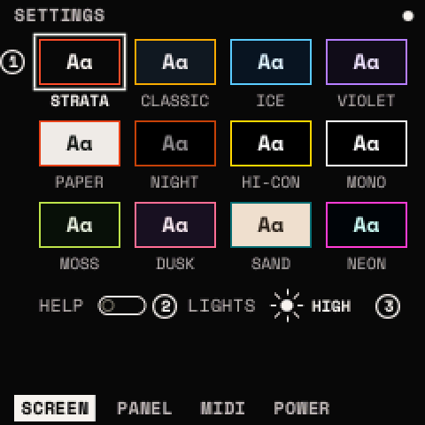
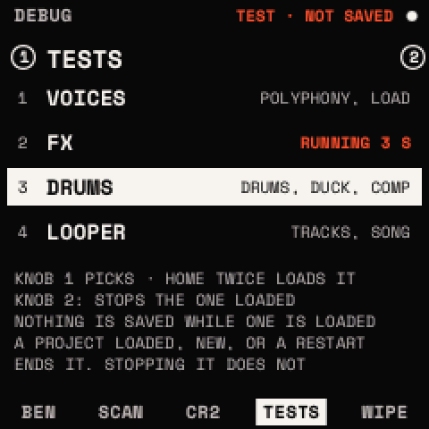

# Settings, LEDs and DEBUG

Press <kbd>HOME</kbd> twice for the SETTINGS. ALGORITHM steps the pages; <kbd>HOME</kbd> leaves. Settings are kept by
themselves a few seconds after you stop playing.

## SETTINGS

| Page | Setting | What it does |
| --- | --- | --- |
| SCREEN | COLOR | Twelve themes: STRATA, CLASSIC, ICE, VIOLET, PAPER, NIGHT, HI-CON, MONO, MOSS, DUSK, SAND, NEON |
| | HELP | Show a hint when a module opens (on) |
| | LIGHTS | LED brightness: OFF, LOW, MED, HIGH |
| PANEL | ACCEL | Knobs faster when turned quickly (on) |
| | HOLD | Time before a held button counts as held: 300–600 ms (400) |
| MIDI | CHANNEL, LEARN, CLEAR, PROGRAM | See [MIDI and USB](midi.md) |
| POWER | SHOW BATTERY | OFF, on HOME, or on every screen |
| | SCREEN OFF AFTER | Darken the screen after 1, 5 or 15 minutes untouched; any control wakes it |

The battery shows as four cells, or a bolt on USB power. Unconfirmed on hardware: the battery levels and the screen
sleep.

## LEDs

Every LED follows one code:

| LED | Means | Examples |
| --- | --- | --- |
| Off | nothing there | an empty clip, a key outside the scale |
| Dim | something there | a clip, a scale note, a drum, a menu button not shown |
| Medium | in use | the scale's root, an accented drum, the grid's playhead |
| Lit | active | a key held, a clip playing, the menu shown, the beat |
| Blinking | waiting | a launched clip, a count-in |
| Breathing | recording, or a layer open | a held or latched layer's button |

<kbd>REC</kbd> is lit while recording and blinks while it waits for the bar. <kbd>PLAY</kbd> flashes on each beat while
the transport runs. <kbd>ARP</kbd> is lit while the arpeggiator is on.

## DEBUG

On the HOME page, hold <kbd>HOME</kbd> for 5 seconds (past the help map). On any other page the same hold only
shows the help map. <kbd>HOME</kbd> leaves DEBUG. ALGORITHM steps its pages. They diagnose the hardware, and reset or
test Strata:

- **BENCH**: what the FM-1 measures (audio, CPU, screen, keys, tables, flash, stacks). RUN times the processor.
- **KEY SCAN**: the panel's switches as they are read, live.
- **CORE 2**: the FM-1's second core, off by default. ON takes effect at the next power-on; TEST runs a 30-second load
  while something plays. Unconfirmed on hardware.
- **TESTS**: four test projects ([below](#test-projects)).
- **WIPE**: turn KNOB 1; the screen asks. Press <kbd>HOME</kbd> twice to put every setting back to its default.
  Presets, projects and the drum library stay. Once, or any other button, keeps everything ("KEPT").

KEY SCAN draws the encoders' own lines as rings and names them, for example "PA5:9, PA5:10: KNOB 1". A cell with no
key, button or knob that closes while you watch turns vermilion.

## Test projects

Four built-in projects load and play by themselves, to put one part of Strata under load: use them to hear how a build
copes, or to record the audio.

1. Hold <kbd>HOME</kbd> on the HOME page for 5 seconds. Turn ALGORITHM to TESTS.
2. Turn KNOB 1 to choose a test. A moment later the screen asks, for example "TEST 2: FX?".
3. Press <kbd>HOME</kbd> twice. The test loads and starts. Once, or another button, cancels.
4. Turn KNOB 2 to stop it early. It also stops by itself after 60 to 90 seconds.

| Test | What it plays |
| --- | --- |
| 1 VOICES | Chords of 1, 2, 4 and then 8 notes at full velocity on SUPERSAW, PAD, VOWEL PAD and OTT GROWL in turn, with a filter envelope and an LFO moving the wavetable position. |
| 2 FX | A chain of eight effects that goes through all 13 types, every knob swept to both ends by LFOs and envelopes. |
| 3 DRUMS | Two drum tracks over all seven models: ratchets, chance, accents, each drum's effects, KIT ACCENT, the DUCK, its CURVE and COMP, and the duck on a held chord. |
| 4 LOOPER | All eight tracks (drums, bass, chords, ARP, a lead with recorded motion, speed changes, MIDI out), a SONG of five scenes with repeats, mutes, solos, volume and pan changing. |

- Loading a test first saves your open project, your settings and the sound you are playing, exactly as loading a project
  does.
- Nothing from the test is ever saved. While one is loaded, automatic saving is off and the top line of every page says
  **TEST · NOT SAVED** (HOME shows the test's name).
- A test ends when you load a project, make a NEW project, or restart. Stopping it, or letting it finish, leaves it
  loaded.
- When it ends, the sound you had before the test comes back, so **a sound you choose during a test is replaced when it
  ends**. Save a sound you like first (<kbd>SAVE</kbd>), or it is lost. Tempo, time signature, CLOCK IN and the looper's
  settings come back too.

Unconfirmed on hardware.
