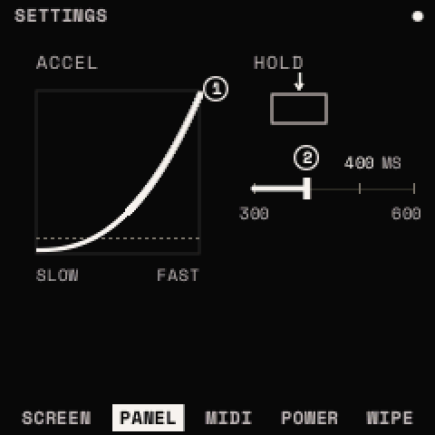
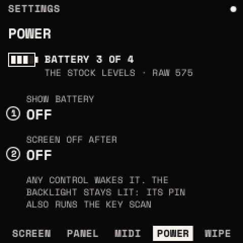
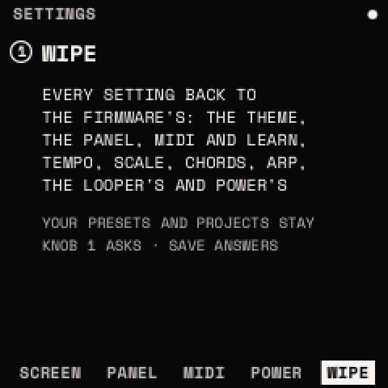
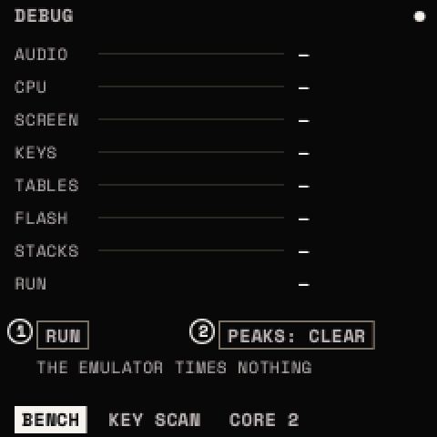
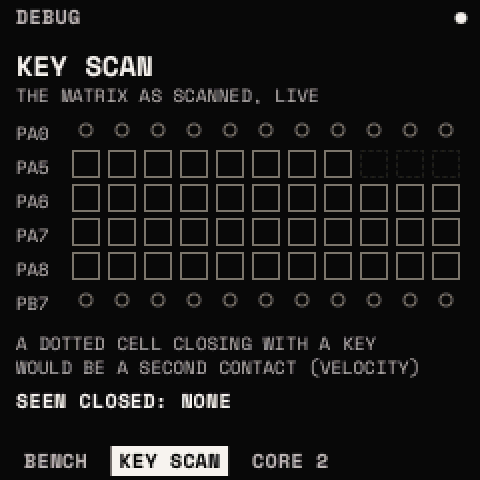
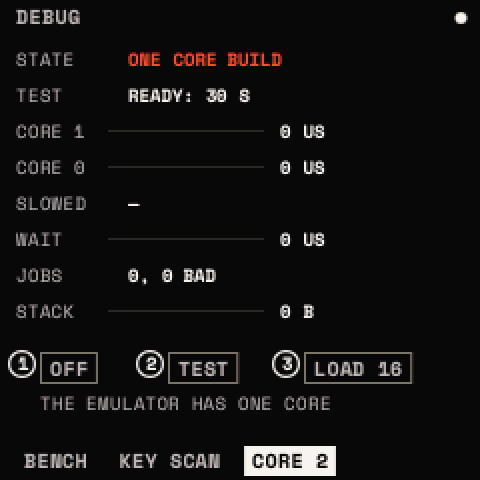

# SETTINGS and DEBUG

<kbd>HOME</kbd> twice opens the **SETTINGS**; <kbd>HOME</kbd> held for 5 s (past the help map) opens **DEBUG**.
ALGORITHM steps their pages; <kbd>HOME</kbd> leaves. The settings are kept by themselves once nothing has sounded for 3
s, and come back at power-on; they are not part of a sound.

## SETTINGS

| Page | KNOB 1 | KNOB 2 | KNOB 3 | KNOB 4 |
| --- | --- | --- | --- | --- |
| SCREEN | COLOR | HELP | LIGHTS | |
| PANEL | ACCEL | HOLD | | |
| MIDI | CHANNEL | LEARN | CLEAR | PROGRAM |
| POWER | SHOW BATTERY | SCREEN OFF AFTER | | |
| WIPE | WIPE | | | |

### SCREEN

- **COLOR**: the theme: STRATA (default), CLASSIC, ICE, VIOLET, PAPER, NIGHT, HI-CON, MONO, MOSS, DUSK, SAND, NEON.
- **HELP**: a module's hint at the bottom as it opens, and what pressing a menu again does (on by default).
- **LIGHTS**: the LEDs' brightness, OFF, LOW, MED, HIGH (default); a sun whose rays grow with it.

### PANEL

- **ACCEL**: the knobs' speed sensitivity, on (default: 0.1 % a detent slowly, up to 5 % quickly) or off (1 % a detent
  at any speed).
- **HOLD**: how long a button is held before it counts as held (its layer, the help map): 300, 400 (default), 500 or
  600 ms.

### MIDI

- **CHANNEL**: ANY (default) or 1 to 16, drawn as a grid of channels.
- **LEARN**: MIDI LEARN on or off ([MIDI](midi.md#midi-learn)).
- **CLEAR**: turned twice within 2 s, forgets every learned CC.
- **PROGRAM**: program changes load presets (off by default).

The page also lists the CCs learned and the CCs every sound answers.

### POWER

- **SHOW BATTERY**: OFF (default), HOME (on HOME's top line), EVERY SCREEN.
- **SCREEN OFF AFTER**: OFF (default), 1, 5 or 15 MIN with no control touched. Any control wakes the screen, and the
  touch that wakes it does nothing else. The backlight stays lit (on the FM-1 its pin also enables the key and knob
  scan); the sound, the looper, MIDI and USB go on; never dark under a countdown or a count-in.

The page shows the battery as four cells ("BATTERY 3 OF 4", the lowest cell alone vermilion), "USB POWER" with a bolt
when a USB host powers it, and the battery's raw reading. The cells use the official firmware's thresholds on that
reading (531, 561, 591). **Unverified on the FM-1**: the thresholds against your battery, and the screen's sleep.

### WIPE

Every setting back to the firmware's: the theme, the panel, MIDI and the learned CCs, the tempo (120 BPM, 4/4,
INTERNAL), the scale and the chords, the ARP and its steps, the looper's settings (QUANTIZE, COUNT-IN, CLICK, its LEVEL,
LAUNCH), POWER, LIGHTS, and CORE 2 off after a restart. **Your presets, your drum library and the projects stay.** Turn
KNOB 1 and it asks first ("WIPE?"): <kbd>SAVE</kbd> wipes ("WIPED: PRESETS, PROJECTS KEPT"), anything else keeps the
settings.

## DEBUG

For testing Strata on the hardware. These pages stay in every build.

### BENCH: RUN · PEAKS

What the FM-1 measures, a row each:

| Row | Shows |
| --- | --- |
| AUDIO | an audio half's render time, the last and the longest, and the halves that were late |
| CPU | the CPU guard's smoothed load, its budget steps and the voices it shed |
| SCREEN | a frame's drawing, the last and the longest, and the section of the longest |
| KEYS | the longest the keys, MIDI and the knobs waited for the main loop (drawing; apart, over flash work) |
| TABLES | a wavetable build's longest step and the whole build |
| FLASH | the longest interrupts-off time of an erase and of a page's write, and the erases so far |
| STACKS | how deep both stacks have been, then SPARE OK, or SPARE HIT if anything wrote in the memory Strata leaves unused |
| RUN | two timed loops whose instructions are known: the core's speed |

KNOB 1 **RUN** times the loops (a moment's silence; on the FM-1 only). KNOB 2 **PEAKS**: CLEAR the longest figures. The
console's `bench` gives the same figures and an event log of the last 32 events (late audio, flash work, voices shed ..).
The emulator has no clock of its own and says so.

### KEY SCAN

The panel's 11 × 6 matrix of keys, buttons and encoder pins as the scan reads it, live: a closed cell filled, a key's
or button's framed, an encoder pin a ring, a cell of none dotted. A dotted cell that closes while the page is open turns
vermilion and is named ("SEEN CLOSED: PA5:9"): a second contact, such as velocity would need. Read-only.

### CORE 2: ON · TEST · LOAD

The FM-1's second core, measured before a later version puts voices on it. **Off by default.**

- **ON / OFF**: core 2 started at the next power-on (the settings are written after 3 s of quiet: wait 5 s, then switch
  off and on). Never after a boot that crashed, or with <kbd>HOME</kbd> held at power-on.
- **TEST**: 30 s, while something plays (hold a chord, or PLAY a pattern): core 1 renders wavetable oscillators while
  core 0 plays, then core 0 does the same work alone. Again: stopped.
- **LOAD**: the test's unison voices, 4 to 32 (16).

Its rows: STATE (OFF, ANSWERING, NO ANSWER: OFF, MISREAD: OFF, STOPPED: OFF, SAFE START: NOT ON), TEST (READY, the
seconds left, DONE), CORE 1 (its time for the work, its longest tick), CORE 0 (the same work on core 0), SLOWED (core 0's
own sound while core 1 ran, against alone), WAIT (core 0's longest wait for core 1), JOBS (done; BAD: any it would not
run), STACK (core 1's, of 4,096 bytes). A unit whose core 1 misreads or stops answering is held, plays on one core and
turns ON off (some FM-1s do). The emulator has one core: TEST is refused there. **Needs a hardware test**: CORE 2's
figures on the FM-1 are not measured yet.
