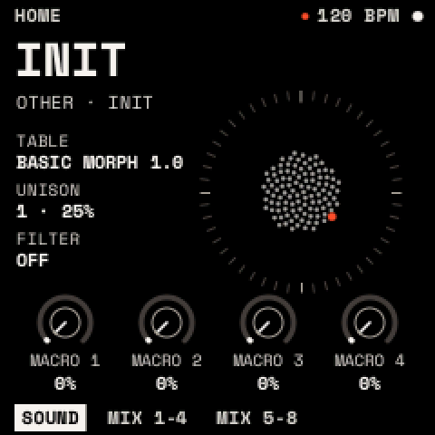
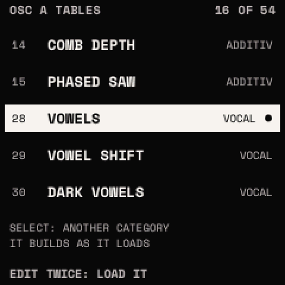

# The sound

A sound is two wavetable oscillators (OSC A, OSC B), a SUB oscillator and NOISE through a FILTER. Defaults for every
parameter are in the [parameter reference](parameters.md).

## HOME

<kbd>HOME</kbd> shows the selected track's sound, with the **bloom**, a ring of dots that swirls with the sound.

- KNOB 1–4 are **MACRO 1–4**: each moves whatever the sound assigns to it ([macros](modulation.md#macros)).
- Turn SELECT to choose the track (T1 to T8); turn PRESETS to choose a sound.
- ALGORITHM shows **MIX 1-4** and **MIX 5-8**: the eight tracks' volumes on the knobs.

## How to

**Switch a source or the filter on**: press <kbd>EDIT</kbd>, turn SELECT to OSC B, SUB, NOISE or FILTER, then hold
<kbd>EDIT</kbd> and press <kbd>OCT+</kbd>. (<kbd>OCT−</kbd> switches it off.)

**Choose a wavetable from a list**:

1. Show OSC A or OSC B and press <kbd>EDIT</kbd> twice.
2. Turn SELECT to jump between categories and PRESETS to choose a table.
3. Press <kbd>EDIT</kbd> twice again to load it.

## OSC A and OSC B

A wavetable is a row of single-cycle waves; WT POS morphs through them. Each oscillator has five pages, then VALUES.

| Page | Parameter | What it does | Range |
| --- | --- | --- | --- |
| WAVE | WT POS | Position in the table | 0–100 % |
| | TABLE | One of the 54 tables | |
| | WARP | How the wave is read: SYNC, BEND+/−, PWM, ASYM+/−, MIRROR, FM (from the other oscillator) | OFF … FM |
| | AMOUNT | How much WARP does | 0–100 % |
| UNISON | UNISON | Stacked copies per note | 1–16 |
| | UNI MODE | Detune spread: LINEAR (even) or SUPER (denser at the centre) | |
| | DETUNE | How far the copies are detuned | 0–100 % |
| | BLEND | Level of the side copies against the centre | 0–100 % |
| SPREAD | WIDTH | Stereo spread of the copies | 0–100 % |
| | WT SPRD | Each copy at a slightly different WT POS | 0–100 % |
| | PHASE | Start point of each note's cycle | 0–360° |
| | RAND | Randomness of each copy's start | 0–100 % |
| PITCH | OCT, SEMI, FINE | Tuning | ±4 oct, ±12 st, ±100 ct |
| | PH MODE | RETRIG (restart at each note) or FREE (keep running) | |
| OUTPUT | LEVEL, PAN | Level and position | |
| | ROUTE | Through the FILTER, or DIRECT past it | |

> **Tip:** for FM, turn OSC B on with a sine-like table and its LEVEL at 0, then set OSC A's WARP to FM. OSC B's PITCH
> now sets the FM ratio and AMOUNT its depth.

**The 54 tables**, by category:

| Category | Tables |
| --- | --- |
| ANALOG | BASIC MORPH, SAW, SQUARE, TRI TO SAW, SAW TO SQR, SINE TO TRI, PULSE WIDTH, SOFT PULSE, DARK SAW |
| ADDITIVE | ODD TILT, ALL TILT, ODD TO EVEN, COMB SWEEP, COMB DEPTH, PHASED SAW |
| VOCAL | VOWELS, VOWEL SHIFT, DARK VOWELS, BRIGHT A-I, CHOIR |
| SPECTRAL | BAND SWEEP, TWIN BANDS, WIDE BAND, BAND SPREAD, CHAOS A, CHAOS B, DUST, DRAWBARS, BELLS, GLASS, STRINGS, HOLLOW |
| SYNC | SYNC SAW, SYNC SQUARE, SYNC SINE, SYNC TRI |
| FM | FM 1:1, FM 1:2, FM 1:3, FM 2:7, FM 1:5 BELL |
| FOLD | FOLD SINE, FOLD TRI, FOLD ASYM, FOLD MIX |
| PHASE | PD SAW, PD SQUARE, RESO SAW, RESO TRI, RESO TRAP |
| DIGITAL | CRUSH SINE, CRUSH SAW, STEPS, STAIR TRI |

## SUB and NOISE

| SUB parameter | What it does |
| --- | --- |
| SHAPE | SINE, TRIANGLE, SAW, SQUARE, PULSE, ROUND |
| OCT | 0 to −3 octaves under OSC A (−1) |
| WIDTH | PULSE's width, square to narrow |
| LEVEL, PAN, ROUTE | as an oscillator's |

| NOISE parameter | What it does |
| --- | --- |
| TYPE | WHITE, PINK, BROWN |
| COLOR | Tilt darker (−) or brighter (+) |
| STEREO | 0 % mono to 100 % independent sides |
| LEVEL, PAN, ROUTE | as an oscillator's |

## FILTER

One filter per voice, in stereo. It starts off.

| Page | Parameter | What it does | Range |
| --- | --- | --- | --- |
| TONE | TYPE | LP 12/24, HP 12/24, BP 12/24, NOTCH, PEAK, LADDER (warm, resonant), FORMANT (vowels) | |
| | CUTOFF | Where the filter acts (FORMANT: walks A E I O U) | 20 Hz – 20 kHz |
| | RESO | Resonance at the cutoff | 0–100 % |
| | DRIVE | Saturation before the filter | 0–100 % |
| RESPONSE | KEYTRACK | How much the cutoff follows the note | 0–100 % |
| | VAR | Cutoff spread in stereo (FORMANT: shifts the formants) | 0–100 % |
| | MIX | Filtered against dry | 0–100 % |

> **Tip:** for a pluck, set LP 24 or LADDER with a low CUTOFF, press <kbd>ENV</kbd> twice on this page, and put ENV 2
> onto CUTOFF with a positive amount. ENV 2's DECAY now sets the pluck's length.

## VOICE

<kbd>GLO</kbd> opens VOICE (part of the sound) and GLOBAL (the tempo, in [Playing](playing.md#tempo)).

| Page | Parameter | What it does | Range |
| --- | --- | --- | --- |
| VOICE | MODE | POLY; MONO (last note); LEGATO (no envelope restart while a note is held) | |
| | VOICES | Most notes at once | 1–8 |
| | GLIDE | Pitch slide between notes | OFF – 30 s |
| | GL MODE | Glide ALWAYS, or only on LEGATO notes | |
| PLAY | BEND UP, BEND DN | Pitch-bend range | 0–24 st |
| | VEL AMP | How much velocity sets the level | 0–100 % |
| | VOLUME | The sound's level | OFF – +6 dB |

When all voices are busy, a new note takes over a released voice first, then the oldest held note.
