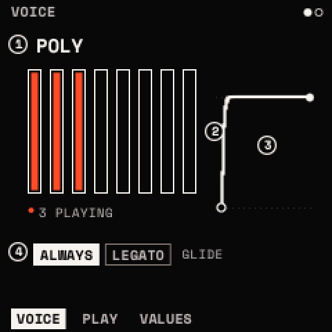
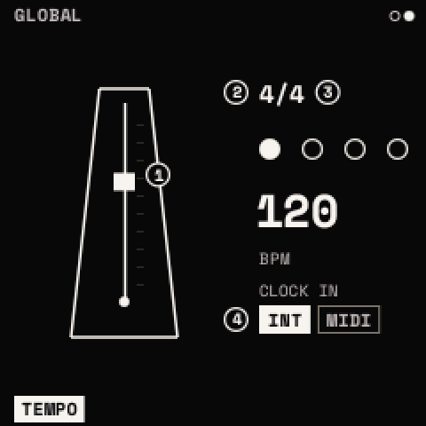

# Voice and global

<kbd>GLO</kbd> opens two modules: **VOICE** (how the sound plays: part of the sound, saved with it) and **GLOBAL**
(the tempo: kept with the settings, the same for every sound). SELECT steps them. Held, <kbd>GLO</kbd> is the
[PERFORM](layers.md#perform) layer.

## VOICE

### VOICE: MODE · VOICES · GLIDE · GL MODE

| Knob | Parameter | Range | What it does |
| --- | --- | --- | --- |
| 1 | **MODE** | POLY, MONO, LEGATO | POLY: chords, a voice a note. MONO: one note at a time, the last pressed, each note restarting the envelopes. LEGATO: one note, and a note played while another is held does not restart the envelopes |
| 2 | **VOICES** | 1 – 8 | the most notes POLY plays at once (8 by default) |
| 3 | **GLIDE** | OFF – 30 s | the pitch sliding from the last note to the new one. MIDI CC 5 |
| 4 | **GL MODE** | ALWAYS, LEGATO | glide on every note, or only on notes played while another is held |

The page draws the eight voices as pills, lit while they play ("3 PLAYING"), and the glide as a curve.

### PLAY: BEND UP · BEND DN · VEL AMP · VOLUME

| Knob | Parameter | Range | What it does |
| --- | --- | --- | --- |
| 1 | **BEND UP** | 0 – 24 semitones | the pitch bend's range up (2 by default) |
| 2 | **BEND DN** | 0 – 24 semitones | its range down |
| 3 | **VEL AMP** | 0 – 100 % | how much velocity sets a note's level: 0 every note equal, 100 % fully by velocity (50 % by default) |
| 4 | **VOLUME** | OFF – +6.0 dB | the sound's own level (0 dB by default). Modulatable; MIDI CC 7 |

Then VALUES.

**When notes run out.** With every voice in use, a new note takes one over: first a voice in its release (the
quietest), then the oldest held note that is not the newest or the lowest; never the note just played. The voice taken
fades out over about 3 ms first, so it does not click. Unison copies count too: when many notes with big unison would
be too much for the processor, the oldest notes lose copies before any note is taken ([Limits](limits.md)).

## GLOBAL

### TEMPO: BPM · TS-BEAT · TS-NOTE · CLOCK IN

| Knob | Parameter | Range | What it does |
| --- | --- | --- | --- |
| 1 | **BPM** | 20 – 300 | the tempo (120 by default), in beats of TS-NOTE a minute |
| 2 | **TS-BEAT** | 1 – 16 | beats a bar (4) |
| 3 | **TS-NOTE** | 1, 2, 4, 8, 16 | the note a beat is (4: a quarter note) |
| 4 | **CLOCK IN** | INTERNAL, MIDI | INTERNAL: this tempo. MIDI: the tempo of the MIDI clock coming in, and MIDI's start, continue and stop run the transport |

BPM counts TS-NOTE beats: 120 in 6/8 is 120 eighth notes a minute, and a bar is TS-BEAT of them, so the note values'
bars follow the time signature (in 3/4, 1 BAR is three beats).

With CLOCK IN MIDI, the BPM shown is MIDI's ("BPM: MIDI"), the first clock after a start is the downbeat, and if the
clock stops for a second the panel's BPM takes over again. [MIDI](midi.md#clock) has the details.

**Tap tempo**: hold <kbd>GLO</kbd> and tap <kbd>PLAY</kbd> three times or more in time; the tempo is the taps' mean
gap. Taps more than 2 s apart start again. Not while MIDI's clock sets the tempo.

<kbd>GLO</kbd> + <kbd>OCT−</kbd> held 5 s on GLOBAL: 120 BPM, 4/4, CLOCK IN INTERNAL. The tempo, the time signature and
CLOCK IN are kept with the settings, not with a sound.
